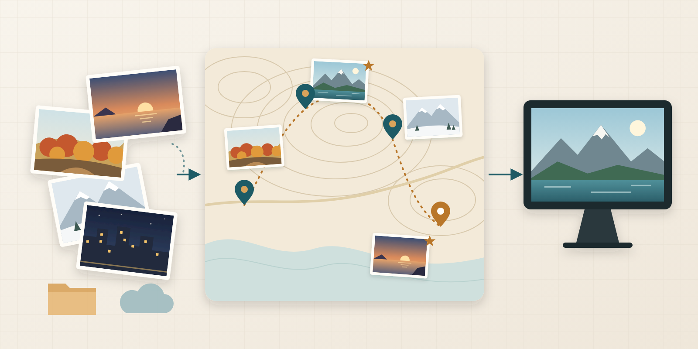

# GEOFRAME

**撮った写真を、手元で整えて、見せる準備まで。**

GEOFRAME(ジオフレーム)は、自宅に置くセルフホスト型の写真管理基盤です。ローカルフォルダや Google Drive の写真を 1 つのカタログにまとめ、撮影地を地図で整え、表示用の画像を用意します。写真を画面に映すのは、別プロジェクトの [Miharashi](https://github.com/ysogabe/miharashi) です。

**紹介ページ(LP): https://ysogabe.github.io/geoframe/** (リポジトリの公開後に開けるようになります)

## 何ができるか

- **写真をひとつのカタログに**: ローカルフォルダと Google Drive の写真を、原本を変えずに索引します。HEIC にも対応します。
- **表示用の画像を作る**: 向きを直した長辺 2560px の JPEG を別に作ります。位置情報を含む EXIF は残しません。
- **良いカットを選ぶ**: 鮮明さや露出を調べ、似た写真の中から勧める 1 枚を決めます。お気に入りはそれより優先します。
- **撮影地を地図で整える**: 位置の無い写真は前後の写真から撮影地を推定し、地名を付けます。管理画面の地図で直した位置は、そのあとの自動の推定で上書きしません。
- **旅の記録を下書きする**: 旅程と写真を照合して日別の旅行ブログの下書きを作り、EXIF を除いた画像つきの静的 HTML に書き出せます。
- **言葉で写真を探す(任意)**: 言葉による検索や、同じ場面の写真の整理を、LAN 内のモデルかクラウドの AI で行えます。設定するまで動きません。
- **表示側へ写真を渡す**: 写真の一覧と表示用画像を HTTP で配り([写真フィードの契約](docs/architecture/photo-feed-contract.md))、Miharashi がそれを読んで映します。

1 つのファイルで動くサーバーで、データは SQLite のファイル 1 つ(`catalog.db`)にまとまります。ブラウザで管理画面を開いて使います。

> [!IMPORTANT]
> GEOFRAME には利用者認証がありません。信頼できるローカルネットワークで使うか、認証付きのリバースプロキシの内側に置いてください。インターネットへ直接公開しないでください。
>
> 地図・地名の補完・Google Drive・クラウドの AI を使うと、座標や縮小した写真が外部のサービスへ送られます(クラウドの AI は課金されます)。詳しくは[使い方](docs/USAGE.md#運用上の注意と外部との通信)を見てください。

## いまの状態

作者の自宅で毎日動かしながら、少しずつ手を入れています。2026 年 10 月に、写真を映す機能を Miharashi へ移し([ADR 0008](docs/decisions/0008-photo-platform-and-miharashi-display.md))、サーバーを Rust の単一バイナリに作り直しました。いまはリポジトリの公開に向けて準備しています([公開準備チェックリスト](docs/public-release-checklist.md))。

動作を確かめているのは x86_64 の Linux だけです。

## 使う・開発する

ビルドと起動、外部との通信、設定とデータの扱い、試験の回し方は [使い方](docs/USAGE.md)、本番の配布(systemd・更新・バックアップ)は [デプロイガイド](deploy/README.md)、環境変数の一覧は [設定リファレンス](docs/reference/configuration.md) にまとめています。設計や判断の記録は [Docs](docs/README.md)、紹介ページの更新と公開の手順は [LP の管理](docs/LP.md) を参照してください。

変更を送るときは [コントリビューションガイド](CONTRIBUTING.md) を、脆弱性の報告は公開 Issue ではなく [セキュリティ方針](SECURITY.md) に従ってください。

## ライセンス

[MIT License](LICENSE) です。同梱するサードパーティの資産(MapLibre GL JS、Share Tech Mono)のライセンスは [`web/vendor/`](web/vendor/README.md) にあります。
