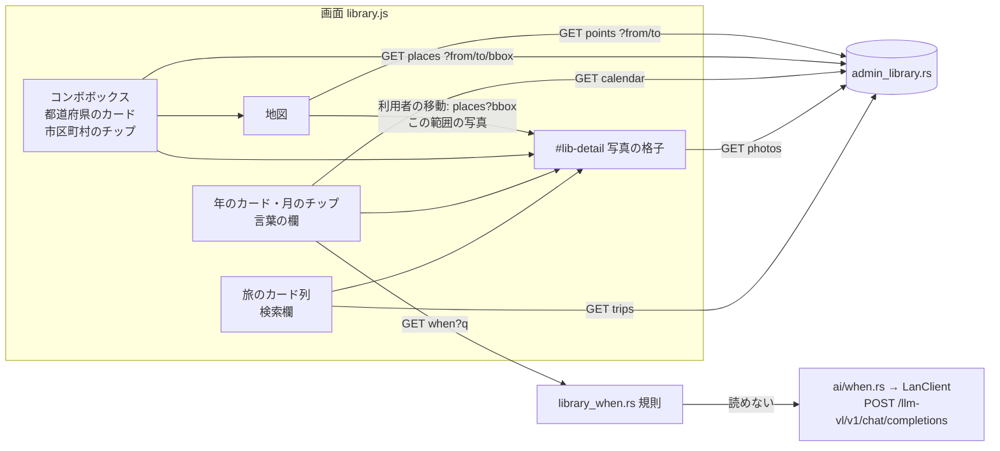

# ライブラリの見直し 設計

作成日: 2026-11-02。状態: 設計レビュー 2 回（Sol）・安全面レビュー 1 回（Opus）を反映済み。ユーザー承認待ち。

## 概要

[PRD](prd.md) の R1〜R14 を実装する。サーバーは既存の `GET /api/admin/library/*` を広げ、日付の言葉を読む
`GET /api/admin/library/when` を足す。画面は `library.js` の状態と描画を、`grid` で一覧と格子を入れ替える作りから、
「カード列＋選択＋下の詳細」の作りに組み直す。地図は場所の画面に入る。PR は 1 本で、下の「実装の順番」をコミットの単位にする。

## 今の作り

サーバー（`crates/geoframe/src/admin_library.rs`）:

- ルーティングは `server.rs:796-824` の GET の分岐に、`trips`・`photos`・`points`・`calendar`・`places` が完全一致で並ぶ。
- パラメータの検証は `parse_minute`（88）・`parse_range`（101）・`parse_bbox`（118）・`parse_ids`（138）・`parse_name`（155、`NAME_MAX_CHARS=64`）。失敗は `bad_params()`（249）の 400。
- `Filter`（161-201）は固定の条件文字列とバインド値を積む。`narrowed` が立たないと `/photos` は 400（`photos_filter` 204-247）。
- 旅の表紙は `build_trips`（343）の 396-416 行。位置があり除外でない最初の写真、無ければ先頭。`thumb_url` は `admin.rs:848` の `thumb_for` が空でなければ `thumb::thumb_url`（`thumb.rs:119`）。
- `build_calendar`（647）は `substr(taken_at,1,4|7)` で数える。`build_places`（701）は `(pref, city)` で数え、`group_places`（729）でまとめる。どちらも表紙・範囲を持たない。
- 定数 `TIMED`（55）・`UNTIMED`（57）・`ABROAD`（59）・`VISIBLE`（61）・`ORDER`（63）。索引は `idx_photos_time(taken_at)` だけ。DB は読み取り専用で開く（接続 4 本）。

ローカル LLM（`crates/geoframe/src/ai/`）:

- `http.rs` の `Endpoint`（236-269）は固定パスの列挙で、`chat/completions` は無い。`is_post()`（254）の一覧に入れないと `post_json`（438）の `debug_assert!` で落ちる。
  `X-Client-Name: geoframe` は必ず付く。同期の `ureq` なので tokio のワーカーで直接呼ばない。`AiHttp` は作るたびに自分の枠（`Lanes::new()`）を持つ。
- `provider.rs:50` の `LanClient::new(&config.ai)` が `ai.json` の `local_base_url` から作る。宛先は `ai/dest.rs` で private / loopback だけ、リダイレクトは追わない、プロキシは使わない。
  失敗後の待ちと停止の状態（`check_shared`・`record_shared`）は `pub(super)` で、`ai/` の外からは使えない。
- 本番の組み立ては `cli.rs:439` で `lan` を作り、`cli.rs:459` で `query::Runtime::new(&config, lan, stop.clone(), …)` に渡して `AppState::with_ai_search` で差し替える。
- 回数の上限の例は `ai/query.rs:85-100`（1 つの Mutex の中で 1 分の窓を掃除・確認・記録してから送る）。AI が無効なら `query.rs:81` で止める。対話の期限は `Deadline::interactive`（15 秒、`http.rs:171`）。
- 他のサイトからの要求を断る前例: `thumb.rs:742`（`Sec-Fetch-Site` が `cross-site`・`same-site` なら 403）。

画面（`web/static/js/library.js`、582 行）:

- 状態 `ls`（22）。`showLib`（518）が `view` と `grid` で `#lib-trips`・`#lib-calendar`・`#lib-places`・`#lib-map-box`・`#lib-grid-box` を出し分ける。`openGrid`（316）・`closeGrid`（548）・`#lib-back` で往復する。
- 日付のカードの範囲は `yearRange`・`monthRange`（236-237）で `00`〜`99` の形いっぱいに取る（暦に無い値も件数と格子が一致するように。`library_api.rs:1059` 以降が守る）。
- 地図は `ensureLibMap`（409）で遅延して作る。クラスタを押すと `easeTo`（元のイベントは渡らない）。`pointsStale` と `onLibHiddenChange`（559）は「`view === 'map'` かつ格子でない」で地図が見えているかを判断する。
- CSS は `web/static/admin.css` の 329 行付近からの `.lib-*`（`#lib-map` に `min-height:320px` とスマホ用の高さ）。色は `:root`（4）、`.btn`（105）、`.chip`（113）、`.tags`（153）。幅 640px 以下の `@media` が 262・398 行。
- 画面の試験は `web/tests/library_render.mjs` を `crates/geoframe/tests/admin_ui_library.rs` が回す。偽の DOM（`fakedom.mjs`）は `admin.html` を読まず DOM を手で組む。偽の MapLibre（`fake_maplibre.mjs`）に `fitBounds` は無い。
- `static_files.rs:483` が画面の JS の `innerHTML`・`outerHTML`・`insertAdjacentHTML`・`document.write` を禁じる。

## 方針

1. **選択＋下の詳細（master-detail）**。`ls.grid` をやめ、view ごとの選択と `#lib-detail`（下の格子）にする。一覧は常に残す。
   選ばなかった案: 今の置き換え式（往復が使いにくさの原因）、横に開くパネル（カードの横並びと幅を取り合う）。
2. **場所と地図は 1 つの view `places`**。左にコンボボックスと都道府県のカード、右に地図、地図の下に詳細。地図だけの view は無くす。
   選ばなかった案: 分けたまま連動だけ足す（2 画面を行き来する手間が残る）。失うもの: 場所を開くたびに地図を読む。文字だけの軽い場所の一覧は無くなる。
3. **地図の範囲でのカードの絞り込みはサーバーで数える**。`/places` に `bbox` を足し、範囲の中の写真だけを数え直す。
   選ばなかった案: 県ごとの写真の範囲（bbox）と表示範囲の重なりで画面が判断する（県の両端に写真があると、中央を見ているときも県が残る）。
4. **日付の言葉はサーバーで読む**。規則のパーサー（純粋な関数）は `library_when.rs`、LLM の呼び出しは `ai/when.rs`（`ai/` の共有の待ち・停止の状態を使うため）。
   規則で読めないときだけ同じ要求の中で LLM に回す。選ばなかった案: 画面の JS で規則を読む（LLM はどのみちサーバー経由で 2 か所に分かれる）、
   LLM を主にする（2026-11-02 の試験で 14 問中 5 問が誤り）。
5. **LLM には期間を直接出させ、サーバーで形と範囲を検証し、必ず画面に出す**。部品に分けさせる案も試したが誤りが減らなかった。
6. **カード・チップ・ピッカーの範囲は今の「形の範囲」（`00`〜`99`）、言葉の範囲は暦の日付**。カードの件数と格子の件数を一致させる今の約束を守る。
7. **旅のカードの絞り込みは画面で、写真の検索はサーバーで**。旅の一覧は全件を既に持っている。写真は `/photos` に `q` を足す。
8. **コンボボックスの候補は `/places` の応答から作る**。都道府県の読みの表（47 件）は `library.js` の定数。

## 構成



ファイル:

- `crates/geoframe/src/admin_library.rs`: `calendar`・`places` の表紙と範囲、`places` の `from`/`to`・`bbox`、`photos` の `q`。
- `crates/geoframe/src/library_when.rs`（新規）: 規則のパーサー（基準日を引数に取る純粋な関数）、小さな暦の関数、`GET /api/admin/library/when` の処理。
- `crates/geoframe/src/ai/when.rs`（新規）: `when::Runtime`（`LanClient` の clone・`StopFlag`・回数の窓・失敗後の待ち）、LLM の要求の組み立てと応答の検証。
- `crates/geoframe/src/ai/http.rs`: `Endpoint::VlChat`（`POST /llm-vl/v1/chat/completions`）を `path()` と `is_post()` に足す。
- `crates/geoframe/src/server.rs`: `AppState` に `when: Arc<ai::when::Runtime>`（`AppState::new` では LLM なしで作る）と `with_when`、GET の分岐に `/api/admin/library/when`（`labeled(…, "/api/admin/library/when")`）。
- `crates/geoframe/src/cli.rs`: 459 行の AI 検索と同じ所で `ai::when::Runtime::new(&config, lan.clone(), stop.clone())` を作り `with_when` で差し替える（取り込みが無効でも作る）。
- `web/static/js/library.js`: 作り直し（下の「画面」）。
- `web/static/admin.html`・`web/static/admin.css`: ライブラリタブの部品と `.lib-*`（`#lib-map` の今の高さの指定は置き換える）。
- 試験: `crates/geoframe/tests/library_api.rs`（追記）、`crates/geoframe/tests/library_when.rs`（新規）、`crates/geoframe/src/library_when.rs` と `ai/when.rs` の単体試験、
  `web/tests/library_render.mjs`（書き直し）・`web/tests/fakedom.mjs`（新しい DOM）・`web/tests/fake_maplibre.mjs`（`fitBounds`・`getBounds` の差し替え・`moveend`）、
  `crates/geoframe/tests/admin_ui_library.rs`、`crates/geoframe/tests/static_files.rs`（禁止語に `setHTML`・`srcdoc`・`createContextualFragment`・`DOMParser` を足す）。

## インターフェース

### 代表写真（年・都道府県で共通）

その組の中で、`hidden` でない → 位置がある → `taken_at` が新しい → `id` が大きい、の順で 1 枚目。`hidden=1` でも除外でない写真を先に選ぶ。
SQL は `ROW_NUMBER() OVER (PARTITION BY 組 ORDER BY COALESCE(hidden,0), (lat IS NULL OR lon IS NULL), taken_at DESC, id DESC)`（同梱の SQLite は窓関数に対応）で組ごとに 1 行を取り、
`thumb_for` を通す。`thumb_url` は旅と同じく空のことがある（画面は「画像なし」の代わりを出す）。

### `GET /api/admin/library/calendar?hidden=1`

年ごとに `cover` を足す。月は今のまま（表紙なし）。

```json
{"ok":true,"years":[{"year":"2025","count":1244,"cover":{"id":812,"thumb_url":"/thumb/812.jpg?v=…"},
  "months":[{"month":"08","count":132}]}],"untimed":12}
```

### `GET /api/admin/library/places?hidden=1&from=…&to=…&bbox=w,s,e,n`

- `from`・`to`（任意）: `parse_range` と `Filter::range`。`bbox`（任意）: `parse_bbox`（`photos` と同じ条件）。どちらも件数・表紙・範囲と `abroad` の件数のすべてに掛かる。
  `bbox` があるとき、範囲の中に写真の無い都道府県・市区町村は出ず、`abroad` は位置のある海外の写真だけを数える。
- 都道府県に `cover` と `bbox`、市区町村に `bbox` を足す。`bbox` は `[min_lon, min_lat, max_lon, max_lat]`（位置のある写真だけの MIN/MAX）。無ければ `null`。

```json
{"ok":true,"prefs":[{"pref":"長野県","count":423,"cover":{"id":5,"thumb_url":"…"},"bbox":[137.3,35.2,138.7,37.0],
  "cities":[{"city":"松本市","count":80,"bbox":[137.6,36.1,138.0,36.4]}]}],"abroad":120}
```

### `GET /api/admin/library/photos?…&q=…`

- `q`（任意）: パーセント解除のあと前後の空白を除き、空白（全角も）で語に分ける。空になれば `q` は無いのと同じ。64 文字（`NAME_MAX_CHARS`、前後の空白を除いたあとで数える）を超えるか 6 語以上なら 400。
- 語ごとに `(COALESCE(pref,'') LIKE ? ESCAPE '\' OR COALESCE(city,'') LIKE ? ESCAPE '\' OR COALESCE(place,'') LIKE ? ESCAPE '\' OR COALESCE(name,'') LIKE ? ESCAPE '\' OR COALESCE(taken_at,'') LIKE ? ESCAPE '\')`
  を AND で積み、同じパターンを 5 回バインドする（Rust のソースでは `ESCAPE '\\'`）。パターンは `%` ＋ 語の `\` を先に `\\` へ、そのあと `%`・`_` を `\%`・`\_` へ置き換えたもの ＋ `%`。
  条件文字列は固定の型を語の数だけ並べたもの（ユーザーの文字列は SQL に入れない）。
- `q` は `narrowed` を立てる。ほかの絞り込み（期間・`pref` など）と同時に使える。

### `GET /api/admin/library/when?q=…`（新規）

- 最初に `Sec-Fetch-Site` を見て、`cross-site`・`same-site` なら 403（`thumb.rs:742` と同じ。回数を数える前、LLM に送る前）。
- `q`: パーセント解除のあと前後の空白を除いて 1〜64 文字。正規化のあとにも 64 文字を超えたら 400。
- 成功: `{"ok":true,"from":"2025-06-01 00:00","to":"2025-08-31 23:59","source":"rule"|"llm"}`。`from`・`to` はそのまま `/photos`・`/points`・`/places` に渡せる 16 桁の形。
  表示の文字（「2025-06-01〜2025-08-31 として検索（規則）」）は画面が `from`・`to` の日付の部分から組み立てる。
- 読めない: 200 `{"ok":false,"error":"unreadable"}`。LLM が使えない: 200 `{"ok":false,"error":"unavailable"}`。画面はどちらも R8d の文を出す（`unavailable` のときは「LLM が使えません」を添える）。
- 基準日はサーバーの現地日付（`sysinfo` の `localtime_r`。本番は JST）。

#### 規則（R8a）

前処理: 全角の数字・英字・記号（`０-９`・`〜～−ー`・`／`）を半角に直し、空白を除く。

読む順番:

1. 文字列全体が 1 つの期間（下の表の部品の組み合わせ）として読めれば、それを使う。`2024-08`・`2024-08-15`・`2024/8` はここで読む（範囲の `-` と取り違えない）。
2. 読めなければ、`〜`・`から…まで`・`から` で 2 つに分けて範囲として読む（`-` は範囲の区切りに使わない）。
   - 右に年が書かれていない（「2月」「秋」）ときだけ左の年を引き継ぎ、それで右が左より前になるなら右を翌年にする（「2024年10月〜2月」→ 2025 年 2 月）。
   - 右に年が書かれている（「今年2月」「2023年」）ときは引き継がない。それで右が左より前になるなら読めない。
   - 期間は左の始まり〜右の終わり。
3. どちらでも読めなければ LLM へ。

| 部品 | 例 | 期間 |
|---|---|---|
| 年 | `2025年`・`2025` | その年 |
| 年＋月 | `2024年8月`・`2024/8`・`2024-08` | その月 |
| 年＋月＋日 | `2024年8月15日`・`2024-08-15` | その日 |
| 相対の年 | `今年`・`去年`・`昨年`・`おととし`・`一昨年`・`N年前` | その年 |
| 相対の年＋月 | `去年の12月`・`おととしの12月`・`3年前の8月` | その月 |
| 月だけ | `8月` | 年なしの規則 |
| 相対の月 | `今月`・`先月`・`Nか月前`・`Nヶ月前` | その月 |
| 季節 | `春`(3-5月)・`夏`(6-8月)・`秋`(9-11月)・`冬`(12月〜翌2月) | 年が付けばその年に始まるもの、無ければ年なしの規則 |
| 行事 | `正月`(1/1-1/7)・`GW`/`ゴールデンウィーク`(4/29-5/5)・`お盆`(8/13-8/16)・`年末年始`(12/28-翌1/3) | 季節と同じ |
| 週・最近 | `今週`(基準日の週の月曜〜基準日)・`先週`(前の週の月〜日)・`最近`(基準日の 30 日前〜基準日、両端を含む 31 日) | — |
| 年代 | `2010年代` | 2010-01-01〜2019-12-31 |

**年なしの規則**: 年の書かれていない月・季節・行事は、「始まりの日が基準日以前で、いちばん新しいもの」にする。

年は 1900〜基準年+1 の外なら読めない。月 1〜12・日は暦で正しいものだけ。うるう年の 2 月末は暦で求める（自前の小さな暦の関数。新しい crate は足さない）。
`from` は `00:00`、`to` は `23:59` を付ける。

基準日 2026-11-02（月）での期待値（AC10 の単体試験）:

| 入力 | from | to |
|---|---|---|
| 2024年8月 | 2024-08-01 | 2024-08-31 |
| 2024-08 | 2024-08-01 | 2024-08-31 |
| 2024-08-15 | 2024-08-15 | 2024-08-15 |
| 去年の夏 | 2025-06-01 | 2025-08-31 |
| 先月 | 2026-10-01 | 2026-10-31 |
| 3年前の正月 | 2023-01-01 | 2023-01-07 |
| 2023年の春〜秋 | 2023-03-01 | 2023-11-30 |
| 去年のGW | 2025-04-29 | 2025-05-05 |
| 今年の冬 | 2026-12-01 | 2027-02-28 |
| 冬 | 2025-12-01 | 2026-02-28 |
| 2年前のお盆 | 2024-08-13 | 2024-08-16 |
| おととしの12月 | 2024-12-01 | 2024-12-31 |
| 最近 | 2026-10-03 | 2026-11-02 |
| 2025年 | 2025-01-01 | 2025-12-31 |
| 今週 | 2026-11-02 | 2026-11-02 |
| 先週 | 2026-10-26 | 2026-11-01 |
| 昨年10月から今年2月まで | 2025-10-01 | 2026-02-28 |
| 2024年10月〜2月 | 2024-10-01 | 2025-02-28 |
| 8月 | 2026-08-01 | 2026-08-31 |
| 12月 | 2025-12-01 | 2025-12-31 |
| 2010年代 | 2010-01-01 | 2019-12-31 |
| 2023年〜2022年 | 読めない | |
| 2025年13月 | 読めない | |
| 1800年 | 読めない | |

ほかの基準日での期待値（境界）:

| 基準日 | 入力 | from | to |
|---|---|---|---|
| 2027-01-02 | 冬 | 2026-12-01 | 2027-02-28 |
| 2027-01-02 | 年末年始 | 2026-12-28 | 2027-01-03 |
| 2027-01-02 | 正月 | 2027-01-01 | 2027-01-07 |
| 2028-03-10 | 冬 | 2027-12-01 | 2028-02-29 |
| 2026-03-01 | 春 | 2026-03-01 | 2026-05-31 |
| 2026-02-28 | 春 | 2025-03-01 | 2025-05-31 |

#### LLM（R8b、`ai/when.rs`）

送る前に、次の順で確かめる。どれかに当たれば送らずに `unavailable`。

1. AI が無効（`config.ai.legacy().enabled` が偽。AI 検索の `query.rs:81` と同じ）。
2. `LanClient` が無い（`local_base_url` が無い・不正）。
3. 失敗後の待ちの間（下の「失敗後の待ち」）、または停止（`StopFlag`）が立っている。
4. 回数の上限: 1 つの Mutex の中で、1 分より古い記録を捨て、20 回に達していれば断り、達していなければ記録を積む（`query.rs:85-100` と同じ。送る前に予約する）。
   数えないのは「規則で読めた要求」と「入力の 400・403」だけ。LLM に送ったものは、応答が検証に落ちても数える。

送り方:

- `Endpoint::VlChat` → `POST {local_base_url}/llm-vl/v1/chat/completions`。対話の枠（AI 検索と共有の `LanClient` の `run_interactive`）を通し、期限は 8 秒。
  枠が使用中（`HttpError::Busy`）なら待たずに `unavailable`。
- 本文は `serde_json::json!` で組む。`q` は `user` の `content` にだけ入れる。`system` は固定の指示とサーバーが作った基準日だけ:
  `{"model":"qwen3-vl-4b-q4_k_m","temperature":0,"max_tokens":80,"messages":[{"role":"system","content":<固定の指示＋基準日>},{"role":"user","content":<q>}]}`。
  指示は 2026-11-02 の試験で使ったもの（出力は `{"from":"YYYY-MM-DD","to":"YYYY-MM-DD"}` か `{"error":"unknown"}` の JSON だけ、季節・行事の定義）。

失敗後の待ち: 時間切れ・接続の失敗・5xx・429 のあと、60 秒（`Retry-After` が秒数ならその秒数、上限 300 秒）は送らずに `unavailable`。

応答の検証: `choices[0].message.content` から最初の `{`〜最後の `}` を取り出して JSON として読む。`from`・`to` は、まず ASCII の数字と `-` だけの 10 文字（`YYYY-MM-DD`）であること、
次に暦として正しいこと、`from <= to`、年が 1900〜基準年+1、期間が 20 年以内。外れたら `unreadable`。LLM の文字列そのものは画面に返さない。

ログ: `ai/when.rs` と `library_when.rs` が出すログは、`HttpError::as_str()` の固定のコードと経路だけ。`q`・応答の本文・`content` は出さない。要求のログ（`access_log`）はルート名だけ（`labeled`）。

## データ

DB の変更は無い（新しい表・列・索引なし）。設定の追加も無い（`local_base_url` は既存）。

## 画面

### 部品（`admin.html` のライブラリタブ）

```
.lib-bar: [旅][日付][場所] | #lib-search（旅） / #lib-when + #lib-when-note（日付） / #lib-place-combo（場所） | 除外も含める | #lib-note
#lib-trips      .lib-cards（旅のカード）
#lib-calendar   .lib-cards（年のカード＋日時なし） + #lib-months（選んだ年の月のチップ）
#lib-places     .lib-place-side（期間の表示と解除・都道府県のカード・海外不明） | .lib-place-main（地図の操作・#lib-map・#lib-detail）
#lib-detail     見出し（選んだものの名前・件数）・#lib-grid・ページ送り（旅・日付では一覧の下、場所では地図の下）
```

- カード（`.lib-card`）は対話しない容器。中に、主の選択ボタン（`button.lib-card-main`：表紙・名前・枚数。`aria-pressed`）と、その兄弟として
  旅の「地図で見る」ボタン・都道府県の市区町村のチップを置く（ボタンを入れ子にしない）。
- 旅・日付: 選択が無いとき `.lib-cards` は `grid-template-columns: repeat(auto-fill, minmax(220px, 1fr))`。選択があるとき `.lib-cards.is-strip`
  （1 段・`overflow-x:auto`・`scroll-snap`）にし、選んだカードを `scrollIntoView({block:'nearest', inline:'nearest'})`。
- 場所: `.lib-place` を `grid-template-columns: minmax(280px, 35%) minmax(0, 1fr)`。都道府県のカードは 2 列。`#lib-map` は高さ 55vh（`min-height:320px` を置き換える）。
- 選んだカードは `.is-selected`（シアンの枠と光）。
- 幅 640px 以下: カード列は横スクロール、場所は 1 列（コンボボックス → カード列 → 地図 40vh → 詳細）。列に `min-width:0`。

### 状態（`ls` の作り直し）

```
view: 'trips' | 'calendar' | 'places'
sel:  {trips: null|S, calendar: null|S, places: null|S}   … view ごとの選択。今の選択は sel[view]
  S = {kind:'trip', key, from, to} | {kind:'year', year} | {kind:'month', year, month}
    | {kind:'span', from, to}（ピッカーの Shift の範囲。形の範囲）| {kind:'words', from, to, source}（言葉。暦の範囲）
    | {kind:'untimed'} | {kind:'pref', pref} | {kind:'city', pref, city} | {kind:'abroad'} | {kind:'bbox', bbox}
    | {kind:'q', q} | {kind:'period'}（場所の画面で、期間の写真全体）
anchor: null | {from, to}      … Shift の範囲の起点（押した年・月の形の範囲）。範囲は min(from)〜max(to)
period: null | {from, to}      … 場所の画面に掛かる期間（旅の「地図で見る」）
mapBbox: null | [w,s,e,n]      … 利用者が地図を動かしたときのカードの絞り込み
prefCards / placeOptions        … 都道府県のカード用の /places の応答（period・hidden・mapBbox を掛ける）と、
                                   コンボボックスの候補用の /places の応答（period・hidden だけ）。保存先・seq（placeCards・placeOptions）・loaded を別に持つ
gen: 数                        … 選択・view・期間・除外・地図の絞り込みが変わるたびに 1 増やす
```

- 年・月・Shift の範囲は今の `yearRange`・`monthRange` の形（`00`〜`99`）で `from`・`to` を作る。言葉の範囲は `when` の応答の暦の日付。
- `detailParams()` は今の `gridParams` を `kind` ごとに書き直したもの。場所の view では `period` を `pref`・`city`・`abroad`・`bbox`・`period` のすべてに掛ける。
- **古い応答の捨て方**: 要求の種類ごとの `seq`（`trips`・`detail`・`points`・`popup`・`calendar`・`placeCards`・`placeOptions`・`when`）に加え、`when` の応答は送った時点の `gen` と今の `gen` が同じときだけ使う
  （読み取りを待つ間に月を選べば `gen` が増え、遅れた応答は捨てる）。除外の切り替えでは、すべての一覧の `seq` を増やして飛んでいる応答を捨ててから、見えている view を読み直す。
  見えていない view は `loaded` を落とすだけで、次に開くときに読む（飛んでいた応答は `seq` で捨てられるので `loaded` を立て直さない）。
- 地図が見えているかは「`view === 'places'` かつライブラリのタブが見えている」。`pointsStale` の判断をこれに置き換える。

### 動き

- 旅: `#lib-search` の `input` で、`rangeLabel` と `placeLabel` の文字を小文字にして部分一致（空白で分けた語のすべて）で旅のカードを隠す。
  Enter（変換中でないとき）で `sel.trips = {kind:'q', q}`、詳細の見出しは「“…” の検索」。
  「地図で見る」は `period = 旅の期間`、`sel.places = {kind:'period'}`、`mapBbox = null`、ページ 1 で `setLibView('places')`。地図は点を読んだあと点の範囲へ `fitBounds`。
- 日付: 年のカードで `{kind:'year'}`、月のチップで `{kind:'month'}`。応答に無い月のチップは `disabled`。
  Shift を押しながら年・月を押すと、`anchor` と押したものの形の範囲の `min(from)`〜`max(to)` で `{kind:'span'}`（逆向き・年またぎ・年と月の混在も同じ）。
  `#lib-when` の Enter（変換中でないとき）で `GET when?q=`。読み込み中は `#lib-when-note` に「読んでいます…」。成功で `{kind:'words'}` と「<from の日付>〜<to の日付> として検索（規則 / LLM）」。失敗で R8d の文。
- 場所: 都道府県のカードで `{kind:'pref'}` と `fitBounds(bbox)`。その県のカードの下に市区町村のチップ（件数の多い順、最大 30。残りは「ほか N（上の欄で探せます）」）。
  チップで `{kind:'city'}` と `fitBounds`。`bbox` が `null` なら地図は動かさない。`fitBounds` は `{padding: 地図の幅が 480px 未満なら 16、それ以外は 40, maxZoom: 12}`。
  - **地図の移動の理由**: カード・チップ・候補・「地図で見る」・「全体に戻す」で地図を動かすときは、MapLibre の `fitBounds(bounds, options, eventData)`・`easeTo(options, eventData)` の
    第 3・第 2 引数に `{libMove: true}` を渡す（MapLibre はこの値をその移動の `movestart`・`move`・`moveend` のイベントに載せる）。印を状態に持たないので、移動が途中で別の移動に
    置き換わっても印が残らない。`moveend` のイベントに `libMove` があれば絞らない。無ければ（ドラッグ・ズーム・ホイール・クラスタを押したときの `easeTo`・自動の移動の途中で利用者が
    ドラッグして中断した後の移動）利用者の移動として、`mapBbox = currentBbox()` で `/places?bbox=…` を読み直す。
    カードが範囲の中の写真のある県だけ・範囲の中の枚数になり、`#lib-note` に「地図の範囲: N 都道府県」。
  - 「全体に戻す」で日本全体の範囲に戻し、`mapBbox = null` で読み直す。「この範囲の写真を見る」で `{kind:'bbox'}`。
  - 期間の表示（「期間: … ✕」）の解除で `period = null`。`sel.places` が `period` なら `null` にし、`seq.detail` を増やして飛んでいる詳細の応答を捨て、詳細を隠す。
    カード用・候補用の `/places` と `/points` は期間なしで読み直す。`sel.places` がほかの選択（県・市区町村・範囲など）なら、その選択のまま期間なしで詳細を読み直す（ページ 1）。
  - 地図の点を押したときの吹き出しは今のまま（`setDOMContent`）。
- コンボボックス（`#lib-place-combo`）: WAI-ARIA の combobox（リストの自動補完）。候補は `/places`（今の期間で。地図の絞り込みは掛けない別の読み込み）の都道府県と市区町村（`city` が空のものは除く）。
  - 一致: 入力と候補の名前を NFKC・小文字・カタカナ→ひらがなに直し、名前の部分一致か、都道府県の読み（ひらがな・ローマ字。`ken`/`fu`/`to` を除いたものも）の部分一致。
  - 並び: 都道府県 → 市区町村、それぞれ件数の多い順。上位 20 件で、超えたら最後に「ほか N 件（文字を足して絞ってください）」（選べない行）。同じ名前の市区町村は「長野県 松本市（80）」のように県名で区別する。
  - キー: ↑↓ で `aria-activedescendant` を動かす。Enter で決める（`event.isComposing` のときは無視）。Esc で閉じる。候補をクリックでも決める。候補の `id` は `lib-opt-<添字>`、地名は `textContent` にだけ入れる。
  - 決めると都道府県・市区町村のカードを選んだのと同じ動き（`mapBbox` で隠れているカードなら、`mapBbox` を外してから選ぶ）。
- 期間・除外が変わるときは、カード用と候補用の `/places` の `seq` を両方増やし、両方を読み直す（見えていなければ `loaded` を両方落とす）。
- 「除外も含める」: 見えている view の一覧・地図の点・候補・詳細を `hidden` を変えて読み直す（詳細はページ 1）。選んでいたものが応答に無くなっても選択は残し、詳細は「該当する写真がありません」。
- 地図の寸法: 場所の view を出したとき・詳細の出し入れ・幅 640px の境をまたいだときは、描画の確定後（`requestAnimationFrame`）に `map.resize()`。

## 安全面

- 入力の検証: 写真の `q`・when の `q` は文字数（パーセント解除と前後の空白の除去のあとで数える。when は正規化のあとにも数える）と語数の上限を持ち、外れたら 400。
  LIKE のパターンは `\` を先に、そのあと `%`・`_` を逃がし、SQL の文字列にユーザーの値を入れない（バインドだけ）。`from`・`to`・`bbox` は既存の検証。DB は読み取り専用で開いている。
- 他のサイトからの要求: `/when` は `Sec-Fetch-Site` が `cross-site`・`same-site` なら 403（LAN の利用者のブラウザ経由で GPU を動かされ、回数と枠を食い潰されるのを防ぐ）。
  `/photos` などの読み取りは DB の負荷が小さいので今のまま（`/api/ai/search` の同じ穴は既存のもので、この作業の外）。
- 外への通信: 新しいのは `POST /llm-vl/v1/chat/completions` だけ。AI 検索と同じ `LanClient`（宛先は private / loopback のみ、リダイレクトを追わない、要求 8 MiB・応答 1 MiB）と
  同じ枠・停止の合図を使う。送るのは利用者が打った言葉と基準日だけ（写真・位置・ファイル名は送らない）。
- LLM への差し込み: `q` は `user` の `content` にだけ入る（`serde_json` で組む）。外に出るのは形・暦・範囲を検証した日付 2 つだけで、その日付も検証のある `/photos` などに入るだけ。
  最悪でも本人に誤った期間（20 年以内）が表示されるだけ。
- GPU の占有: 1 分 20 回（送る前に予約）・8 秒の期限・枠が使用中なら待たない・失敗後 60 秒は送らない。
- ログ: 言葉の本文・LLM の応答は出さない。LAN の入口（`:8100`）側が本文を記録するかは geoframe の外なので、配布の前に確かめる。
- 画面: 描画は `textContent` と DOM API だけ。`static_files.rs` の禁止語に `setHTML`・`srcdoc`・`createContextualFragment`・`DOMParser` を足す。候補の `id` は添字から作る。

## テスト計画

| AC | 確かめ方 |
|---|---|
| AC1・AC16 | `admin_ui_library`（fakedom）でカードの容器のクラス、CSS の文字列検査（`auto-fill`・`minmax(220px`・640px の `@media` の中の `overflow-x:auto`）。最後に実ブラウザで目視（ユーザー）: 1280px の枚数、320px 幅・横向き・長い地名・1 点だけの県・タブの切り替えから戻ったとき、地図と写真にたどり着けること |
| AC2 | `library_api.rs`: 試験データで年・都道府県の `cover.id` を、代表の選び方から手で数えた id と比べる。除外だけの組・位置なしだけの組も |
| AC3〜AC5 | `library_render.mjs`: カードを押す → 偽の fetch に来た URL、`#lib-detail` の表示、`.is-selected`、`#lib-back` が無い。主のボタンのマウス・Enter・Space で 1 回だけ読む。「地図で見る」・チップを押しても主の選択が二重に起きない |
| AC6 | `library_api.rs`: `bbox` の値（位置なしだけの組は `null`）。`library_render.mjs`: 偽の MapLibre の `fitBounds` の引数 |
| AC7 | `library_api.rs`: `places?bbox=` で範囲の中だけを数える（県の両端に写真があり、範囲が中央だけ → その県は出ない）。`library_render.mjs`（偽の MapLibre は `eventData` を `moveend` に載せる）: ドラッグ相当・クラスタを押す `easeTo` のあとの `moveend` で `/places?bbox=…`、カード・候補の選択の `fitBounds` のあとは読まない、自動の移動の途中のドラッグ（`libMove` の無い `moveend`）で読む、カードを続けて 2 回選ぶ（中断された 1 回目の `moveend` も含め読まない）、自動の移動の途中にクラスタを押すと読む、「全体に戻す」、「この範囲の写真を見る」の URL。カード用と候補用の `/places` を逆の順で返しても、それぞれの最新の応答だけが使われる |
| AC8 | `library_api.rs`: `from`・`to` で件数・`abroad` が変わる。`library_render.mjs`: 3 つの API に同じ `from`・`to`、下に旅の写真。解除で `/places`・`/points` が期間なしで読み直され、期間の写真全体の詳細は隠れて飛んでいる応答も捨てる。県を選んでから解除すると、県の詳細を期間なしで読み直す |
| AC9 | `library_api.rs`: 部分一致、複数語の AND、`%`・`_`・`\`・`a\%` が文字として効く、全角空白で分ける、65 文字・6 語で 400、`q` だけで 200。`library_render.mjs`: 入力でカードが減る、Enter の URL、変換中の Enter で読まない |
| AC10 | `library_when.rs` の単体試験: 上の 2 つの表の全行（基準日を引数で渡す）と「娘が生まれた頃」 |
| AC11 | `tests/library_when.rs` と `ai/when.rs` の単体試験（`tests_http.rs` と同じ偽サーバー・偽 DNS）: 規則で読めた言葉で LLM に 1 回も来ない／読めない言葉で 1 回来て本文に基準日が入り、`q` は `user` にだけ入る（`"`・改行・`}`・`</s>` を含む `q` でも本文が正しい JSON）／応答が不正（JSON でない・10 文字でない・暦に無い・from>to・2100 年・20 年超）で `unreadable`／偽サーバーが 500・遅い・無い で `unavailable`、その後 60 秒は送らない／AI 無効・`LanClient` 無し・停止で送らない／AI 検索が枠を使っている間は待たずに `unavailable`／21 回目で `unavailable`、規則で読めたものと 400 は数えない／`Sec-Fetch-Site: cross-site` で 403 |
| AC12・AC13 | `library_render.mjs`: when の応答で `#lib-when-note` の文と詳細の URL、`disabled` の月、Shift の範囲（逆向き・年またぎ・年と月の混在）の URL |
| AC14 | `library_render.mjs`: 「松」「ながの」「nagano」の候補と並び、20 件を超えたときの行、↓・Enter で `pref`・`city` の両方、Esc、変換中の Enter、ARIA の属性と `lib-opt-<添字>` |
| AC15 | `library_render.mjs`: 除外の切り替えで出る URL がすべて `hidden=1`、詳細がページ 1 |
| AC16a | `library_render.mjs`: when の応答を遅らせて月を選ぶ → 遅れた応答で選択が変わらない。除外の切り替えの前に出した一覧の応答が後から来ても捨てる |
| 回帰 | 今の試験のうち、ビューア（拡大・★・除外・位置の指定）・ページ送り・遅れた応答・`.hidden` の CSS の優先順位・吹き出しの試験は形を変えて残す。偽の DOM の部品の id が `admin.html` と一致することを確かめる試験を残す |
| AC17 | `cargo fmt --all --check`・`cargo clippy --all-targets -- -D warnings`・`cargo test` |

## リスクと対策

- **画面の作り直しが大きい**（`library.js` のほぼ全体と試験）: サーバーを先にコミットし（画面は今のまま動く。応答に項目が増えるだけ）、画面は段階ごとにコミットする。
- **地図の寸法**: 場所の画面で地図が最初から見えるので、上の「地図の寸法」の時点で `resize()`。fakedom では見えないので、実ブラウザの目視を最後に入れる。
- **MapLibre の `fitBounds` と `maxBounds`**: 1 点だけの県は bbox が点になるので `maxZoom:12` で止める。±179.999 の制限はそのまま。
- **地図の移動の理由の取り違え**: `programMove` は `fitBounds`・`easeTo` を呼ぶ直前に立て、次の `moveend` で必ず下ろす。動かなかった（同じ範囲）ときに印が残らないよう、
  移動が要らない場合は印を立てない（今の範囲と同じなら呼ばない）。
- **LLM の誤読**: 期間を必ず表示し、ピッカーで直せる。規則で読める言い方は LLM に行かない。
- **LLM が遅い・止まる**: 8 秒で切り、その後 60 秒は送らない。規則とピッカーは影響を受けない。
- **本番の `local_base_url` に `llm-vl` が通らない**: 配布前に `/llm-vl/v1/chat/completions` へ 1 回送って確かめる。通らなければ規則だけで動く（R8d の文が出る）。
- **代表写真の窓関数の重さ**: 3,700 件の全件の並べ替えで、旅の一覧（同じく全件を読む）と同程度。

## 実装の順番

PR は 1 本。次の段ごとにコミットする。

1. `admin_library.rs`: `calendar`・`places` の `cover`、`places` の `bbox`（応答）・`from`/`to`・`bbox`（絞り込み）、`photos` の `q`。結合試験（AC2・AC6・AC7・AC8・AC9 のサーバー側）。
2. `library_when.rs`: 規則のパーサーと暦の関数、単体試験（AC10）。
3. `ai/http.rs` の `Endpoint::VlChat`、`ai/when.rs`、`server.rs`・`cli.rs` の配線、`/when` の処理と試験（AC11）。
4. `admin.html`・`admin.css`・`fakedom.mjs`・`fake_maplibre.mjs`・`static_files.rs`: 部品・見た目・試験の土台（AC1・AC16）。
5. `library.js`: 状態・選択・詳細（旅・日付）、試験の書き直し（AC3〜AC5・AC15・AC16a・回帰）。
6. `library.js`: 場所と地図の統合（AC6〜AC8 の画面側）。
7. `library.js`: 旅の検索・日付の言葉とピッカー・コンボボックス（AC9・AC12〜AC14 の画面側）。
8. 全体の試験（AC17）、実ブラウザでの目視（ユーザー）。
