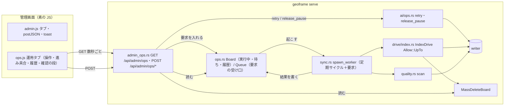
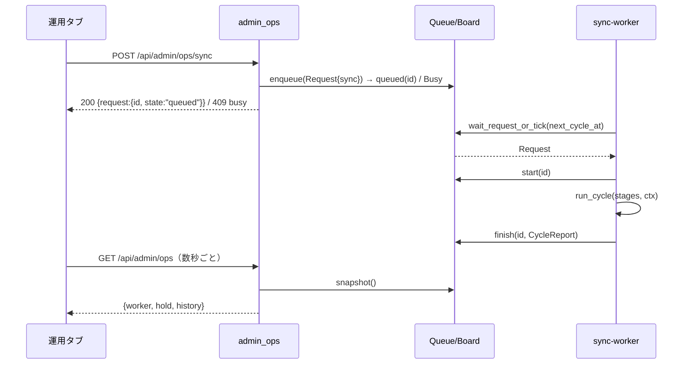

# 運用コンソール（C） 設計

作成日: 2026-11-01。状態: 下書き（レビュー前）。PRD: [prd.md](prd.md)。行番号は 2026-11-01（main 37ea68b）時点。

## 概要

[PRD](prd.md) の 5 つの運用操作（同期をいま回す・品質解析の一括・Drive の大量削除の保留の解除・AI ジョブの再試行・
AI の停止の解除）を、稼働中の `serve` の中で行い、進み具合を「運用」タブで見せる。A の設計書
（[../admin-rework/design.md](../admin-rework/design.md)）と B の設計書（[../admin-library/design.md](../admin-library/design.md)。
どちらも末尾の「実装との差」が実装の正）の上に足す。

## 今の作り（調査結果）

### 同期サイクル

- `serve` は取り込みが有効なとき `sync::spawn_worker`（`crates/geoframe/src/sync.rs:438-459`）で 1 本のスレッドを起こす
  （`cli.rs:463-470`）。起動直後に 1 回、以後 `stop.wait(poll)`（`sync.rs:455`、`poll = config.drive_poll()`）で待って
  `one_cycle`（`sync.rs:464-492`）を回す。段の一覧は `default_stages_with(drive)`（`sync.rs:300`）で 1 回作り、閉包に move する。
- `StopFlag`（`stop.rs`）は `Condvar` と `Option<Instant>` だけで、**停止しか伝えられない**（`wait` は `stop.rs:84` 付近）。
  要求で起こす仕組みは無い。
- `run_cycle`（`sync.rs:368-432`）は段ごとにパニックを隔離し、`CycleReport { stages: Vec<StageReport{name, result}>, photos }`
  を返す。`StageResult` は `Done(Counts)`・`Skipped(&'static str)`・`Failed(String)`・`Panicked`・`NotRun`（`sync.rs:322-334`）。
  **`one_cycle` はこの戻り値を捨てる**（ログだけ。`sync.rs:489`）。`AppState` には何も残らない。
- `Stage` trait（`sync.rs:169-172`）は `name()` と `run(&self, ctx: &StageCtx)`。`StageCtx`（`sync.rs:69-82`）は
  `mode`・`config`・`read`・`writer: Option<&Writer>`・`cache`・`http`・`stop`。
- 段の失敗の文面 `StageError`（`sync.rs:127-139`）は SQLite のメッセージ（表名・列名まで）を含みうる。
- `.ingest.lock`（`ingest.rs:153-170`）は取り込み有効の `serve` が起動から終了まで持つ。CLI の書き込み系は
  `start_existing` で `Locked` になり「サービスを止めてから」と出る（`cli.rs:904-908`、`:1190`）。

### 品質解析

- 段 `quality`（`quality.rs:537-545` の `Quality::run` → `apply`）は 1 サイクル `quality_per_cycle` 件だけ解析し、
  残りが 0 のときだけ再構築する。CLI `quality-scan`（`cli.rs:771`）は `quality::scan(ctx)`（`quality.rs:548-591`）で、
  未解析が無くなるまで回る一括版。使うのは `ctx.read`・`ctx.writer()`・`ctx.config`・`ctx.stop` だけ（`cache`・`http` は
  構造体の都合で要る）。`one_off`（`cli.rs:797-879`）は `StopFlag::new()` を新しく作るので、CLI は停止の合図で止まらない。

### Drive の大量削除の保留

- `HoldReason`（`drive/index.rs:63-69`）: `Ratio`（消す行 > 50 件かつ Drive の行の 20% 超）・`EmptyListing`。
  `MassDeleteHold`（`index.rs:82-93`）: `held`・`reason`・`drive_rows`・`since`・`checked_at`（`YYYY-MM-DD HH:MM:SS`）。
- `MassDeleteBoard`（`index.rs:104-134`）は `Mutex<Option<MassDeleteHold>>`。プロセスの中だけ（DB には書かない。
  再起動で消え、次のサイクルでまた付く）。`DriveShared.board`（`drive.rs:276-299`）に入り、`serve` は
  `state.with_mass_delete_board`（`cli.rs:480`、`server.rs:155`）で `/api/admin/status` の `sync.mass_delete_hold` に出す
  （`admin.rs:254-270`）。
- `IndexDrive { shared, allow_mass_delete: bool }`（`index.rs:139-157`）。`plan()`（`index.rs:340-410`）は `allow` のとき
  `doomed` を全部 `deletes` にし（**一覧が空のときの全削除も通る**。`index.rs:398-401`）、`allow` でなければ空の一覧
  （`deletes_withheld`）と比率（`mass_delete_withheld`）で保留する。`run` は一覧を取って計画を作った直後、書き込みの前に
  `board.record(plan.hold(), now)` を呼ぶ（`index.rs:541-547`）。
- `default_stages_allowing_mass_delete`（`sync.rs:295-297`）は**新しい `DriveShared` を作る**ので、`serve` の保留の記憶とは
  別物になる。`serve` 内では使えない。
- 鍵が無いとき `index_drive` は `Skipped(NO_KEY)` で通信しない（`index.rs:514-518`）。試験で安全に使える。

### AI ジョブの操作

- `ai::ops::retry(writer, ai, handlers, target, clock)`（`ai/ops.rs:356-389`）: 種類ごとに登録済みの handler を探し
  （無ければ `unsupported`）、`ai.gate` で使えない用途は `policy_disabled`、`handler.prepare_retry()` を writer の外で呼び、
  `jobs::retry_failed`（`jobs.rs:1061`、`BEGIN IMMEDIATE`、`state='failed'` の行だけ）で `Requeue`／`Obsolete`／`Satisfied` に
  振り分ける。`RetryReport { requeued, obsolete, satisfied, unsupported, policy_disabled }`（`ops.rs:334-343`）。
- `ai::ops::release_pause(writer, ai, target)`（`ops.rs:410-444`）: `All` は `DELETE FROM ai_provider_pauses`、`Task` は今の設定の
  識別に当たる鍵だけ。設定が無ければ `ReleaseError::ConfigUnavailable`。
- 背景ワーカーの取り出しは `state IN ('pending','deferred')`（`jobs.rs:692`・`:719`）なので、`retry` が触る `failed` と重ならない。
  writer は単一スレッドで依頼が直列（`writer.rs`）。
- `serve` の組み立て（`cli.rs:429-452`）: `ai_clock = Arc::new(jobs::unix_now)`、`worker::production_handlers(...)` は値のまま
  `start_ai` に渡され、**`AppState` には handlers も clock も入らない**。`LanClient` は `query::Runtime` に move される。
- `release_pause` は `ai_provider_pauses` だけを消す。`ai_provider_waits`（`ai/waits.rs`。期限つきの一時待機）と、ワーカーの
  メモリ上の `blocked`（`worker.rs:521`）は残る。
- `ai/ops.rs:9-13` のモジュールコメントと `cli.rs:877-880` が「サービス停止中だけ」と書いている。

### 書き込み API の経路

- `post.rs`: `Route` enum（`:56-65`）、`label`（`:68-79`）、`route_of`（`:85-97`、完全一致）、`handle`（`:259-309`。
  `pre_body_check` で CSRF（`csrf.rs:65-80`）・`Content-Length` 必須・64 KiB、本文は JSON オブジェクト、`state.writer()` が
  無ければ `Unavailable`（503）、`spawn_blocking` の `match route`）。`Ok(value)` は **200 固定**（`:300-302`）。
  `ApiError`（`:100-113`）: 400・404・409 `Busy`・503・500。
- `guard`（`server.rs:582-611`）: Host 検査、`route_of` に無い POST は 403。GET の登録は `site`（`server.rs:689-`）の完全一致
  （`/api/admin/config` が `:748`、`/api/admin/curation/groups` が `:787`）を前方一致（`:793-805`）より前に置き、
  `labeled`・`json_response`（`no-store`）を使う。
- 選別タブの `token`（`curation.rs:277-301`。SHA-256 の先頭 8 バイトの hex）と 409 `group_changed`（`admin_curation.rs:416-423`）。

### `/api/admin/status` と試験

- `sync` は `{ready, pending, total}`（`admin.rs:207-212`）＋取り込み有効なら `mass_delete_hold`。`tests/admin_api.rs:892-893` が
  **`sync` の鍵を厳密に固定**している。`python_shape`（`admin_api.rs:28-52`）で除く項目を増やす手もあるが、`sync` の中には足せない。
- 取り込み有効の `serve` を子プロセスで起動する結合試験: `tests/ingest_cli.rs:604-634`（`serve(data, port, Some(("1", &staging)))`、
  `IngestEnv` は `GEOFRAME_TEST_EUID=1000` と存在しない鍵のパス）。`spawn_state`（`tests/common/mod.rs:453`）は `AppState` を
  変える閉包を受ける（`with_mass_delete_board` を入れられる）。

### 画面

- タブ: `admin.html:25-37` の `button[data-tab]`・`section#v-*`、`admin.js:64-79` の `showTab`（許可する名前の列挙、`.on`・`.hidden`、
  `closePhotoOverlays()`、タブごとの読み込み）、`boot()`（`admin.js:349-360`。`init*()` を呼び、状況タブは 30 秒の `setInterval`）。
  新しい JS は `admin.html:211` 付近の script タグと `build.rs`／`embedded.rs` の埋め込みに足す。
- 書き込み: 共通の `postJSON(path, body)`（`admin.js:42-51`。`Content-Type: application/json`、`!ok` は `error` を例外に）、
  `toast(msg, isErr)`（`admin.js:34`）。選別タブは `ver`（表示の版）で古い応答を捨て、`busy` で多重送信を防ぐ（`curation.js:1-35`）。
- 状況タブ: `massDeleteNotice`（`admin.js:114-131`。「この画面からは解除できません」の固定文言）、`aiOpsCells`
  （`admin.js:162-`。「サービスを止めて `geoframe ai-jobs release-pause …` で解除」が `admin_ai_ops_render.mjs:25` の期待値）。
- DOM は `el(tag, cls, text)`・`textContent`。`innerHTML`・`outerHTML`・`insertAdjacentHTML`・`document.write` は
  `tests/static_files.rs:479-491` が禁止（`confirm()` は禁止されていないが、fakedom に無いので使わない）。
- 描画試験: `web/tests/fakedom.mjs`（タイマーは無い。`admin_ai_ops_render.mjs:12` は `setInterval` 等を空実装で渡す）、
  `*_render.mjs` は `fetch` を URL ごとの合成 JSON に差し替える。Rust 側は `tests/common/node.rs:18-44`（ヒープ上限・120 秒）経由。

## 方針

1. **運用の要求は同期ワーカーの 1 本のスレッドで直列に処理する**（R10）。段は「読んでから書く」（`index_drive` の計画 → 書き込み、
   `quality` の未解析の読み取り → 解析 → 書き込み）ので、別スレッドで並行に走らせると同じ行を二重に扱う。ワーカーの待ち
   `stop.wait(poll)` を、「要求が来るか、次の周期になるか、停止か」で起きる待ち（`ops::Queue`）に置き換える。
   - 選ばなかった案: 要求ごとに `spawn_blocking` で段を走らせる（上の二重処理）。`StopFlag` に要求の通知を足す（停止の意味が
     濁る。`Queue` が `StopFlag` を持ち、1 秒刻みで `is_stopped()` を見るほうが小さい）。
2. **結果はメモリ上の掲示板（`ops::Board`）に残し、`GET /api/admin/ops` で読む**（R14）。`MassDeleteBoard` と同じ作り
   （`Arc<Mutex<…>>`、DB に書かない、再起動で消える）。`/api/admin/status` には足さない（`sync` の鍵が固定。R16）。
3. **AI の再試行・停止の解除は POST の中で writer を通して同期的に行う**（R13）。短い（1 トランザクション）ので待ち行列に
   入れない。`serve` が `handlers` と `clock` を `AppState` に持つよう `cli.rs` を変える（`start_ai` に渡す前に `clone`。`Arc` の複製）。
   結果は応答に入れ、`Board` の履歴にも 1 件として残す。
4. **大量削除の解除は「印つきの承認」＋「上限つきの許可」の 2 重にする**（R12）。印（`token`）は `MassDeleteHold` の
   `held`・`reason`・`drive_rows`・`since` から選別タブと同じ作り（SHA-256 の先頭 8 バイトの hex）で作り、POST で一致を
   確かめる。実行する `index_drive` には `Allow::UpTo(held)` を渡し、取り直した一覧で消える行が `held` を超えれば削除せず
   保留に戻す。`allow_mass_delete: bool` は `enum Allow { No, Yes, UpTo(u64) }` に広げ、CLI の `--allow-mass-delete` は
   `Yes` のまま（引数・挙動は変えない。R18）。
   - 選ばなかった案: `default_stages_allowing_mass_delete` を使う（別の `DriveShared` で記憶が分かれる）。全段を回す
     （削除だけが目的なので `index_drive` 1 段でよい。続きは次の定期サイクル）。件数の手入力（ユーザーの選択で不採用）。
5. **品質解析の一括は `quality::scan`（CLI と同じ）をワーカーのスレッドで、`serve` の `stop` を渡して走らせる**（R11）。
   長く走るあいだ定期サイクルと他の要求は待つ（PRD の「決まっていないこと」）。停止の合図で段が止まる（CLI より安全）。
6. **応答に環境の情報を出さない**。段の失敗は `result: "failed"` だけ（文面はログ）。`Skipped` の理由は `&'static str` の
   固定文なので出す。件数は `Counts`（`(&'static str, u64)`）をそのまま出す。
7. **画面は 1 つの `GET /api/admin/ops` を数秒ごとに読む**。応答の順序は要求番号（`seq`）で守る（最新の要求より古い応答は
   捨てる）。選別タブの `ver` ほど複雑な規則は要らない（段は 1 枚で、画面の状態はサーバーの写しだけ）。POST の成功・失敗の
   直後に読み直す。

## 構成



### 新しいモジュールと変更

| 場所 | 変更 |
|---|---|
| `src/ops.rs`（新） | `Request`・`RequestKind`・`Record`・`Board`・`Queue`、`token_of(&MassDeleteHold)`、JSON 化 |
| `src/sync.rs` | `spawn_worker` に `Queue`・`Board` を渡す。ループを「要求があれば要求、無ければ周期でサイクル」に。`run_cycle` の結果を `Board` へ。`StageResult` を JSON にする補助 |
| `src/drive/index.rs` | `allow_mass_delete: bool` → `Allow { No, Yes, UpTo(u64) }`。`plan()` の分岐に `UpTo` を足す。`IndexDrive::allowing_up_to(shared, n)` |
| `src/sync.rs` | `stages(drive, allow)` を `Allow` に。`index_drive_stage_up_to(drive, n)`（1 段だけの `Vec<Box<dyn Stage>>`） |
| `src/admin_ops.rs`（新） | `GET /api/admin/ops` の組み立て、5 本の POST の入力検証と実行 |
| `src/post.rs` | `Route::OpsSync`・`OpsQualityScan`・`OpsDriveRelease`・`OpsAiRetry`・`OpsAiReleasePause` |
| `src/server.rs` | `AppState` に `ops: Option<Arc<ops::Shared>>`（`Queue`＋`Board`）、`ai_handlers: Arc<Vec<Arc<dyn Handler>>>`、`ai_clock: Clock`。`site` に `/api/admin/ops` の完全一致 |
| `src/cli.rs` | `serve` で `ops::Shared` を作り、`spawn_worker` と `AppState` に渡す。`production_handlers` の結果を `clone` して `AppState` へ |
| `web/static/js/ops.js`（新）、`admin.html`、`admin.css`、`admin.js` | 運用タブ。`showTab` に `ops` を足し、離れるとき `stopOpsPolling()` |
| `web/tests/ops_render.mjs`、`tests/admin_ui_ops.rs`、`tests/ops_api.rs` | 試験 |
| 文書 | `deploy/README.md`、`deploy/geoframe-admin.sh`、`docs/rust-migration/server.md`、`docs/architecture/photo-pipeline.md`、`docs/README.md`、`ai/ops.rs` のコメント |

### 同期ワーカーの流れ



ワーカーのループ（擬似コード）:

```
next_cycle_at = now                      // 起動直後に 1 回
loop {
  match queue.wait_until(next_cycle_at, stop) {   // 要求が来る / 周期が来る / 停止。停止は 1 秒刻みで確かめる
    Woken::Stop => break,
    Woken::Request(req) => { board.start(&req); let rec = run(req); board.finish(rec);
                             if req.is_sync() { next_cycle_at = now + poll } }   // 手動の同期は定期の 1 回分（続けて 2 回回さない）。
                                                                                 // 品質解析・保留の解除は周期を変えない
    Woken::Tick => { board.start_cycle(); let rep = one_cycle(...); board.finish_cycle(rep); next_cycle_at = now + poll; }
  }
}
```

`run(req)`:

- `Sync` → `run_cycle(&stages, &ctx)`（定期と同じ段）。
- `QualityScan` → `quality::scan(&ctx)` を 1 段 `quality` の記録にする。
- `DriveRelease { limit }` → `run_cycle(&[IndexDrive::allowing_up_to(drive, limit)], &ctx)`。`plan()` が
  `doomed.len() > limit` なら `mass_delete_withheld` に落とし、`board.record(plan.hold())` で保留が残る。記録の `outcome` は
  `exceeded`（段の `counts` に `withheld` があることで判定）。

`Queue` は `Mutex<Option<Request>>`＋`Condvar`。`enqueue` は空のときだけ入れて `notify_one`、入っていれば `Err(Busy)`。
定期サイクルの実行中に来た要求は入り、サイクルが終わった直後（次の `wait_until` の冒頭）に取り出される。実行中の要求と
同じ種類の要求も `Busy`（画面はボタンを無効にするが、サーバー側でも断る）。

### `Board` の中身

```
Board {
  running: Option<Running { id, kind, started_at }>,          // 要求か定期サイクル（kind: "cycle"）
  queued: Option<Queued { id, kind, requested_at }>,
  next_cycle_at: Option<String>,                              // 周期の予定（実行中は None）
  last_cycle: Option<Record>,                                 // 定期サイクルの直近
  history: VecDeque<Record>,                                  // 要求の履歴。最新 10 件
  next_id: u64,
}
Record { id, kind, requested_at, started_at, finished_at, outcome, stages: Vec<StageJson>, report: Option<Value> }
StageJson { name, result: "done"|"skipped"|"failed"|"panicked"|"not_run", reason: Option<&'static str>, counts: Map<&str,u64> }
outcome: "done"（失敗 0）| "partial"（失敗あり）| "exceeded"（drive-release の上限超え）| "released"・"retried"（AI 系）
```

時刻は `sysinfo::local_timestamp()` と同じ `YYYY-MM-DD HH:MM:SS`（`MassDeleteHold` と揃える）。

## インターフェース

### `GET /api/admin/ops`

完全一致。`Cache-Control: no-store`。HEAD・POST は 403（`guard`）。`INGEST=0` でも 200。

```json
{
  "ok": true,
  "ingest": true,
  "poll_minutes": 10,
  "worker": {
    "running": {"id": 12, "kind": "sync", "started_at": "2026-11-01 10:00:00"},
    "queued": null,
    "next_cycle_at": "2026-11-01 10:10:00",
    "last_cycle": {"id": 0, "kind": "cycle", "started_at": "…", "finished_at": "…", "outcome": "done",
                   "stages": [{"name": "index_local", "result": "done", "counts": {"indexed": 3}},
                              {"name": "index_drive", "result": "skipped", "reason": "Drive の鍵がありません"}]}
  },
  "hold": {"held": 120, "reason": "ratio", "drive_rows": 500, "since": "…", "checked_at": "…", "token": "9f3a…"},
  "ai": {"retry_kinds": ["photo_judge"], "failed": {"photo_judge": 4}, "pauses": 1},
  "history": [ {"id": 12, "kind": "sync", "requested_at": "…", "started_at": "…", "finished_at": null, "outcome": null, "stages": []}, … ]
}
```

- `ingest: false` のときは `worker`・`hold`・`ai` を `null`、`history` を `[]`。
- `hold` は `MassDeleteBoard::current()` が `Some` のときだけ。`token = hex(sha256("{held}\t{reason}\t{drive_rows}\t{since}")[..8])`。
- `ai.retry_kinds` は `handlers` に登録のある種類（いまの配布バイナリで `retry` が実際に再検査できる種類）。`failed` は
  `jobs::status_counts` の `failed` の件数（`/api/admin/status` の `ai_jobs` と同じ元）。`pauses` は `ai_provider_pauses` の行数。
  これ以上の AI の情報（理由コード・用途）は `/api/admin/status` の `ai_*` を画面が併読する。

### POST（すべて JSON、`post.rs` の経路。`INGEST=0`／`ops` が無いときは 503）

| 経路 | 本文 | 成功 | 失敗 |
|---|---|---|---|
| `/api/admin/ops/sync` | `{}` | 200 `{ok, request:{id, kind:"sync", state:"queued"}}` | 409 `busy` |
| `/api/admin/ops/quality-scan` | `{}` | 同上 `kind:"quality_scan"` | 409 `busy` |
| `/api/admin/ops/drive-release` | `{"token": "<16 hex>"}` | 同上 `kind:"drive_release"`、`limit` | 400 `bad_params`、409 `no_hold`・`hold_changed`・`busy` |
| `/api/admin/ops/ai-retry` | `{"target": "all"}` か `{"target": {"kind": "<JobKind>"}}` | 200 `{ok, report:{requeued, obsolete, satisfied, unsupported, policy_disabled}}` | 400 `bad_params`、500 |
| `/api/admin/ops/ai-release-pause` | `{"target": "all"}` か `{"target": {"task": "<TaskKind>"}}` | 200 `{ok, released: n}` | 400 `bad_params`、409 `config_unavailable`、500 |

- `busy` は `ApiError::Busy("busy")`。`hold_changed`・`no_hold`・`config_unavailable` も `Busy` の符号（409）。
- `drive-release` は `token` を検証してから `enqueue`。検証と `enqueue` のあいだに保留が変わる窓は、実行時の `UpTo(limit)` が
  塞ぐ（`limit` は検証時の `held`）。
- `ai-retry`・`ai-release-pause` は `spawn_blocking` の中で `ai::ops::retry`／`release_pause` を呼ぶ（CLI と同じ関数）。
  `JobKind`・`TaskKind` の文字列は CLI の `--kind`・`--task` と同じ名前（`jobs::JobKind::parse` 相当）。未知なら 400。

### 画面（`ops.js`）

- 状態 `os = { seq, timer, snap, confirming }`。`openOpsTab()` で読み直しと 3 秒の `setInterval` を始め、`stopOpsPolling()`（`showTab` から）
  で止める。`fetch` は `seq` を控え、応答時に `seq` が違えば捨てる。
- 描画は 4 つの区画: 「操作」（ボタン＋説明。`running`・`queued` と同じ種類は `disabled`、`ingest:false` なら区画ごと案内に置換）、
  「大量削除の保留」（`hold` があるときだけ。2 段階の確認。R6）、「定期サイクル」（`last_cycle`・`next_cycle_at`・実行中）、「履歴」
  （`history` を新しい順、段の表）。
- POST は `postJSON`。成功は `toast`、失敗は `toast(msg, true)`。`hold_changed`・`no_hold` は確認の段を閉じて読み直す。
  `busy` は「すでに実行中か待ちがあります」。
- AI の区画（PR ②）: `/api/admin/status` の `ai_jobs.reasons`（失敗の理由）と `ai_pauses`・`ai_task_blocks` を併読し、
  `retry_kinds` に無い種類は「この版では再検査できない（failed のまま保持）」と添える。解除の横に R7 の案内。
- 状況タブ: `massDeleteNotice` の末尾の行を「意図した削除なら運用タブから解除（確かめた件数を超える削除はしない）」に、
  `aiOpsCells` の案内を「運用タブから解除（`serve` が動いていないときは `geoframe ai-jobs release-pause --task <用途>`）」に。
  `admin_ai_ops_render.mjs:25` の期待値を同じ文言に合わせる（検証の構造は変えない）。

## データ

- 保存先は無い（メモリ上の `Board` と既存の `MassDeleteBoard`）。DB のスキーマは変えない。移行なし。
- `ai-retry`・`ai-release-pause` が書く表は既存の `ai_jobs`・`ai_provider_pauses`（CLI と同じ）。

## 安全面

- **入力**: POST の本文は JSON オブジェクトのみ（`post.rs`）。`token` は 16 桁の小文字 hex、`target` は固定の語か既知の種類名。
  それ以外は 400 `bad_params`（入力の値は応答に入れない）。
- **権限**: 認証は無い前提（LAN）。Host 検査・CSRF（JSON の Content-Type・同一 Origin）・64 KiB・`INGEST=0` の 503 は既存の経路を
  そのまま通す。GET は `guard` で HEAD・POST を 403 に。操作はどれも**外部へ送らない**（同期は Drive と地理院へ既存の段が
  アクセスする。`ai-retry` は再検査のみで、送るのは背景ワーカー）。
- **破壊的操作の二重の守り**: 大量削除は印の一致（画面が見たもの）＋上限（実行時に取り直した一覧で超えたら保留に戻す）。
  一覧が空の保留（`EmptyListing`）も同じ道（`held` = Drive の全行）。確認の段に「消える行は N 件まで」と明記する。
  **印は認可ではない。** 認証の無い LAN では、`GET /api/admin/ops` を読める相手は誰でも `token` を得て POST できる。印が守るのは
  「古い画面（保留が変わる前に見た件数）で解除してしまう」ことだけで、相手の正当性は ADR 0008 の前提（家庭 LAN・外部公開時は
  Cloudflare Access）に任せる。`setflag`・`rotate`・選別の `confirm` と同じ境界だが、`drive-release` は管理 API で最も破壊的な
  書き込みなので、この境界を文書と `admin_ops.rs` のコメントに書いておく。
- **削除で消えるもの**: `write_plan`（`drive/index.rs:421-447`）は `DELETE FROM photos WHERE id=?`（行ごと。手で直した位置
  `loc_source='manual'`・★・除外も行と一緒に消える）と、`remove_derivatives`（`index.rs:580-592`）で表示用画像を消す。原本（Drive 側）
  には触れない。`photo_quality` の孤児は次の `quality` の段が消し（`quality.rs:167`）、`photo_curation` の行は残るが読む側が
  世代で突き合わせるので効かない（B の設計）。サムネイル（`thumbs/`）は要求時に作る物なので残っても害は無い。
  確認の段にこの範囲を書く（R6）。
- **情報の漏れ**: 応答に段の失敗の文面・パス・モデル名・接続先を出さない（方針 6）。アクセスログは既存の `labeled` でテンプレートだけ。
- **資源**: 要求は 1 つだけ待てる（溢れは 409）。GET は `Board` の `Mutex` を短く持つ（スナップショットの複製）。
  3 秒の読み直しはタブ表示中だけ。`quality::scan` は長く走りうるが、既存の `quality` の段と同じ解析（同じ上限）で、停止の合図で止まる。
- **停止**: `Queue::wait_until` は 1 秒刻みで `stop.is_stopped()` を見る。終了が最大 1 秒遅れる（`THREAD_STOP_LIMIT` の内側）。
  実行中の段は既存どおり「今の段が終わるまで」。

## テスト計画

| AC | 確かめ方 |
|---|---|
| AC1 | `ops_render.mjs`: `ingest:true` の合成応答でボタン 5 つ、`ingest:false` で案内だけ |
| AC2 | `tests/ops_api.rs`: `ingest_cli.rs` と同じ子プロセスの `serve`（`INGEST=1`、鍵なし）。POST sync → 200、直後の POST → 409 `busy`、`GET /api/admin/ops` を最長 20 秒待って履歴に `sync` の記録、`index_drive` が `skipped`、`index_local` が `done`。描画試験でボタンの `disabled` と段の表 |
| AC3 | 同上の子プロセスに、未解析の写真を持つ合成 DB（`build_admin_catalog` の派生。画像は小さな合成 JPEG）。POST quality-scan → 記録の段が `quality` 1 つ、`photo_quality` の行数が増える |
| AC4 | `drive/index.rs` の単体試験: `plan(existing, files, Allow::UpTo(n))` で n 以下は `deletes`、超えは `mass_delete_withheld`。`ops.rs` の単体試験: `token_of` が同じ入力で同じ、1 項目違えば違う。`tests/ops_api.rs`: `spawn_state` で `MassDeleteBoard` に記録を入れ、`token` 取得 → 正しい POST 200（`queued`）、違う `token` 409 `hold_changed`、記録を消して 409 `no_hold`。描画試験で確認の段と 409 の閉じ |
| AC5 | `tests/ops_api.rs`: `curation_api.rs` と同じ writer 付きの `spawn_state` に `ai_jobs`（`failed`、handler 未登録の種類）と `ai_provider_pauses` の行。`ai-retry all` → `unsupported` の件数、行は `failed` のまま。`ai-release-pause all` → `released`、行が消える。`task` 指定で設定なし → 409 `config_unavailable` |
| AC6 | GET の見出し・`no-store`・HEAD/POST 403・`INGEST=0` で `ingest:false`。`Board` に `Failed("…/data/catalog.db …")` を含む合成の記録を入れて本文に無いことを確かめる。`tests/admin_api.rs` は触らない |
| AC7 | 5 本の POST に対し、`csrf_python.rs`・`curation_api.rs` と同じ形で 403・503・413・400 |
| AC8 | `ops_render.mjs`: `last_cycle`・`next_cycle_at`・`history` 10 件の順序 |
| AC9 | `static_files`・`admin_ai_ops_render` が通る。文書は grep で手で確かめる |
| AC10 | `cargo test`、`cargo clippy --all-targets -- -D warnings`、`cargo fmt --all --check` |

## リスクと対策

- **品質解析の一括が長い**: 定期サイクルと他の要求が待つ。画面に「実行中（開始時刻）」を出し、PRD の「決まっていないこと」に残す。
  必要なら `UpTo` と同じ考えで「1 回 n 枚まで」を後から足せる（`Request::QualityScan { limit }`）。
- **`admin_ai_ops_render.mjs` の期待値**: 文言を変えると落ちる。期待値だけを合わせ、検証の構造は変えない（R8）。
- **`cli.rs` の `serve` の組み立ての変更**: `handlers` を `clone` して `AppState` に持たせる。`start_ai` が `None`（AI 無効）でも
  `retry` は handlers で再検査できる（CLI と同じ）。`production_handlers` は `!config.ingest` で空（`INGEST=0` は 503 なので届かない）。
- **`release_pause` のあとも送られない**: `ai_provider_waits` と `blocked` が残る。R7 の案内で説明し、`/api/admin/status` の
  `ai_waits` を併読させる。
- **停止の遅れ**: 1 秒刻みの確認で最大 1 秒。`tests/shutdown.rs` の期待（停止の時間）を確かめる。
- **印の衝突**: `token` は保留の 4 項目から作るので、同じ件数・理由・行数・開始時刻なら同じ（同じ保留）。開始時刻 `since` は
  保留が続くあいだ変わらないので、件数だけが変わった保留（`checked_at` で更新）は別の印になる。
- **`Allow` への変更**: `IndexDrive` の既存の試験（`index.rs` の `plan` の試験）を `Allow::Yes`／`No` に置き換える。CLI の `--allow-mass-delete` の
  挙動は `Yes` で同じ。

## 実装の順番

1. `ops.rs`（`Request`・`Record`・`Board`・`Queue`・`token_of`、単体試験）。
2. `drive/index.rs` の `Allow`、`sync.rs` の `stages(drive, Allow)`・`index_drive_stage_up_to`、`plan` の試験。
3. `sync.rs` の `spawn_worker` の変更（`Queue`・`Board`、`run(req)`、結果の記録）。`cli.rs` の `serve` で配線。
4. `admin_ops.rs`（GET の JSON、`sync`・`quality-scan`・`drive-release` の POST）、`post.rs`・`server.rs` の登録、`tests/ops_api.rs`（AC2〜AC4、AC6、AC7）。
5. `ops.js`・`admin.html`・`admin.css`・`admin.js`（タブ、`showTab`、`boot`）、状況タブの文言、`ops_render.mjs`・`tests/admin_ui_ops.rs`（AC1、AC4、AC8、AC9）。
6. 文書（同期系）。── ここまで PR ①。
7. `cli.rs` で handlers・clock を `AppState` へ、`admin_ops.rs` に `ai-retry`・`ai-release-pause`、`tests/ops_api.rs`（AC5、AC7 の AI 分）。
8. `ops.js` の AI の区画と R7 の案内、R9、描画試験、文書（AI 系）。── PR ②。
