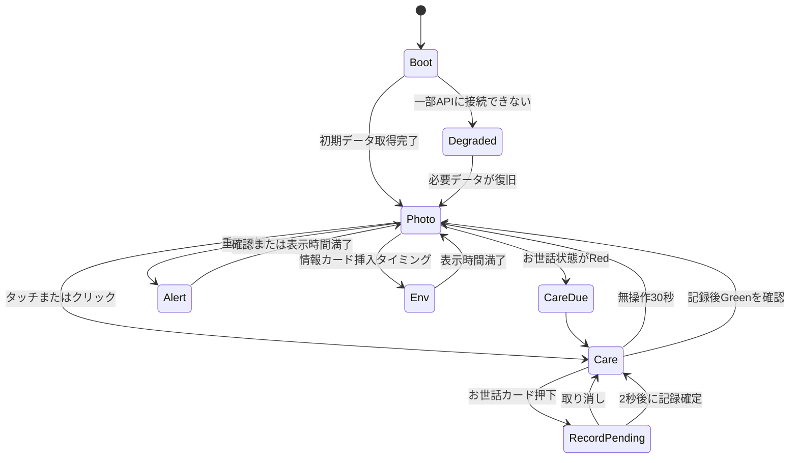

# GEOFRAMEアンビエント表示 — 企画案・概要設計

作成日: 2026-07-30
対象リポジトリ: `01-MLIT-Project`（スマートディスプレイ）
先行実装環境: macOS + SDL2
将来ターゲット: M5Stack Tab5（ESP32-P4 + M5GFX + PPA）

---

## 1. 企画概要

### 1.1 コンセプト

**「普段は家族の写真が流れ、必要な瞬間だけ生活の操作盤になるアンビエント端末」**

GeoFrameの写真・気象・地震・Home Assistant表示と、hogo-meterの保護猫お世話記録を1台へ統合する。
通常は操作UIを隠したフォトフレームとして動作し、次の契機で役割を切り替える。

- 画面をタッチすると、お世話記録ボタンを表示する。
- お世話予定が近づくと、写真上へ「そろそろ」を控えめに表示する。
- お世話期限を超過すると、お世話画面へ自動的に切り替える。
- 地震など重要な通知は、写真表示より優先して専用演出で表示する。
- 室温・湿度・CO2などは写真を邪魔しないHUDまたは情報カードとして表示する。

専用端末としての即応性と信頼性を保ちながら、普段は置物にならず、生活空間に存在する意味を持たせる。

### 1.2 今回の到達点

まずmacOS上にSDL2アプリを実装し、次を実データで検証する。

1. GeoFrame写真の全画面表示
2. 複数トランジションのランダム切り替え
3. 天気・地震通知の演出
4. Home Assistantセンサー情報の表示
5. タッチ相当操作によるhogo-meterお世話画面の表示
6. hogo-meter実サーバーからの設定取得と記録送信
7. 将来のTab5 Rendererへ移植できる描画・状態管理の境界

この段階ではMacアプリを完成品とせず、画面体験、状態遷移、API契約、演出性能を固めるための
リファレンス実装と位置づける。

### 1.3 対象外

初期Mac版では次を対象外とする。

- 地図表示およびMapLibre連携
- 音声操作
- カメラ・人物認識
- Tab5実機ファームウェアの作成
- hogo-meterサーバー側APIの変更
- GeoFrameの既存Web版の置き換え

---

## 2. 体験設計

### 2.1 基本画面

#### PHOTO（通常）

- 写真を画面全体へcover表示する。
- 時計と撮影情報は小さなHUDとして表示・非表示を設定できる。
- Home Assistantの主要値は常時表示する場合も、写真間の情報カードとして挟む場合も選べる。
- マウスクリックまたはタッチでCAREへ遷移する。PHOTO上で直接お世話記録は行わない。

#### CARE（お世話操作）

- hogo-meterの3項目または6項目カードを表示する。
- ラベル、最終記録時刻、経過時間、Green/Yellow/Red状態はhogo-meterサーバーを正とする。
- カード押下後は、既存Tab5版と同じ2秒の取り消し猶予を表示する。
- 無操作30秒でPHOTOへ戻る。
- Red項目が残っている場合でも、ユーザーが明示的に閉じた後は一定時間の再表示抑止を設ける。

#### CARE_DUE（時間到来）

- Yellowでは写真下部へ細い帯を表示し、写真表示を継続する。
- RedではCAREへ自動遷移する。
- 記録後、サーバーpollでGreenを確認したら数秒後にPHOTOへ戻る。
- 記録操作中・取り消し猶予中は、他の通常通知による画面遷移を禁止する。

#### ALERT（重要通知）

- 地震など、即時性の高い情報を専用画面または写真上の全面オーバーレイで表示する。
- 背景写真を暗転し、警報色のパネル、発生時刻、震源、規模などを段階的に出す。
- 同一イベントIDは再表示クールダウンを設ける。
- 通常通知は操作中に割り込ませず、重要通知のみ操作完了後に表示する。

#### ENV（室内環境）

- 温度、湿度、CO2、VOC、気圧、センサーバッテリーを表示候補とする。
- PHOTO上のコンパクトHUDと、写真間に挟む全画面情報カードの2形式を持つ。
- CO2は既存GeoFrameと同じく、1000ppm以上を注意、1500ppm以上を警告として色分けする。
- 値が一定時間更新されない場合は数値を残しつつ`STALE`を表示する。

### 2.2 状態遷移



### 2.3 表示優先順位

上位状態が表示中は、下位状態への自動遷移を保留する。

1. 初期設定・OTA・致命的エラー
2. 記録操作と取り消し猶予
3. 緊急地震通知
4. hogo-meter Red状態
5. 通常のGeoFrame通知
6. Home Assistant環境カード
7. 写真表示

---

## 3. システム構成

### 3.1 全体像

```text
                                  ┌──────────────────────────┐
                                  │ hogo-meter Dashboard API │
                                  │ config / records / OTA   │
                                  └────────────┬─────────────┘
                                               │ HTTPS
┌───────────────────────────────┐              │
│ GeoFrame Python server        │              │
│                               │              │
│ Drive / SQLite / derivatives  │              │
│ JMA weather + quake           │              │
│ Home Assistant proxy          │              │
└───────────────┬───────────────┘              │
                │ HTTP/LAN                      │
                ▼                               ▼
┌─────────────────────────────────────────────────────────────┐
│ Ambient Display Core                                        │
│ StateMachine / Scheduler / AlertEngine / TransitionEngine   │
│ GeoFrameClient / HogoService / EnvironmentModel             │
└──────────────────────────────┬──────────────────────────────┘
                               │ RenderPlan
                 ┌─────────────┴─────────────┐
                 ▼                           ▼
       ┌──────────────────┐        ┌──────────────────────┐
       │ macOS Renderer   │        │ Tab5 Renderer        │
       │ SDL2             │        │ M5GFX + ESP32-P4 PPA │
       └──────────────────┘        └──────────────────────┘
```

### 3.2 責務分離

#### Ambient Display Core

プラットフォームに依存しないC++コードとする。

- 画面状態機械
- 写真再生順序
- トランジション選択
- 通知の優先順位とクールダウン
- Home Assistant値の表示モデル化
- hogo-meter表示モデルと記録保留状態
- 時刻とタイムアウト

#### Renderer

描画の意味を受け取り、プラットフォームごとに最適な方法で表示する。

- `SdlRenderer`: Mac先行実装。SDL2テクスチャを使用する。
- `M5Renderer`: 将来実装。M5GFXで文字・カード、PPAで全画面画像処理を行う。

座標単位は論理解像度1280×720とする。Macウィンドウはアスペクト比を保って拡縮し、Tab5は等倍表示する。

#### Transport / Provider

- `GeoFrameClient`: GeoFrameローカルAPI、写真ファイルを取得する。
- `HogoHostClient`: Mac用。hogo-meterと同一のHTTP契約をlibcurlで実行する。
- `hogo_common`: Tab5用。hogo-meter実装のソースを未改変で使用する。
- `FixtureProvider`: オフラインUI開発と再現テストに使用する。

---

## 4. Renderer概要設計

### 4.1 共通インターフェース

低レベルの全描画命令を無理に共通化せず、演出単位のAPIを中心にする。

```cpp
class Renderer {
public:
    virtual void beginFrame() = 0;
    virtual void showPhoto(const PhotoFrame& photo) = 0;
    virtual void showTransition(const TransitionFrame& frame) = 0;
    virtual void showCare(const CareViewModel& model) = 0;
    virtual void showEnvironment(const EnvironmentViewModel& model) = 0;
    virtual void showAlert(const AlertViewModel& model) = 0;
    virtual void endFrame() = 0;
    virtual RendererCapabilities capabilities() const = 0;
};
```

`TransitionFrame`は種別、開始写真、次写真、0.0〜1.0の進捗、乱数seedを持つ。MacとTab5で
同じseedを用いれば、同じ再生シーケンスを再現できる。

### 4.2 トランジション

初期候補を次の6種類とする。

| 種別 | SDL実装 | Tab5実装想定 | 負荷 |
|---|---|---|---|
| FadeThroughBlack | テクスチャalpha | 輝度段階またはPPA blend | 低〜中 |
| CrossFade | 2テクスチャ合成 | PPA blend | 中 |
| Slide | source/destination rect | PPA SRMまたは領域copy | 低 |
| Wipe | clip rect | 領域copy | 低 |
| Blinds | 複数clip rect | 複数領域copy | 低〜中 |
| KenBurns | scale + crop | PPA SRM | 中 |

次は初期対象外とする。

- リアルタイムblur
- ページカール
- 粒子エフェクト
- 任意メッシュ変形

ランダム選択には重みを持たせ、同じ種類を連続させない。写真の縦横比、直前の通知、Rendererの
capabilityにより候補を絞り、非対応時は`FadeThroughBlack`へフォールバックする。

### 4.3 性能目標

#### Mac

- 1280×720で60fps
- 入力から視覚フィードバックまで50ms未満
- 10分連続再生でメモリ使用量が単調増加しない

#### Tab5移植時

- 通常UI操作のフィードバック100ms未満
- 全画面トランジションは15〜20fps以上を最低目標とする
- 演出時間は600〜1000msを基本とし、低fpsを感じさせない動きを選ぶ
- 1280×720 RGB565の前画像・次画像・作業領域をPSRAM内に保持できる設計とする
- フル画面処理ではCPUループを避け、PPAのblend/SRMを優先する

Macの60fps達成を、そのままTab5での60fps保証とはしない。Macは体験とロジックの基準、Tab5は
同じ演出意図をハードウェアに合わせて再実装する。

---

## 5. データとAPI

### 5.1 GeoFrame既存APIの利用

Mac MVPでは既存APIをそのまま利用する。

| API | 用途 | 更新間隔 |
|---|---|---:|
| `GET /api/photos` | 写真一覧、タイトル、撮影時刻 | 5分 |
| `GET /api/onthisday` | 「1年前の今日」候補 | 1時間 |
| `GET /api/env` | 天気、直近地震 | 60秒 |
| `GET /api/roomenv` | HA環境センサー | 30秒 |
| `GET /api/presence` | 在室・画面制御判断 | 10秒 |
| `GET /api/stats` | 写真統計カード | 10分 |

画像は`/api/photos`の`file`をGeoFrame serverから取得する。

### 5.2 Tab5向けGeoFrame API拡張

現在の`/api/photos`はGPS付き写真のみを返し、画像は長辺2560px derivativeである。地図を持たない
Tab5ではGPSなし写真も表示対象にし、端末での縮小・メモリ消費を避ける必要がある。

Tab5着手前に、次の端末向けAPIを追加する。

```text
GET /api/device/v1/manifest
GET /api/device/v1/photo/{id}?width=1280&height=720&fit=cover
GET /api/device/v1/status
GET /api/device/v1/events?since=<cursor>
```

- `manifest`: GPSの有無にかかわらず表示可能な写真を返す。
- `photo`: 端末解像度へサーバー側で変換したJPEGを返す。
- `status`: 天気、HA環境値、presenceなど低頻度データを集約する。
- `events`: 地震などの通知をイベントIDとcursor付きで差分取得する。

初期Mac版は既存APIを使い、端末向けAPIを先行条件にしない。

### 5.3 Home Assistant

クライアントからHome Assistantへ直接接続しない。既存GeoFrame serverを認証プロキシ兼キャッシュとして
利用し、HAトークンは端末へ配布しない。

設定は既存の`GEOFRAME_HA_ENV_ENTITIES`を正とする。初期表示候補は次のとおり。

- 温度
- 湿度
- CO2
- VOC
- 気圧
- センサーバッテリー
- 在宅・人感
- ドア開閉（通知は設定で有効化）

値には`value`、`unit`、`device_class`、`friendly_name`、サーバー取得時刻を持たせる。クライアントは
`device_class`を基本に表示ラベルと単位を決定し、未知の種類も文字列として表示できるようにする。

### 5.4 地震アラート

初期Mac版は`/api/env`の`quakes`を使用し、`eid`を重複排除キーとする。

- 新しい`eid`を検知したときだけALERTを生成する。
- 起動時に既に存在するイベントをすべて新着扱いしない。
- 表示済みイベントIDをローカルへ保存する。
- 現在のGeoFrame serverは`/api/env`を5分キャッシュするため、速報性の上限も最大約5分となる。
- 実機フェーズで速報性が必要なら、地震だけを60秒以下のキャッシュへ分離する。

---

## 6. hogo-meter通信の移植方針

### 6.1 基本原則

Tab5版ではhogo-meterの通信仕様を似せて再実装せず、次の上流実装をスマートディスプレイ側へ
**未改変スナップショットとして取り込む**。

上流: 別リポジトリの `hogo-meter`（ローカルパスは環境ごとに指定）
設計時基準コミット: `eadc9953b21a`

主な移植対象:

- `firmware/lib/hogo_common/server_sync.{h,cpp}`
- `firmware/lib/hogo_common/net_client.{h,cpp}`
- `firmware/lib/hogo_common/ca_certs.h`
- `firmware/lib/hogo_common/identity_store.{h,cpp}`
- `firmware/lib/hogo_common/care_store.{h,cpp}`
- `firmware/lib/hogo_common/provisioner.{h,cpp}`
- `firmware/lib/hogo_common/mac_util.h`
- `firmware/lib/hogo_common/net_time.{h,cpp}`
- `firmware/lib/hogo_common/wifi_store.{h,cpp}`
- `firmware/lib/hogo_common/wifi_setup_portal.{h,cpp}`
- `firmware/lib/hogo_common/self_ota.{h,cpp}`
- `firmware/lib/hogo_common/fw_pubkey.h`
- `firmware/lib/hogo_common/app_types.h`

`app_scaffold.h`はGeoFrame統合後の画面状態が異なるため、そのままアプリ統括には使わない。Wi-Fi、NTP、
provisioning、deregister、OTAの不変条件を参照し、新しい上位状態機械から既存モジュールを呼び出す。

取り込み先は`native-display/vendor/hogo_common/`とし、vendoredファイルを直接編集しない。
`UPSTREAM.md`へ上流パス、コミット、取り込み日時、ファイル一覧を記録する。更新時は全置換し、差分と
通信契約テストを確認する。

### 6.2 維持する通信契約

- 起動直後にconfigを即時取得し、以後30秒間隔でpollする。
- `GET /api/agent/{deviceId}/config`
- `POST /api/agent/{deviceId}/records`
- `POST /api/agent/register`
- `POST /api/agent/{deviceId}/deregister-ack`
- `GET /api/agent/{deviceId}/firmware`
- `X-Device-Secret`認証
- HTTPS時だけCloudflare Access Service Tokenを付与する。
- `setInsecure()`を使用せず、同梱ルートCAで証明書を検証する。
- HTTPS通信はNTP同期後に開始する。
- 記録をローカルへ先に永続化し、固定長8件の送信キューで非同期複製する。
- 記録送信は最大5回、5秒間隔で再試行する。
- 1回の`update()`でHTTPリクエストを最大1件に抑える。
- 記録送信をconfig pollより優先する。
- リモート初期化はACK受理後にidentityを消去する。
- OTAは署名とSHA-256を検証し、既存のヘルスゲートを維持する。

### 6.3 Mac版の扱い

上記モジュールはArduinoの`HTTPClient`、`WiFiClientSecure`、NVS等へ依存するため、Macへそのままリンクしない。
Mac版は`HogoHostClient`を用い、libcurlで同じURL、ヘッダー、JSON、poll間隔、記録キュー動作を再現する。

Mac版の資格情報は環境変数またはgitignored設定ファイルから与える。

```text
HOGO_BASE_URL
HOGO_DEVICE_ID
HOGO_DEVICE_SECRET
HOGO_CF_ACCESS_CLIENT_ID
HOGO_CF_ACCESS_CLIENT_SECRET
```

実運用中のTab5と同じ`deviceId`は使わない。ダッシュボードにMacシミュレーター専用デバイスを登録し、
専用の`deviceId`/`secret`で接続する。これによりUI試験の記録POST、状態リセット、異常系試験が実世帯の
記録や実機表示へ影響しないようにする。

Mac版では次を行わない。

- MACアドレスによる自己登録
- NVS操作
- Wi-Fiセットアップポータル
- ファームウェアOTA
- deregister ACK

これらはTab5実装時にvendored `hogo_common`を使用して有効化する。Mac版はUI・状態遷移・通常の
config/records通信を検証するホストであり、デバイス管理機能の代替実装にはしない。

### 6.4 通信と描画の分離

hogo-meter通信は描画スレッドを直接ブロックしない。Macではworker threadでHTTPを行い、結果を
thread-safe queueでメインスレッドへ渡す。Tab5では上流コードのbounded-blocking特性を維持しつつ、
表示更新タスクと通信タスクを分離できるか実機検証する。

通信失敗時もローカル表示とタッチ操作を継続し、最終取得値には`OFFLINE`または`STALE`を付ける。

---

## 7. ソース構成案

```text
01-MLIT-Project/
├── app/                         # 既存GeoFrame Python/Web実装
├── native-display/
│   ├── CMakeLists.txt                 # macOS host build
│   ├── README.md
│   ├── config/
│   │   └── example.env
│   ├── include/
│   │   ├── ambient/
│   │   ├── renderer/
│   │   └── transport/
│   ├── src/
│   │   ├── core/                      # 状態機械・スケジューラ・通知
│   │   ├── renderer/sdl/              # Mac SDL2 Renderer
│   │   ├── renderer/m5gfx/            # 将来のTab5 Renderer
│   │   ├── transport/geoframe/        # GeoFrame API client
│   │   ├── transport/hogo_host/       # Mac用libcurl adapter
│   │   └── main_sdl.cpp
│   ├── assets/
│   │   ├── fonts/
│   │   └── fixtures/
│   ├── tests/
│   │   ├── state_machine/
│   │   ├── transitions/
│   │   └── contract/
│   └── vendor/
│       └── hogo_common/               # 上流未改変スナップショット
└── docs/
    └── architecture/native-display.md
```

Mac版はSDL2、SDL2_image、SDL2_ttf、libcurlを使用する。JSONライブラリはhost adapter内部に閉じ込め、
Coreへライブラリ固有型を露出させない。

---

## 8. データモデル概要

```cpp
struct Photo {
    int64_t id;
    std::string url;
    std::string title;
    std::string takenAt;
};

struct SensorValue {
    std::string entityId;
    std::string name;
    std::string deviceClass;
    std::string value;
    std::string unit;
    std::chrono::system_clock::time_point fetchedAt;
};

struct CareItemState {
    int slot;
    std::string label;
    uint32_t lastEpoch;
    enum class Status { None, Green, Yellow, Red } status;
    bool shouldLight;
};

struct Alert {
    std::string id;
    AlertType type;
    AlertPriority priority;
    std::string title;
    std::string body;
    std::chrono::system_clock::time_point occurredAt;
};
```

外部JSONをRendererへ直接渡さず、Providerが上記の表示用モデルへ変換する。これによりAPIと表示を
独立して変更できる。

---

## 9. 設定

初期Mac版では`native-display/.env`を読み込み、次を設定可能にする。

```dotenv
GEOFRAME_BASE_URL=http://localhost:8080

HOGO_BASE_URL=https://example.invalid/hogo-meter
HOGO_DEVICE_ID=
HOGO_DEVICE_SECRET=
HOGO_CF_ACCESS_CLIENT_ID=
HOGO_CF_ACCESS_CLIENT_SECRET=

DISPLAY_WIDTH=1280
DISPLAY_HEIGHT=720
PHOTO_DURATION_SEC=20
CARE_IDLE_TIMEOUT_SEC=30
TRANSITION_DURATION_MS=800
ENV_CARD_INTERVAL_MIN=10
```

秘密値をコマンドライン、ログ、スクリーンショット名へ出さない。`.env`はGit管理対象外にする。

---

## 10. 障害時の縮退

| 障害 | 挙動 |
|---|---|
| GeoFrame API不達 | キャッシュ済み写真を継続。無ければhogo-meter画面を表示 |
| 写真取得失敗 | 当該写真を一時除外し次へ進む |
| Home Assistant不達 | 最終値にSTALE表示。写真表示は継続 |
| hogo config不達 | 最終取得ラベル・状態を表示。記録操作はローカル保留 |
| hogo record送信失敗 | 既存仕様どおりキューで再試行 |
| 全ネットワーク断 | キャッシュ写真、時計、ローカルお世話状態で継続 |
| Rendererが演出非対応 | FadeThroughBlackへフォールバック |

保護猫記録機能をGeoFrame serverの稼働に依存させない。GeoFrame機能は付加価値であり、hogo-meterの
記録・復旧・認証の不変条件を弱めない。

---

## 11. 実装フェーズ

### Phase 0: Mac SDL骨格

- `native-display/`を作成
- SDLウィンドウ、論理解像度、入力、メインループ
- fixture写真とfixtureセンサー値
- PHOTO/CARE/ENV/ALERT状態機械
- スクリーンショット出力

完了条件: ネットワークなしで全状態を再現できる。

### Phase 1: 写真とトランジション

- `/api/photos`と画像取得
- 2枚先読みとLRUキャッシュ
- 6種類のトランジション
- 重み付きランダム選択
- 60fps、メモリリーク、通信失敗時継続の確認

完了条件: 30分連続で安定再生し、同じseedで同じ遷移を再現できる。

### Phase 2: GeoFrame通知・Home Assistant

- `/api/env`、`/api/roomenv`、`/api/presence`
- 地震イベント重複排除
- ENV HUDと情報カード
- CO2警告色、STALE表示
- 通知優先順位と操作中保留

完了条件: 実センサー値を表示し、fixture地震を任意時刻に再生できる。

### Phase 3: hogo-meter統合

- `HogoHostClient`
- config poll、3/6項目表示、Yellow/Red遷移
- 2秒取り消し付き記録送信
- 認証ヘッダーとキューのcontract test
- GeoFrame不達時にもCAREが動くことを確認

完了条件: Macから実hogo-meter APIのconfig取得とテスト記録を実行できる。

実API試験はMacシミュレーター専用デバイスだけを対象とし、稼働中実機の`deviceId`を使用しない。

### Phase 4: Tab5移植準備

- GeoFrame端末向けAPIと1280×720 derivative
- `hogo_common`未改変スナップショット取り込み
- M5Renderer capabilityとPSRAM計画
- PPAによるCrossFade、Slide、Wipeの性能スパイク

完了条件: 代表3演出の実機fpsと操作応答を測定し、採用演出を確定できる。

### Phase 5: Tab5実装

- M5GFX/PPA Renderer
- Wi-Fi、NTP、provisioning、記録キュー、OTA
- 写真キャッシュとオフライン復帰
- 長時間運転、熱、メモリ、通信断試験

---

## 12. 検証計画

### 機能

- PHOTOの最初のタッチでは記録されず、CAREが開く。
- Red到来でCAREへ遷移し、Yellowでは写真を維持する。
- 記録取り消しと2秒後の確定が既存hogo-meterと一致する。
- 地震イベントは同一`eid`で重複表示されない。
- Home Assistant値に単位、警告色、STALEが付く。
- 操作中に通常通知が割り込まない。

### 通信契約

- hogo-meterと同じURL、メソッド、JSON、認証ヘッダーを送る。
- HTTPS時だけCF Accessヘッダーを送る。
- poll間隔、記録優先、キュー上限、再試行回数を維持する。
- HTTP 401/403/404/409/5xx、タイムアウトの挙動をfixture serverで再現する。
- ログにsecretやCF Access credentialが出ない。

### 描画・性能

- Mac 1280×720で60fpsを維持する。
- 画像ロードは描画スレッドをブロックしない。
- 画像2枚先読みでもメモリが安定する。
- ウィンドウ拡縮でアスペクト比とタッチ座標が一致する。
- 各演出を固定seedでスクリーンショット比較できる。

### 長時間運転

- 30分、8時間の連続再生
- GeoFrame server再起動
- Home Assistant停止・復旧
- hogo-meter API停止・復旧
- Macのスリープ・復帰

---

## 13. 主要リスクと対策

| リスク | 対策 |
|---|---|
| Macでは滑らかだがTab5で遅い | Renderer capability、実機fps基準、低負荷演出へのfallback |
| hogo-meter上流との乖離 | 未改変vendor、基準commit記録、contract test |
| Arduino依存コードをMacで共有できない | Macはhost adapter、Tab5は上流コードそのものを使用 |
| 写真が大きくTab5のdecode負荷が高い | server側1280×720 derivative |
| 全画面alpha合成がPSRAM帯域を消費 | PPA使用、15〜20fps目標、低負荷演出を混在 |
| 通知が多く写真が見えない | 優先度、クールダウン、日次上限、操作中保留 |
| 地震通知が遅い | 初期は既存5分cacheを明示し、必要なら専用短周期APIへ分離 |
| HAやGeoFrame停止でお世話操作不能 | hogo通信とローカル記録をGeoFrameから独立させる |

---

## 14. 採用判断

本企画では次を採用する。

1. スマートディスプレイのプロジェクト内へ`native-display/`を新設する。
2. Mac先行版はSDL2の独自Rendererとする。LVGLは使用しない。
3. CoreはC++で共通化し、MacとTab5で同じ状態機械・演出選択を使う。
4. Tab5はM5GFXでUI、ESP32-P4 PPAで写真の全画面演出を実装する。
5. Home AssistantはGeoFrame server経由で取得し、トークンを端末へ持たせない。
6. hogo-meterのTab5通信コードは未改変で取り込み、認証・再試行・OTAの既存契約を維持する。
7. Macでは同じAPI契約のhost adapterを用い、Arduino固有機能を模倣しない。
8. GeoFrame不達時もhogo-meter機能を継続する。

この構成により、Macで映像体験を高速に試作しながら、Tab5では抽象UIフレームワークの全画面合成を避け、
写真トランジションと重要通知をハードウェアに合わせて最適化できる。
