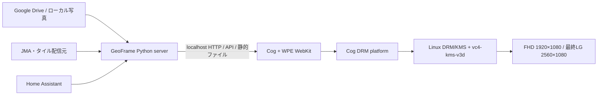

# GEOFRAMEスマートディスプレイ — Cog/WPE・Raspberry Pi 400 企画案／概要設計

> [!NOTE]
> 未採用のハードウェア構成案を保存したアーカイブです。パッケージ仕様やコマンドは現行環境で再確認してください。

作成日: 2026-07-30
対象リポジトリ: `01-MLIT-Project`（スマートディスプレイ）
初期ターゲット: Raspberry Pi 400（4GB）+ USBマスストレージ
開発・動作確認表示器: 一般的なFHDモニター（1920×1080、16:9、60Hz）
最終表示器: LG 29UM59-P（29インチ、2560×1080、21:9）
表示ランタイム: Cog + WPE WebKit + DRM/KMS
比較対象: [`native-display-concept.md`](native-display-concept.md)

---

## 1. 結論

Raspberry Pi 400版の第一候補を、次の構成とする。

```text
Raspberry Pi OS Lite 64-bit
  ├─ GeoFrame Python server（既存 server.py）
  └─ Cog + WPE WebKit
       └─ DRM/KMSへ直接出力
            └─ HDMI 1920×1080 @ 60Hz（開発）
                    → 2560×1080 @ 60Hz（最終）
```

- 既存の`app/index.html`、写真・地図・気象・地震・Home Assistant APIを生かす。
- Chromiumとデスクトップ環境を外し、Cogを単一Webアプリ用ランタイムとして使う。
- 通常構成はWaylandコンポジタを挟まない`drm`プラグインとする。
- 開発中は一般的なFHDモニターの1920×1080/60Hz、最終段階でLG 29UM59-Pの
  native 2560×1080/60Hzへ切り替える。初期URLは`/?low`とする。
- 直接DRMで問題が出た場合だけ、Cage + Cog `wl`プラグインへ切り替える。
- USB起動はPi 400のEEPROMでUSBを優先し、OSはUSB 3ポートへ接続した高品質メモリから起動する。
- 俗に「boot.txt」と呼ばれがちな設定は1ファイルではない。起動順はEEPROM、映像設定は
  `/boot/firmware/config.txt`、カーネル引数は`/boot/firmware/cmdline.txt`で管理する。

この構成は「Web版GeoFrameをなるべく変更せず、Chromiumより小さい専用実行環境で動かす」案である。
SDL/M5GFX案より移植量は小さい一方、MapLibre GLとWPE WebKitの実機互換性が最大の採否条件になる。

---

## 2. 企画概要

### 2.1 コンセプト

**「写真と生活情報を自然に見せ、必要な瞬間だけ重要通知へ切り替わる常設ディスプレイ」**

既存GeoFrameのWeb画面をアプリ本体として利用し、Raspberry Pi 400を専用機化する。通常時は写真、
地図、天気、Home Assistantセンサーを表示し、地震や生活通知を優先度に応じて前面へ出す。

### 2.2 この案で得たいもの

- 既存HTML/CSS/JavaScript資産とPython APIをそのまま生かす。
- Chromiumのタブ、ブラウザUI、デスクトップセッションを持たない専用キオスクにする。
- MacのブラウザでUIを開発し、同じWebアプリをPi 400へ配布する。
- Home Assistant認証情報をブラウザへ置かず、既存Python serverをプロキシとして維持する。
- Linux起動後に人手を介さず表示し、WebProcess異常時にも自動復帰する。
- 将来、Pi 5や別のLinux SBCへ同じ構成を移せるようにする。

### 2.3 初期到達点

1. Pi 400をUSBメモリだけで起動できる。
2. Raspberry Pi OS Lite 64-bit上でGeoFrame serverが常駐する。
3. CogがDRM/KMSへ直接、まず1920×1080で全画面表示する。
4. 写真、MapLibre地図、気象、地震、Home Assistantセンサーが表示できる。
5. ネットワーク断、server再起動、WebProcess異常から自動復帰する。
6. 24時間連続運転でメモリ増加、描画停止、ストレージ異常がない。

### 2.4 初期対象外

- Raspberry Pi OS Desktop、X11、Chromiumの併用
- 4K出力と4K/60Hzチューニング
- Pi 400のオーバークロック
- Cog/WPE WebKit自体の独自ビルド
- A/Bルートファイルシステム、読み取り専用rootfs
- hogo-meter連携、CARE画面、お世話記録
- タッチ操作、物理ボタン、新規の操作UI

---

## 3. Cog/WPEを選ぶ理由と限界

CogはWPE WebKitを使う小型の単一ウィンドウWebブラウザで、ブラウザUIを持たず、組み込みキオスクの
Webアプリコンテナとして設計されている。Debian Trixie arm64の`cog`パッケージには`drm`、`wl`、
`headless`の各プラットフォームモジュールが含まれる。

| 観点 | Cog/WPE案 | Chromiumキオスク案 | SDLネイティブ案 |
|---|---|---|---|
| 既存Web UIの再利用 | 高い | 高い | 低い |
| OS/ランタイムの小ささ | 高い | 中 | 高い |
| MapLibre互換性 | 実機確認必須 | 最も高い | 地図を別実装 |
| CSS演出の開発速度 | 高い | 高い | 中 |
| GPU経路の単純さ | DRM直結なら高い | デスクトップ依存 | 高い |
| ブラウザ拡張・DevTools | 限定的 | 豊富 | 該当なし |
| Tab5へのコード移植 | できない | できない | Core設計次第 |

性能面では、CogだからJavaScriptやWebGLがネイティブ描画になるわけではない。WPE WebKitのWebProcess、
WebGL、画像decode、JavaScript実行コストは残る。利点は、Chromiumとフルデスクトップの常駐コストを減らし、
画面出力経路を単純化できる点にある。

したがって採用判断は「起動時メモリが小さいか」だけでなく、現在のMapLibre GL JS 4.7.1が
VideoCore VI上のWPE WebKitでハードウェア描画されるか、写真演出と同時に十分滑らかかで決める。

---

## 4. システム構成

### 4.1 全体像



### 4.2 プロセス責務

#### GeoFrame Python server

- 既存`app/server.py`を継続利用する。
- 写真manifest、画像derivative、気象、地震、タイル、Home Assistant proxyを担当する。
- Home Assistantトークンなどの秘密値を`.env`に保持する。
- `127.0.0.1:8080`をCogへ公開する。

#### GeoFrame Web application

- 既存`app/index.html`と同梱vendor資産を表示する。
- 写真・地図・情報HUD・地震演出・センサー表示を担当する。
- 端末固有分岐はUser-Agentではなく、URL queryまたはconfig APIで明示する。
- 初期プロファイルは`/?low&device=rpi400-cog`とする。

#### Cog / WPE WebKit

- URLを1つだけ表示する。
- `drm`プラットフォームでKMS出力を占有する。
- WebProcess停止時は`restart`動作を使う。
- Cog側で候補modeを制限し、同じ既存Web画面を開発FHDと最終ultrawideへ表示する。

#### systemd

- `geoframe-server.service`と`geoframe-cog.service`を別unitにする。
- serverを先に起動し、HTTP readyを確認後にCogを起動する。
- どちらも異常終了時に再起動する。
- desktop autologinやユーザーWayland sessionへ依存しない。

---

## 5. Web画面とデータ設計

### 5.1 画面モード

既存Web画面を基礎に、次の状態を論理的に分離する。

| 状態 | 内容 | 主な遷移契機 |
|---|---|---|
| PHOTO/MAP | 写真、地図、時刻、天気、環境HUD | 通常状態 |
| ENV | 温湿度、CO2、VOC、気圧等の情報カード | 一定間隔 |
| ALERT | 地震など重要通知 | 新規イベント |
| DEGRADED | オフライン・API異常を控えめに表示 | fetch失敗、値の期限切れ |

表示優先度は`緊急通知 > 通常通知 > ENV > PHOTO/MAP`とする。

### 5.2 既存API

| API | 用途 | Pi 400での目安 |
|---|---|---:|
| `GET /api/photos` | 写真一覧 | 5分 |
| `GET /api/onthisday` | 今日の思い出 | 1時間 |
| `GET /api/env` | 天気・地震 | 60秒。ただしserver cacheも考慮 |
| `GET /api/roomenv` | Home Assistant環境センサー | 30秒 |
| `GET /api/presence` | 在室状態 | 10秒 |
| `GET /api/stats` | 写真統計 | 10分 |

Home Assistantは現行どおりserver経由とし、ブラウザへHA URLや長期アクセストークンを渡さない。
センサー値は取得時刻を保持し、更新期限超過時には数値を消さず`STALE`を付ける。

---

## 6. Raspberry Pi 400推奨構成

### 6.1 ハードウェア

| 項目 | 推奨 |
|---|---|
| 本体 | Raspberry Pi 400 4GB |
| 電源 | Raspberry Pi公式相当の安定したUSB-C電源 |
| 起動媒体 | 高品質USB 3.0メモリ、できれば高耐久品 |
| 接続ポート | Pi 400背面のUSB 3ポート |
| 開発表示 | 一般的なFHDモニター、HDMI、1920×1080、60Hz |
| 最終表示 | LG 29UM59-P、HDMI、2560×1080、60Hz |
| HDMIケーブル | Pi 400のHDMI0からmicro-HDMI→HDMIで直結 |
| ネットワーク | 初回構築は有線、運用は有線優先・Wi-Fi可 |
| 操作 | 表示専用。Pi 400キーボードは保守時のみ使用 |

USBメモリはSSDより書き込み耐久性と電源断耐性に劣ることが多い。写真本体をUSBへ大量複製せず、
derivative cache、journal、SQLite書き込み量を監視する。本運用でI/Oエラーや書き込み寿命が問題になる場合は、
同じUSB起動のままUSB SSDへ媒体だけ変更する。

### 6.2 二段階の表示検証

実装初期はFHDモニターで進め、Cog/WPE、DRM、MapLibre、Home Assistant、systemd復旧を先に安定させる。
その後、最終モニターへ交換してultrawide固有部分だけを追加検証する。

| 段階 | 解像度 | Layout | 検証対象 |
|---|---:|---|---|
| Development | 1920×1080/60Hz | 既存Web画面 | Cog起動、WebGL、API、通知、復旧、基本性能 |
| Final monitor | 2560×1080/60Hz | 同じ既存Web画面 | responsive CSS、追加GPU負荷、EDID |

モニター型番やUser-Agentによる画面分岐は作らない。初期実装では`app/index.html`の機能と画面構成を
変更せず、viewport幅の違いで既存responsive CSSが破綻しないことだけを確認する。

### 6.3 最終表示器: LG 29UM59-P

LG公式仕様では、29UM59-Pは29インチIPS、native 2560×1080、21:9、HDMI入力2系統、HDMI垂直走査
56〜75Hzのウルトラワイドモニターである。初期版は可変refresh rateや75Hzを使わず、2560×1080/60Hzへ
固定する。Pi 400は4K出力まで対応しており、2560×1080/60Hzは能力範囲内と見込むが、最終的にはEDIDと
`kmsprint`でmodeを確認する。

初期段階では21:9専用の新しい情報railや画面モードを追加しない。既存画面を2560×1080へそのまま表示し、
横伸び、部品の重なり、過剰な写真cropなど、実害のある箇所だけresponsive CSSで補正する。21:9を生かした
専用レイアウトは、Cog/WPE構成が安定した後の別企画とする。

29UM59-Pがタッチ非対応であることは、本案では問題にならない。productionでは表示専用とし、pointerとcursorを
無効にする。Pi 400内蔵キーボードはSSHが使えない場合の保守操作だけに使用する。

29UM59-Pにはヘッドホン出力があるが、内蔵speakerを前提にしない。地震アラート等で音を出す場合は、
HDMI音声をモニターのヘッドホン出力からactive speakerへ接続する案を基本とする。

初期OSD設定は次を推奨する。

| OSD項目 | 初期値 | 目的 |
|---|---|---|
| Picture Mode | CustomまたはPhoto | 写真の色を優先し、Game/Reader補正を避ける |
| Ratio | Original | 非native mode時の横伸びを防ぐ |
| FreeSync / VRR | Off | まず固定60HzでKMS/Cogの安定性を確認する |
| Smart Energy Saving | Off | 写真ごとの予期しない輝度変動を避ける |
| Automatic Standby | Off | 常設表示がモニター都合で停止するのを避ける |

焼き付きリスクの高いOLEDではないが、常設HUDを完全固定せず、時刻やsensor railの位置・明度を緩やかに
変える。夜間は黒画面だけにせず、monitor standbyまたはbacklight制御の実装可否を別途確認する。

### 6.4 OS

- Raspberry Pi OS Lite 64-bitを採用する。
- 2026-07時点の現行系はDebian Trixieベースを前提とする。
- Desktop版は使わない。Cog direct DRMにlabwc、X11、Chromiumは不要である。
- Raspberry Pi Imagerでホスト名、ユーザー、SSH公開鍵、locale、timezone、Wi-Fiを事前設定する。
- timezoneは`Asia/Tokyo`、localeは`ja_JP.UTF-8`を基本とする。

### 6.5 パッケージ

初回候補は次のとおり。実機では先に`apt-cache policy cog`で配布版を確認する。

```bash
sudo apt update
sudo apt full-upgrade
sudo apt install cog curl python3-venv kms++-utils
```

Debian Trixie arm64の`cog`パッケージにはDRMとWaylandモジュールが含まれる。Raspberry Pi OSの
repository状態により`cog`が出ない場合は、その場で独自ビルドへ進まず、OS/repositoryとarchitectureを確認する。

確認項目:

```bash
uname -m
apt-cache policy cog
cog --version
ls /usr/lib/aarch64-linux-gnu/cog/modules/
kmsprint
```

期待architectureは`aarch64`、モジュールには`libcogplatform-drm.so`が存在すること。

---

## 7. USBメモリ起動の推奨手順

### 7.1 MacでOSを書き込む

1. Raspberry Pi Imagerを使用する。
2. DeviceにRaspberry Pi 400、OSにRaspberry Pi OS Lite 64-bitを選ぶ。
3. 保存先に対象USBメモリを選ぶ。選択した媒体は消去されるため容量・デバイス名を再確認する。
4. OS customizationでhostname、ユーザー、SSH鍵、timezone、locale、Wi-Fiを設定する。
5. 書き込み後にverifyを完了し、安全に取り外す。
6. Pi 400のUSB 3ポートへ挿し、microSDを抜いた状態で起動する。

### 7.2 EEPROMブートローダー

Pi 400はEEPROM bootloaderを持ち、USB mass-storage bootに対応する。古いbootloaderや起動順の場合は、
一時的にmicroSDからRaspberry Pi OSを起動して次を実施する。

```bash
sudo apt update
sudo apt full-upgrade
sudo rpi-eeprom-update -a
sudo reboot
sudo rpi-eeprom-update
sudo rpi-eeprom-config
```

bootloader release trackは安定性優先で`Default`を推奨する。`Latest`は新機能が必要な検証時だけ使う。

起動順は次のどちらかで設定する。

#### 推奨: raspi-config

```bash
sudo raspi-config
```

`6 Advanced Options > A4 Boot Order > B2 NVMe/USB Boot`を選ぶ。Pi 400にはNVMe boot対象がないため、
実質USBを先に試し、その後microSDへフォールバックする構成になる。

#### 明示設定する場合

```bash
sudo -E rpi-eeprom-config --edit
```

```text
BOOT_ORDER=0xf14
```

`BOOT_ORDER`は右から左に解釈されるため、`0xf14`はUSB mass storage（`4`）→microSD（`1`）→再試行
（`f`）である。編集後に再起動し、`rpi-eeprom-config`で反映を確認する。

`program_usb_boot_mode=1`は古いPi向けの手順であり、Pi 400では使用しない。USBの相性問題がない限り、
`USB_MSD_*` timeoutやquirkも追加しない。

### 7.3 起動確認

```bash
findmnt /
lsblk -o NAME,TRAN,SIZE,FSTYPE,MOUNTPOINTS,MODEL
vcgencmd bootloader_version
rpi-eeprom-config | grep BOOT_ORDER
```

- `/`がUSB媒体上にある。
- `TRAN`が`usb`である。
- USBを外した状態ではmicroSD recoveryへフォールバックできる。
- microSDを抜き、電源再投入を3回行って毎回USBから起動できる。

---

## 8. 推奨「boot.txt」設定

### 8.1 ファイル名の整理

Pi 400の現行Raspberry Pi OSに、汎用の`boot.txt`という設定ファイルはない。

| 対象 | 設定場所 |
|---|---|
| USB/SDの起動順 | Pi 400 EEPROMの`BOOT_ORDER` |
| GPU、Device Tree、HDMI補助設定 | `/boot/firmware/config.txt` |
| Linux kernel引数 | `/boot/firmware/cmdline.txt` |
| A/B boot partition選択 | 任意の`autoboot.txt`。初期構成では不使用 |

### 8.2 `/boot/firmware/config.txt`の推奨

**Imagerが生成したファイル全体を置換しない。** 次の有効状態を確認し、重複行を作らない。

```ini
# DRM VC4 V3Dドライバーを有効化
dtoverlay=vc4-kms-v3d
```

これがCog direct DRMに必要な中核設定である。Pi 400向けの推奨は、基本的に配布版の既定値を維持し、
追加の「高速化」設定を入れないことである。

| 設定 | 推奨 | 理由 |
|---|---|---|
| `dtoverlay=vc4-kms-v3d` | 有効 | DRM/KMSとV3Dの標準経路 |
| `arm_boost=1` | OS既定を維持 | Pi 400では標準の1.8GHz動作。独自OCではない |
| `gpu_mem=128`等 | 追加しない | Pi 4世代のKMS/3D用性能設定ではない |
| `dtoverlay=vc4-fkms-v3d` | 使用しない | legacy fake KMSへ戻さない |
| `hdmi_enable_4kp60=1` | 追加しない | 2560×1080/60Hzには不要。4Kp60用設定を混ぜない |
| `hdmi_force_hotplug=1` | 追加しない | EDIDを通常利用する。障害時だけ診断する |
| `disable_fw_kms_setup=1` | 通常は追加しない | EDID mode選択に問題がある場合の回避策 |
| `over_voltage` / `force_turbo` | 追加しない | 常設機の安定性と温度を優先 |
| `noaudio` | 追加しない | 将来の地震・生活通知音を妨げない |

Pi 400では配布版`config.txt`に`arm_boost=1`が含まれる構成が標準である。削除や上書きはせず、
実効clockと温度を測る。`config.txt`変更は再起動後に反映される。

### 8.3 出力profileの選択はCog側で行う

`config.txt`でHDMI modeを強制せず、接続モニターのEDIDを利用してCog DRMプラグインへ上限を渡す。

開発FHD:

```text
COG_PLATFORM_DRM_MODE_MAX=1920x1080@60
```

最終29UM59-P:

```text
COG_PLATFORM_DRM_MODE_MAX=2560x1080@60
```

これによりEDID/KMSを生かしながら、候補を指定解像度・60Hz以下へ制限する。29UM59-Pでnative modeが選ばれない場合のみ
`COG_PLATFORM_DRM_VIDEO_MODE=2560x1080`を追加する。EDIDを読めない場合はKMS connector名を確認してから
`cmdline.txt`の`video=`を検討するが、標準設定には含めない。

---

## 9. Cog起動設計

### 9.1 第一構成: DRMへの直接出力

FHDモニター・キーボード操作の初期コマンドは次を基準とする。

```bash
COG_PLATFORM_DRM_MODE_MAX=1920x1080@60 \
  cog --platform=drm \
      --platform-params=renderer=modeset \
      --webprocess-failure=restart \
      --bg-color='#05080fff' \
      'http://127.0.0.1:8080/?low&device=rpi400-cog'
```

29UM59-Pへ交換したらmodeだけを`2560x1080@60`へ変更し、URLとWebアプリは同じものを使う。実装時はmodeとURLを
`/etc/geoframe/cog.env`へ置き、launcherが環境変数から起動commandを組み立てる。

- `modeset` rendererは描画済みframeをoutputへ直接attachする既定・第一候補である。
- productionは表示専用とし、`pointer=false,cursor=false`の既定値を維持する。
- マウスはCog/WPEの一時的な検証時だけ`pointer=true,cursor=true`へ変更する。
- ポートレート表示が必要な場合は`renderer=gles,rotation=1`または`3`を使う。回転はGLES rendererが
  必要になるため、横置きmodesetより性能上不利かを実測する。

Cog実行ユーザーは`video`、`render`、`input`グループへ所属させ、`/dev/dri/*`と`/dev/input/*`へのアクセスを
確認する。他のコンポジタやdisplay serverを同時起動せず、DRM masterの競合を避ける。

### 9.2 第二構成: Cage + Wayland

direct DRMで入力、回転、WebGL、出力復帰に問題がある場合のfallbackとする。

```bash
COG_PLATFORM_WL_VIEW_FULLSCREEN=1 \
  cage -- cog --platform=wl --webprocess-failure=restart \
  'http://127.0.0.1:8080/?low&device=rpi400-cog'
```

Cageは単一アプリ向けWayland compositorである。層が1つ増える代わりに、Wayland用の入力・出力管理ツールを
利用しやすくなる。最初から両方を混在させず、実機評価結果を記録してどちらか一方へ固定する。

### 9.3 systemd unitの構成案

実装時に`deploy/geoframe-cog.service`と`deploy/cog-kiosk.sh`を追加する。以下は概要設計上のtemplateであり、
ユーザー名とinstall先を実機に合わせて確定する。

```ini
[Unit]
Description=GeoFrame Cog/WPE kiosk
After=network-online.target systemd-user-sessions.service geoframe-server.service
Wants=network-online.target
Requires=geoframe-server.service
Conflicts=getty@tty1.service

[Service]
Type=simple
User=geoframe
Group=geoframe
SupplementaryGroups=video render input
WorkingDirectory=/opt/geoframe
Environment=HOME=/var/lib/geoframe
EnvironmentFile=-/etc/geoframe/cog.env
ExecStart=/opt/geoframe/deploy/cog-kiosk.sh
Restart=always
RestartSec=3
TTYPath=/dev/tty1
StandardInput=tty
TTYReset=yes
TTYVHangup=yes
TTYVTDisallocate=yes

[Install]
WantedBy=multi-user.target
```

`cog-kiosk.sh`は既存`deploy/kiosk.sh`のserver ready待ちを再利用し、Chromium検出・X11設定部分だけを
Cog起動へ置換する。Cogのcache/dataディレクトリは永続パスへ固定し、Web側の`localStorage`を再起動で失わない。

---

## 10. 性能設計

### 10.1 初期目標

| 指標 | 目標 |
|---|---:|
| 開発出力 | 1920×1080 / 60Hz（16:9） |
| 最終出力 | 2560×1080 / 60Hz（21:9） |
| 通常HUD | 55fps以上を目安 |
| 写真transition | 30fps以上、可能なら60fps |
| ユーザー入力から反応 | 100ms未満 |
| 常用CPU | 平均70%未満 |
| 温度 | throttlingなし |
| 起動 | 電源投入から表示まで60秒以内 |
| 連続運転 | 24時間で描画停止・単調なメモリ増加なし |

### 10.2 初期プロファイル

- `/?low`を有効にし、scan/sweep、多重ring等の常時animationを減らす。
- 開発中はFHD、最終確認だけ29UM59-P nativeの2560×1080を使う。4Kは使わない。
- 2560×1080は1920×1080よりpixel数が約33%多いため、16:9での測定結果をそのまま採用しない。
- 写真transition中は地図animationを停止または更新頻度を落とす。
- CSS `filter`、大面積blur、多層半透明、常時box-shadowを負荷測定対象にする。
- 写真derivativeは表示解像度に近いものをserver側で生成し、巨大画像decodeを避ける。
- `will-change`は常時大量に付けず、transition直前・直後だけ使う。

### 10.3 MapLibre採否ゲート

次を実機で確認し、1つでも満たさない場合は原因を切り分ける。

1. FHDでMapLibre canvasが表示され、タイルとGeoJSON overlayが描画される。
2. GPU rendererがsoftware rasterizerになっていない。
3. 地図表示中も写真transitionと定期データ更新が停止しない。
4. 1時間後もWebProcessが異常終了しない。
5. FHDで合格後、2560×1080でも`?low`を含めて実用品質に達する。

direct DRMだけで失敗した場合はCage + Waylandを試す。同じページが両方で失敗する場合はCog/WPE案の
ブラウザ互換性問題と判断し、Chromiumへ戻すか、地図だけ静的画像へ縮退する。測定前に
`config.txt`のoverclockや`gpu_mem`を変更して問題を隠さない。

---

## 11. 障害時動作と運用

| 障害 | 推奨動作 |
|---|---|
| GeoFrame server未起動 | launcherが最大60秒待ち、その後Cogを起動して自動再読込を継続 |
| WebProcess異常終了 | Cogの`--webprocess-failure=restart`、反復時はsystemd再起動 |
| Cog異常終了 | systemdが3秒後に再起動 |
| Home Assistant不達 | 最終値に`STALE`、写真と地図は継続 |
| WAN断 | ローカルcacheと時刻を表示、外部APIだけ縮退 |
| USB I/O error | journalへ記録し、媒体交換。SQLite/cacheの再構築手順を用意 |
| HDMI再接続 | KMSで再検出。復帰しない場合はCog再起動 |
| DRM/input permission不足 | unitを再起動せず停止し、groupsとdevice nodeを修正 |

ログ確認:

```bash
journalctl -u geoframe-server -n 200 --no-pager
journalctl -u geoframe-cog -n 200 --no-pager
systemctl status geoframe-server geoframe-cog
vcgencmd get_throttled
```

`GEOFRAME_SLEEP_CMD` / `GEOFRAME_WAKE_CMD`の既存X11・Wayland用例はdirect DRMではそのまま使えない。
初期版はpresence値の画面内表示までとし、物理的なHDMI off/onは別スパイクで検証する。安易にCogをkillして
画面消灯とみなさず、KMS出力復帰とWeb state保持を確認して方式を決める。

---

## 12. セキュリティ

- CogはlocalhostのGeoFrameだけを開く。
- GeoFrame serverは原則`127.0.0.1` bindとし、LAN公開が必要な場合だけ明示設定する。
- Home Assistant token等の秘密値は`.env`に置き、Web API response、JavaScript、URL、journalへ出さない。
- SSHは鍵認証を使い、パスワードログインを無効化する。
- `geoframe`ユーザーへsudo全権を与えない。
- CogにはDRM/inputに必要なsupplementary groupだけを付与する。
- OSとbootloaderの更新は自動適用直後の無人再起動ではなく、保守時間帯に検証して行う。

---

## 13. 実装フェーズ

### Phase 0: USB起動・KMS確認

- Raspberry Pi OS Lite 64-bitをUSBへ書き込む。
- bootloaderをDefault trackで更新し、USB優先を設定する。
- HDMI0へFHDモニターを接続し、`kmsprint`で1920×1080/60Hz outputとVC4 KMSを確認する。
- 3回のcold bootとmicroSD fallbackを確認する。

完了条件: desktopなしでUSBから安定起動し、SSHとKMS deviceが利用できる。

### Phase 1: Cog表示スパイク

- Debian packageのCog、DRM moduleを導入する。
- 既存GeoFrameを`/?low`で表示する。
- 写真、MapLibre、WebGL、localStorage、キーボード入力を確認する。
- direct DRMとCage fallbackを同一条件で測定する。

完了条件: 採用platformを1つに決め、1920×1080で1時間安定表示できる。

### Phase 2: systemd専用機化

- `geoframe-cog.service`と`cog-kiosk.sh`を実装する。
- server ready待ち、自動再起動、永続cache/data、tty1占有を設定する。
- 電源投入から無操作でGeoFrameが開くことを確認する。

完了条件: 10回の再起動で全回自動表示し、プロセスkillから復帰する。

### Phase 3: Home Assistant・通知

- 実センサー値を`/api/roomenv`で表示する。
- stale、通信断、CO2警告、presenceを確認する。
- 地震イベントの重複排除と表示優先度を確認する。

完了条件: 実HA値とfixture通知を同時表示し、秘密値がbrowser側へ露出しない。

### Phase 4: 最終モニター対応

- 29UM59-Pへ交換する。
- 同じURLのまま2560×1080/60Hz、EDID、既存responsive layoutを確認する。
- 横伸び、重なり、過剰cropがある場合だけ既存CSSを補正する。
- FHD時と比較してMapLibre、写真transition、RSS、温度を再測定する。

完了条件: 既存Web機能が欠けず、21:9で横伸びやUIの重なりが発生しない。

### Phase 5: 長時間運転

- 24時間、次に7日間の連続運転を行う。
- RSS、CPU、GPU、温度、throttling、USB I/O、WebProcess再起動回数を記録する。
- 電源断後のSQLite整合性と自動復旧を確認する。

---

## 14. 実装予定ファイル

```text
01-MLIT-Project/
├── app/                         # 既存Python/Web実装
├── deploy/
│   ├── geoframe-server.service        # 既存。必要最小限の更新
│   ├── geoframe-cog.service           # 新規: direct DRM kiosk
│   ├── cog-kiosk.sh                    # 新規: ready待ち + Cog起動
│   ├── cog.env.example                 # 新規: mode/platform/URL
│   └── README_COG_RPI400.md            # 新規: 実機セットアップ
├── tests/
│   └── wpe/                            # Web互換性・fixture試験
└── docs/
    └── archive/rpi-cog-display-design.md
```

この設計段階では上記deployファイルをまだ変更しない。Phase 1でMapLibre/WebGLの採否ゲートを通過してから、
direct DRM用unitを正式実装する。

---

## 15. 受入条件

### 機能

- 開発FHDで写真・地図・時刻・気象が1920×1080全画面に収まる。
- `/api/roomenv`の実Home Assistant値が単位付きで表示される。
- HA停止時に画面全体が停止せず、値が`STALE`になる。
- 新しい地震イベントだけが通知され、同じイベントを連続表示しない。
- production画面にpointer、cursor、ブラウザUIが表示されない。
- 最終29UM59-Pで既存Web画面が横へ引き伸ばされず、UIが欠けたり重なったりしない。

### 起動・復旧

- USBだけでcold bootできる。
- server、Cog、WebProcessを個別に停止しても自動復帰する。
- networkを10分切断してもUI processが落ちず、復旧後に再取得する。
- HDMI抜き差し後に表示が戻る。戻らない場合もservice再起動で回復する。

### 性能

- FHDと最終2560×1080の両方でsoftware rasterizerになっていない。
- 通知・画面状態の切り替えが100ms以内に開始する。
- 写真transitionが30fps未満へ継続的に落ちない。
- 24時間後もRSSが単調増加せず、`get_throttled`に新規throttle bitが立たない。

---

## 16. 主なリスクと判断

| リスク | 影響 | 対策・判断基準 |
|---|---|---|
| MapLibreとWPE WebKitの相性 | 地図が表示できない | Phase 1を最優先。Cageでも不可ならChromiumまたは静的地図 |
| Pi 400で2560×1080演出が重い | 写真切替がもたつく | `?low`、大面積filter削減、画像解像度最適化 |
| 21:9で写真が過剰crop | 縦写真や4:3写真が見づらい | 既存挙動を確認し、実害があればCSSのfitだけ補正 |
| USBメモリ寿命 | 起動不能・DB破損 | 高耐久媒体、書込監視、backup、必要ならUSB SSDへ交換 |
| HDMI再接続・省電力復帰 | 黒画面 | KMS復帰試験を受入条件化。presence消灯は別スパイク |
| Cog package差 | install不能 | Trixie arm64 packageを確認。独自buildは別判断 |
| WebKitとChromiumのAPI差 | 一部JS不動作 | fixtureページとbrowser console相当ログで互換性試験 |

第一のGo/No-Goは、**Pi 400 + Cog DRM + FHDで現在のMapLibreと写真演出がハードウェア描画されるか**、
最終Go/No-Goは同じ条件を29UM59-Pの2560×1080で満たすかで判断する。両方を通れば、Cog/WPE案は
既存資産を生かしつつ専用機らしい軽量構成として有力である。

---

## 17. 調査根拠

以下は2026-07-30時点で確認した一次資料・配布情報である。

- [Raspberry Pi OS](https://www.raspberrypi.com/documentation/computers/os.html) — Lite/64-bit、現行OS情報
- [Install an operating system](https://www.raspberrypi.com/documentation/computers/getting-started.html#installing-the-operating-system) — Raspberry Pi ImagerとOS customization
- [Raspberry Pi configuration: firmware](https://www.raspberrypi.com/documentation/computers/configuration.html#firmware) — boot order、bootloader update、Default/Latest track
- [Raspberry Pi USB mass storage boot / BOOT_ORDER](https://www.raspberrypi.com/documentation/computers/raspberry-pi.html#usb-mass-storage-boot) — Pi 4世代のUSB boot、`0xf14`
- [Raspberry Pi config.txt](https://www.raspberrypi.com/documentation/computers/config_txt.html) — `/boot/firmware/config.txt`、`vc4-kms-v3d`、`arm_boost`
- [Cog DRM/KMS platform](https://igalia.github.io/cog/platform-drm.html) — renderer、input、rotation、mode制限
- [Cog Wayland platform](https://igalia.github.io/cog/platform-wl.html) — Cage構成、環境変数、device権限
- [Debian Trixie cog manual](https://manpages.debian.org/trixie/cog/cog.1.en.html) — CLIとWebProcess failure動作
- [Debian Trixie arm64 cog package files](https://packages.debian.org/trixie/arm64/cog/filelist) — DRM/WL module同梱確認
- [LG 29UM59-P公式仕様](https://www.lg.com/jp/monitors/21-9-ultra-wide-monitors/29um59-p/) — 2560×1080、21:9、HDMI×2、走査周波数、端子
- [Raspberry Pi 400公式仕様](https://www.raspberrypi.com/products/raspberry-pi-400/specifications/) — micro-HDMI出力能力、USB 3、SoC仕様
