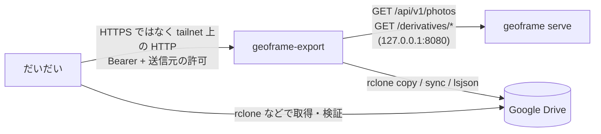

# note 記事用の写真書き出し 設計

- 状態: 計画（設計のみ。実装は未着手）
- 開始: 2026-11-20
- PRD: [prd.md](prd.md)

## 1. 概要

日付（または期間）と書き出し先の種類を受け取り、その期間の表示用 JPEG と `manifest.json` を Google Drive へ書き出す。写真サービス（`geoframe serve`、unit は `geoframe-rs`）とは**別のプロセス**（`geoframe-export`）にする。このプロセスは写真フィードと表示用 JPEG を HTTP で読み、rclone で Drive へ送る。だいだいは tailnet 経由で、トークン付きで呼ぶ。

写真サービスのコードと unit は変えない。

## 2. 今の作り（調査結果）

### 2.1 写真サービス

- 単一の crate `crates/geoframe`。入口は `src/main.rs:9-10` → `cli::run`。`serve` が `server::serve`（`src/server.rs:1056`）を起動し、ルーターは `src/server.rs:1007-1023`。
- 待ち受けの既定は **`0.0.0.0:8080`**（`src/config.rs:63-64`）。`--listen` か `GEOFRAME_HOST`/`GEOFRAME_PORT` で変えられる。本番の unit（`deploy/geoframe-rs.service`）は `--listen` を付けないので、8080 は LAN と tailnet の両方から届く。依頼文の前提「localhost のみ」とは異なる。
- **認証は無い**（`docs/architecture/photo-feed-contract.md:110`、`src/server.rs:671`）。守りは Host 検査（`src/server.rs:637-653`。IP リテラルは常に許可）と、POST の CSRF 検査（`src/post.rs:1-14`）だけ。外部への公開は Cloudflare Tunnel と Access を前提にしている（ADR 0008）。
- unit は `User=geoframe`、`ProtectHome=true`、`SystemCallFilter=@system-service`、`MemoryDenyWriteExecute=true` などで固めてある。バイナリは musl の静的ビルドで、**外部プロセスを一切起動しない**（`Command::new` は試験の `mkfifo` だけ。`src/cache.rs:856`）。
- 設定はファイルを持たず、環境変数と起動引数だけ（`src/config.rs:1-30`、`docs/reference/configuration.md`）。

### 2.2 写真フィード `GET /api/v1/photos`

- ハンドラは `src/server.rs:269-289`。**クエリを読まない**。絞り込み・ページングは無く、全件（2026-11-20 時点で 3,866 件）を返す。
- 対象は `lat IS NOT NULL AND display IS NOT NULL AND hidden=0`（`src/photos.rs:55-57`）に、品質（完全一致の重複の非推奨を除く）と AI の類似グループの表示条件を足したもの（`src/photos.rs:110` 付近）。並びは `taken_at` の昇順で、空は最後。
- 1 件の形は `src/feed.rs:47-104`。使うのは `id`、`file`（= `photos.display`）、`title`、`lat`/`lon`、`time`（= `taken_at`）、`elev`、`inferred`（`loc_source=='inferred'`）。
- `time` は **`YYYY-MM-DD HH:MM` のローカル時刻（オフセット無し）**。サービスは `TZ=Asia/Tokyo` を前提にしている。空は `""`。
- 寸法・明るさ・シャープネスはフィードに無い。品質解析の特徴量（`photo_quality_features.sharpness`/`luminance`、`src/schema.rs:85-100`）は DB にあるが、旧 manifest の値とは定義が違う（4.3）。
- 契約は `docs/architecture/photo-feed-contract.md` と `photo-feed.schema.json` に固定されていて、試験（`tests/photo_feed_contract.rs`）が照合する。miharashi が使う安定した契約。

### 2.3 表示用 JPEG

- `/derivatives/<name>` で静的に配信する（`src/webpath.rs:140,153`）。名前は Drive の ID から作る（`src/imaging/derivative.rs:83-90`）ので、**カタログの `id` からは作れない**。フィードの `file` を使う。
- 長辺 2560px、JPEG 品質 85、EXIF（GPS を含む）は落としてある（`src/imaging/derivative.rs:1-17`）。原本を返す API は無い。Drive の写真の原本は派生を作った直後に消している（`src/drive/fetch.rs:1-14`）。
- ローカル由来の写真では `display` が原本（EXIF 付き）を指すことがある（`docs/architecture/photo-feed-contract.md:85`）。2026-11-20 時点のフィードでは、`file` が `derivatives/` 以外の写真は 0 件。

### 2.4 期間で絞れる既存の API

- 管理用の `GET /api/admin/library/photos` は `from`/`to`（`YYYY-MM-DD HH:MM`、両端を含む）、`page`/`per`、`hidden=1` を持つ（`src/admin_library.rs:124-138`、`:231-241`）。応答に `elev` と寸法は無い（`:816-832`）。
- **フィードとの差**: 2025-06-10 は、ライブラリでは 322 枚、フィードでは 182 枚。差の 140 枚はすべて位置あり・非表示でなく、重複・類似グループで非推奨になった写真（Drive の写真、位置は `drive_meta` 136・`inferred` 4）。

### 2.5 既存の書き出し機能（旅行ブログ）

- `POST /api/blog/export`（`src/blog_write.rs`）は `DATA_DIR/blog_exports/<trip_id>/` に画像と manifest を書く。作業領域に作ってから `rename` で置き換え、失敗しても前の書き出しを残す。書き出せない写真は飛ばして `skipped` で理由を返す。書き出しはプロセスで 1 本だけ（実行中は 409）。
- 書く先はサービスの DATA_DIR の中だけで、Drive には送らない。今回の設計は、この「作業領域で作ってから置き換える」「飛ばした写真を理由付きで返す」「1 本だけ」を踏襲する。

### 2.6 このホストの小サービス

- `issue-api`（:8202）・`usage-api`（:8199）・`miharashi-bridge`（:8201）は、オーナーのユーザー単位の systemd で動く Python のサービス。tailnet の IP に bind し、**送信元 IP の許可リスト**で守る（トークンは無い）。
- `miharashi-daidai-inbox`（:8203）は miharashi リポジトリの Rust のバイナリ。system の unit で、`--listen` に tailnet の具体的な IP（`0.0.0.0` は起動時に拒否）、`--token-file`（実行ユーザーの 0600）、`--allow`（送信元 IP を並べる）を取る。**Bearer トークン＋送信元の許可リスト**。`ProtectSystem=strict`、`MemoryMax=64M` などで固めてある。
- 本設計はこの daidai-inbox の形に合わせる。

### 2.7 Drive と rclone

- rclone は v1.76.0。remote `gdrive:` の設定はオーナーのホームの `~/.config/rclone/rclone.conf`（0600）にある。`geoframe` ユーザーからは読めない。
- 既存の書き出し先（2026-11-20 に読み取りで確認）:
  - `gdrive:yamareco/` … `2026-11-03`、`2026-02-15-16`、`2026-03-07-08`、`2026-08-15-16` など。2 日分は `YYYY-MM-DD-DD` のフォルダに、日付ごとのサブフォルダ（`2026-02-15/`、`2026-02-16/`）と、まとめた `manifest.json` を置いている。
  - `gdrive:travel-journal/` … `2025-06-06`〜`2025-06-12` を 1 日 1 フォルダで置いている。
- rclone は「共用の client_id は 2026 年中に使えなくなる」と警告を出している（9 章のリスク）。

### 2.8 旧 manifest の形（互換の基準）

`gdrive:yamareco/2026-11-03/manifest.json` などから読み取った形:

```json
{
  "date": "2026-11-03",
  "source": "GEOFRAME /api/v1/photos",
  "count": 22,
  "catalog_count": 22,
  "notes": { "taken_at": "...", "mean_brightness": "...", "sharpness_laplacian_var": "...", "spot": "...", "gps_inferred": "..." },
  "photos": [
    {
      "id": 9756, "filename": "091100_9756.jpg", "title": "横瀬町 大字横瀬",
      "taken_at": "2026-11-03 09:11", "lat": 35.951, "lon": 139.097,
      "width": 2560, "height": 1707, "file_size": 1345682,
      "mean_brightness": 61.21, "sharpness_laplacian_var": 2902.29,
      "spot": "", "nearest_spot_distance_m": null,
      "gps_inferred": true, "elev": 1285.0
    }
  ]
}
```

- 期間のときは `date` が `"2026-02-15/2026-02-16"`、`filename` が `"2026-02-15/115000_9183.jpg"` で、`days`（日ごとの `count`・`first`・`last`・`ids`）が付く。
- ファイル名の秒は、フィードが分までしか持たないので常に `00`。
- 古い旅行記の manifest（2025-06）には `gps_inferred` と `elev` が無い。新しいものには必ず入れる。
- `mean_brightness` はグレースケール（縮小前）の 0〜255 の平均。`sharpness_laplacian_var` は、長辺 1024px 以下に縮小したグレースケールに 3×3 の 4 近傍ラプラシアン（オフセット 128、0〜255 に丸め）を掛けた応答の分散。どちらも PIL で計算していた。

## 3. 方針

### 3.1 置き場所の比較

| 案 | 利点 | 欠点 | 判定 |
|---|---|---|---|
| **A. 写真サービスに書き出しのエンドポイントを足す** | プロセスが増えない。DB を直接読めるので、寸法や品質の値も取れる | サービスは無認証で LAN と tailnet に開いている。ここに「Drive へ書く」操作を足すには、サービス全体に認証の仕組みを入れる必要がある。Drive に書ける rclone の資格情報を `geoframe` ユーザーに渡すことになり、`ProtectHome=true` の緩和と、初めての外部プロセスの起動（今の unit のハードニングを見直す）が要る。変更のたびに写真サービス（miharashi の表示元）を再起動する | **採らない**。既存サービスへの影響が大きい（止め条件に当たる） |
| A′. 写真サービスには読み取り専用の GET だけを足し、転送は外のプロセスで行う | DB の値（品質の特徴量、フィード外の写真）を使える | 無認証の API に新しい読み口を増やす。2 つのリポジトリ内の部品を同時に配る必要がある。今回の項目は、フィードと JPEG からすべて作れるので不要 | 今は採らない。対象を「その日の全写真」に広げると決めたときに見直す（5 章 U1） |
| **B. 独立した小さなサービス（`geoframe-export`）** | 写真サービスを変えない。このホストの既存の形（tailnet の IP に bind、Bearer＋送信元の許可リスト。daidai-inbox と同じ）に乗る。rclone の資格情報を写真サービスと分けたまま使える。だいだいが直接呼べる | プロセス・unit・トークンが 1 つずつ増える。フィードの契約に依存する（ただし文書と試験で固定された契約）。明るさ・シャープネスを自前で計算する | **推奨** |
| C. コマンドだけにして、呼び出しは T3 のまま | 一番簡単。ネットワークに新しい入口ができない | だいだいが直接呼べない（前提に合わない）。記事のたびに T3 を介す今の手間が残る | B の一部として持つ（R11。障害時の手動実行と試験用） |
| D. だいだいが 8080 から直接取る（Drive を使わない） | サーバー側の追加が要らない | 8080 は無認証で、tailnet から届くのは意図した契約ではない（ADR 0008 の公開経路は Cloudflare Access）。受け取り側は Drive を前提にしている | 採らない |

**推奨: B（コマンドの入口 C を同梱）。** 写真サービスとは HTTP（フィードと `/derivatives/`）だけでつながり、書き込みも資格情報も持ち込まない。

### 3.2 コードの置き場所

- このリポジトリのワークスペースに 2 つ目の crate `crates/geoframe-export` を足す。バイナリは `geoframe-export`。
- `geoframe` crate（ライブラリ）には依存しない。つながりは HTTP だけにして、写真サービスの内部の型の変更に引きずられないようにする。依存は、ワークスペースで既に使っている crate（`axum`/`tokio`、`ureq`、`serde`/`serde_json`、`zune-jpeg`、縮小用の crate）の同じ版に限る。
- 既存の 3 つの小サービスはリポジトリの外にあるが、これは GEOFRAME のデータの形（フィードの契約、派生画像）に依存するので、契約の試験と同じリポジトリに置く。

### 3.3 同期か非同期か

- 量: 1 回あたり 19〜182 枚（実績）。表示用 JPEG は 1 枚平均約 0.85MB（2025-06-10 の 40 枚の実測。合計 34MB）で、182 枚なら約 155MB。
- 転送時間は**実測していない**（このホストの上り帯域も未計測）。仮定として、上り 20Mbps なら約 1 分、5Mbps なら約 4 分。これに、Drive の 1 ファイルごとの API の往復（並列 4 で数十秒）と、明るさ・シャープネスの計算（182 枚で数十秒の見込み）が加わる。
- 仮定が外れても、数分かかる処理を 1 本の HTTP 要求で待たせるのは、呼び出し側のタイムアウトと切断に弱い。**非同期にする**（受付で `202` とジョブ ID を返し、ID で状態を引く）。確認（`dry_run`）だけは数秒で終わるので同期で返す。
- ジョブの状態はメモリに持つ（直近 20 件）。再起動で消えるが、書き出しは再実行すれば同じ結果になる（3.5）ので、永続化はしない。

### 3.4 認証と送信元の制限

- daidai-inbox と同じ形にする。
  - `--listen` は tailnet の具体的な IP とポート（`0.0.0.0`・`::` は起動時に拒否）。
  - `--token-file` のトークン（実行ユーザーの 0600）を `Authorization: Bearer` で照合（定数時間の比較）。無い・違うは 401。
  - `--allow` で送信元 IP を並べ、それ以外の接続は 403。
- トークンの値はログにも応答にも出さない。トークンの実パスと IP は公開リポジトリに書かず、配置時の unit（`/etc/systemd/system/` の側）に置く。

### 3.5 書き出し先と再実行

- 書き出し先は種類で指定する: `destination` は `yamareco` か `travel-journal`。Drive 上のパスは、サーバーの設定（種類ごとの固定の接頭辞。既定 `gdrive:yamareco` と `gdrive:travel-journal`）と、検査済みの日付から作ったフォルダ名だけで決める。呼び出し側の文字列は rclone の引数に入れない。
- フォルダ名:
  - 1 日: `YYYY-MM-DD`
  - 同じ月の期間: `YYYY-MM-DD-DD`（既存の `2026-02-15-16` と同じ）
  - 月や年をまたぐ期間: `YYYY-MM-DD_YYYY-MM-DD`（既存に例が無い。5 章 U3）
- 再実行（同じ宛先に既にフォルダがある）:
  - 既定（`on_exists: "error"`）: 書かずに状態 `conflict` で終わる。既存のファイル数を結果に入れる。
  - `on_exists: "replace"`: 新しい内容で置き換える（`rclone sync`。消えるファイルは Drive のゴミ箱に移る。rclone の Drive の既定）。
  - 追記（既存を残して足す）は持たない。ファイル名が `HHMMSS_<id>.jpg` で決まるので、同じ日をもう一度書けば同じ名前になり、追記と置き換えの違いは「消えた写真が残るかどうか」だけになる。残すと manifest と実ファイルが合わなくなり、受け取り側の検証が落ちる。

## 4. 構成



### 4.1 ジョブの流れ

1. 要求を検査する（6.1）。実行中のジョブがあれば 409。
2. フィードを取る（`http://127.0.0.1:8080/api/v1/photos`。基底 URL は設定。タイムアウト 30 秒、応答の上限 32MB）。
3. `time` の先頭 10 文字が期間内の日付である写真を選ぶ。`time` が空の写真は数だけ数える（その写真の日付は分からないので、対象の日のものかどうかも分からない）。
4. 0 枚なら、状態 `succeeded`、`count: 0`、`uploaded: false` で終える。Drive には触れない。
5. 宛先の有無を `rclone lsjson --max-depth 1 <宛先>` で見る。あって `on_exists` が `error` なら `conflict` で終える。
6. 作業領域（`StateDirectory` の下の `staging/<job_id>/`、0700）に、写真を 1 枚ずつ取る。`file` が `derivatives/` で始まり、名前が `[A-Za-z0-9._-]` だけのものに限る（それ以外は `skipped: not_derivative`。EXIF 付きの原本を外へ出さない）。1 枚の上限は 30MB。取得に失敗した写真は `skipped: fetch_failed`。
7. 取ったバイト列を**そのまま**書く（再エンコードしない。`file_size` が配信のものと一致する）。デコードして寸法・明るさ・シャープネスを計算する（4.3）。デコードできなければ `skipped: decode_failed`。
8. `manifest.json` を作業領域に書く。
9. 写真を先に送り（`rclone copy` か `sync`。manifest を除外）、成功したら manifest を送る。manifest があれば写真はそろっている、という順序にする。
10. `rclone lsjson -R <宛先>` で、manifest の各ファイルのサイズと突き合わせる（受け取り側と同じ検証）。合わなければ `failed`（`verify_mismatch`）。
11. 作業領域を消す。成功・失敗にかかわらず消す（起動時にも残骸を消す）。

### 4.2 rclone の呼び方

- 実行ファイルのパスと設定ファイルのパスは起動引数で固定（`--rclone`、`--rclone-config`）。シェルを介さず、引数の配列で渡す。
- 子プロセスにはタイムアウトを掛ける（既定 15 分。`try_wait` の繰り返しで見て、過ぎたら kill）。標準エラーはジョブの結果に最後の数行だけ残す（トークンを含まない）。
- 主なオプション: `--transfers 4`、`--checkers 8`、`--retries 3`、`--low-level-retries 10`。`--drive-use-trash` は既定（真）のまま。

### 4.3 明るさとシャープネス

旧 manifest と同じ定義を Rust で実装する。

- `mean_brightness`: 縮小前の画像をグレースケール（ITU-R 601 の `L = (299R + 587G + 114B) / 1000`、PIL の `convert("L")` と同じ）にした値の平均。小数 2 桁。
- `sharpness_laplacian_var`: 長辺 1024px 以下に縮小（PIL の `thumbnail` 相当。縦横比を保つ）したグレースケールに、カーネル `[0,1,0; 1,-4,1; 0,1,0]`・オフセット 128 を掛け、0〜255 に丸めた応答の分散。小数 2 桁。縁の扱いは PIL の `ImageFilter.Kernel` に合わせる（縁の 1 画素は元の値を写す）。
- 縮小の方式が PIL と完全には一致しないため、シャープネスは小数点以下〜数 % ずれることがある（5 章 U2）。実装時に、旧 manifest の 2〜3 日分と突き合わせてずれの大きさを測り、記録する。
- `photo_quality_features` の値は使わない（品質解析が済んでいない写真では空で、定義も違う）。

## 5. ユーザーに決めてもらうこと

| 番号 | 何を決めるか | 推奨 | 推奨どおりなら変わること | 変わらないこと |
|---|---|---|---|---|
| U1 | 対象の写真の範囲 | **フィードに載る写真**（今の手作業と同じ） | 何も変わらない（今と同じ 182 枚の日は 182 枚） | 重複・類似で非推奨の写真は出ない（2025-06-10 なら 140 枚が出ない） |
| U1′ | 〃（別案） | その日の全写真（非表示を除く） | 枚数が増える（2025-06-10 は 322 枚）。写真サービスに読み取り専用の API を足す必要がある（3.1 の A′）。標高の取り方も変わる | 書き出しの手順・認証・Drive の置き場所 |
| U2 | 明るさ・シャープネスの値のずれ | **許す**（定義は同じ。縮小の差で小数点以下〜数 % ずれうる） | 新しい書き出しの値は旧 manifest と厳密には一致しない。`notes` に計算方法と生成元を書く | キーと単位、受け取り側のサイズの検証 |
| U3 | 月・年をまたぐ期間のフォルダ名 | `YYYY-MM-DD_YYYY-MM-DD` | 例: `2026-04-30_2026-05-02` | 1 日と同じ月の期間の名前（既存と同じ） |
| U4 | 実行ユーザーと rclone の設定 | **専用のユーザー**（`geoframe-export`）と、専用の rclone の設定（できれば自分の client_id） | 配置の手間が増える（ユーザー作成、rclone の認可を 1 回）。オーナーのホームを読める権限をサービスに渡さずに済む。共用 client_id の廃止にも同時に備えられる | Drive 上の置き場所と、受け取り側の手順 |
| U4′ | 〃（別案） | オーナーのユーザーで、既存の `~/.config/rclone/rclone.conf` を使う | 配置が簡単（daidai-inbox と同じ `User=`）。ただしサービスがオーナーのホームを読める（`ProtectHome=read-only`）。rclone のトークンの更新のため設定ファイルへの書き込みも要る | 同上 |
| U5 | 0 枚のときに Drive に空のフォルダや manifest を置くか | **置かない**（結果の `count: 0` だけ） | 受け取り側は Drive ではなく API の結果で 0 枚を知る | 0 枚がエラーにならないこと |

## 6. インターフェース

### 6.1 HTTP

すべて `Authorization: Bearer <token>` が要る（`/healthz` を除く）。本文は JSON（`Content-Type: application/json`、上限 4KiB、未知のキーは 400）。

**`POST /v1/exports`** … 書き出しを受け付ける。

```json
{ "from": "2026-02-15", "to": "2026-02-16", "destination": "yamareco", "on_exists": "error", "dry_run": false }
```

- `from`（必須）: `YYYY-MM-DD`。実在する日付。
- `to`（省略可）: 省略すると `from` と同じ。`from` 以上。期間は 14 日以下。
- `destination`（必須）: `yamareco` | `travel-journal`。
- `on_exists`（省略可）: `error`（既定）| `replace`。
- `dry_run`（省略可）: 真なら書かずに、対象の枚数・フォルダ名・既存フォルダの有無を `200` で返す。

応答:

- `202 {"job_id": "...", "status": "running"}`
- `200`（`dry_run`）`{"folder": "2026-02-15-16", "destination": "yamareco", "count": 51, "days": {...}, "exists": false, "existing_files": 0, "undated_in_feed": 6}`
- `400`（検査の失敗。`{"error": "invalid_date"}` など）、`401`、`403`、`409`（実行中）、`503`（フィードが取れない。`dry_run` のとき）

**`GET /v1/exports/{job_id}`** … 状態と結果。

```json
{
  "job_id": "...",
  "status": "succeeded",
  "request": { "from": "2026-02-15", "to": "2026-02-16", "destination": "yamareco", "on_exists": "error" },
  "started_at": "2026-11-20T19:30:00+09:00",
  "finished_at": "2026-11-20T19:32:10+09:00",
  "result": {
    "folder": "2026-02-15-16",
    "count": 51,
    "catalog_count": 51,
    "uploaded": true,
    "bytes": 43210000,
    "skipped": [ { "id": 1234, "reason": "fetch_failed" } ],
    "undated_in_feed": 6,
    "existing_files": 0
  },
  "error": null
}
```

- `status`: `running` | `succeeded` | `conflict` | `failed`。
- `error`: 失敗のとき `{"code": "feed_unavailable" | "rclone_failed" | "rclone_timeout" | "verify_mismatch" | "internal", "message": "..."}`。
- 0 枚の日は `status: "succeeded"`、`count: 0`、`uploaded: false`。
- 無い ID は 404。

**`GET /v1/exports`** … 直近のジョブの一覧（`job_id`・`status`・`request`・時刻だけ）。

**`GET /healthz`** … 認証なしで `200 ok`（送信元の制限は掛ける）。

### 6.2 コマンド

```
geoframe-export run --from 2026-11-03 [--to ...] --destination yamareco [--on-exists replace] [--dry-run] [設定の引数]
geoframe-export serve --listen <ip:port> --token-file <path> --allow <ip> [--allow <ip> ...] [設定の引数]
```

- 設定の引数: `--feed-base`（既定 `http://127.0.0.1:8080`）、`--rclone`、`--rclone-config`、`--remote-yamareco`（既定 `gdrive:yamareco`）、`--remote-travel-journal`（既定 `gdrive:travel-journal`）、`--state-dir`、`--rclone-timeout`。
- `run` は結果を `GET /v1/exports/{job_id}` の `result` と同じ JSON で標準出力に出す。終了コードは 0（成功・0 枚）、3（conflict）、1（失敗）、2（引数の誤り）。
- 引数の解釈は、`geoframe` crate と同じく手書き（`crates/geoframe/src/cli.rs:1-2` の方針。依存を増やさない）。

### 6.3 manifest.json

2.8 の形に合わせる。キーは旧 manifest のものをすべて出し、次を足す。

- 最上位: `generator`（`"geoframe-export <版>"`）、`destination`、`folder`、`skipped`（理由付き）、`undated_in_feed`。
- `source` は `"GEOFRAME /api/v1/photos"` のまま。
- `notes`: 時刻（分まで・秒は 00・ローカル時刻のまま補正しない）、明るさ・シャープネスの計算方法（4.3）、`gps_inferred` の意味、`spot` が空である理由を書く。
- `spot` は `""`、`nearest_spot_distance_m` は `null`。
- `lat`/`lon`/`elev` はフィードの値をそのまま（丸めない）。
- 期間のときは日付ごとのサブフォルダに写真を置き、`filename` に日付を含め、`days` を付ける（2.8）。

## 7. データ

- 永続データは持たない。作業領域（`StateDirectory=geoframe-export` の下の `staging/`）だけを使い、ジョブの終わりと起動時に消す。
- ジョブの記録はメモリ（直近 20 件）と journal のログ（ジョブ ID、期間、宛先、枚数、所要時間、結果。トークンや Drive の資格情報は出さない）。
- 写真サービスの DB・データ置き場には触れない（HTTP で読むだけ）。

## 8. 安全面

| 項目 | 対策 |
|---|---|
| 入口 | tailnet の具体的な IP にだけ bind。送信元の許可リスト（だいだいの IP と、このホスト自身）。Bearer トークン（0600 のファイル、定数時間の比較） |
| 入力 | 本文の上限 4KiB、未知のキーは拒否。日付は `YYYY-MM-DD` の実在する日だけ、期間は 14 日以下。`destination`・`on_exists` は列挙値 |
| Drive のパス | 種類ごとの固定の接頭辞（設定）＋検査済みの日付から作った名前だけ。呼び出し側の文字列は rclone に渡さない。rclone はシェルを介さず引数の配列で起動 |
| 写真サービスから読むもの | 基底 URL は設定で固定（`127.0.0.1:8080`）。`file` は `derivatives/` で始まり、`[A-Za-z0-9._-]` の名前だけ（`..` や `/` を含むものは拒否）。応答・画像のサイズに上限 |
| 外へ出すもの | 表示用 JPEG（EXIF 無し）と manifest（正確な緯度経度を含む）。行き先はオーナーの Drive だけ。原本と EXIF 付きのローカル原本は出さない |
| 資格情報 | rclone の設定は実行ユーザーの 0600。写真サービスの Drive の鍵（読み取り用）とは分ける。U4 の推奨は専用ユーザー＋専用の設定 |
| 同時実行 | 書き出しはプロセスで 1 本（実行中は 409）。作業領域はジョブごとに分ける |
| 子プロセス | rclone にタイムアウト（既定 15 分）。標準エラーは最後の数行だけを結果に残す |
| unit のハードニング | daidai-inbox と同じ（`NoNewPrivileges`、`ProtectSystem=strict`、`PrivateTmp`、`MemoryMax`、`TasksMax` など）。書けるのは `StateDirectory` と、rclone のトークンの更新に要る設定ファイルだけ。`MemoryDenyWriteExecute` などを rclone（Go）と組み合わせて動くかは、検証環境で確かめてから付ける |
| ログ | トークン、`Authorization` ヘッダ、rclone の設定の中身は出さない |
| 既存の公開面 | 8080 が無認証で LAN と tailnet から届くのは既存の状態で、本設計は変えない（広げもしない）。別の課題として扱う |

## 9. リスクと対策

| リスク | 対策 |
|---|---|
| rclone の共用 client_id が 2026 年中に止まる（rclone 自身の警告） | 配置の前に、自分の client_id で rclone を認可し直す（U4 の専用の設定で同時に行う）。止まると今の手作業も同じく止まる |
| フィードの契約が変わる | 契約は `docs/architecture/photo-feed-contract.md` と試験で固定されている。`geoframe-export` の試験に、契約の例（`docs/architecture/` の JSON Schema の例）を使う |
| 明るさ・シャープネスが旧 manifest とずれる | 定義を合わせ、実装時に実データで差を測って記録する（U2） |
| 転送が遅い・途中で切れる | 非同期・タイムアウト・rclone の再試行。manifest を最後に送るので、途中で止まっても「manifest があるのに写真が欠ける」状態にならない。再実行は `replace` で |
| 再起動でジョブの状態が消える | 再実行すれば同じ結果になる。呼び出し側は 404 を見たら `dry_run` で宛先の有無を確かめてから再実行する |
| フィード全件を毎回取る（3,866 件、数 MB） | 1 回の書き出しに 1 回だけ。写真サービスの負荷は管理画面の一覧と同程度 |

## 10. テスト計画

| AC | 確かめ方 |
|---|---|
| AC1 | 偽のフィード（固定の JSON と JPEG を返す試験用の HTTP サーバー）で、日付の境界（00:00・23:59）、期間の両端、空の `time` を含めて選ばれる写真を確かめる。不正な日付・逆順・15 日以上は 400 |
| AC2 | rclone の代わりに引数を記録する試験用のスクリプトを `--rclone` に渡し、宛先が固定の接頭辞＋フォルダ名だけであることを確かめる。不正な `destination` は 400 |
| AC3 | フィードに無い写真（偽のフィードに入れない）・`time` が空の写真が出ないこと。`undated_in_feed` の数 |
| AC4 | manifest のキーが旧 manifest（2.8 の例を試験の fixture にする）のキーをすべて含むこと。`file_size` が配信したバイト数と一致すること。`gps_inferred` が `inferred` と一致すること |
| AC5 | 0 枚の日で `succeeded`・`count: 0`・rclone が呼ばれないこと |
| AC6 | 偽の rclone の `lsjson` が既存ファイルを返すとき、既定は `conflict` で `copy`/`sync` を呼ばない。`replace` では `sync` を呼ぶ |
| AC7 | トークン無し・違うトークンで 401。許可外の送信元で 403（試験では許可リストを空にするなどで作る）。ログにトークンが出ないこと |
| AC8 | 実行中（偽の rclone を待たせる）に 2 件目で 409 |
| AC9 | `202` → `running` → `succeeded` の遷移。失敗する偽の rclone で `failed`/`rclone_failed`、待たせ続けて `rclone_timeout` |
| AC10 | `dry_run` で rclone の `copy`/`sync` が呼ばれず、`lsjson` だけが呼ばれること |
| AC11 | `run` コマンドで同じ fixture から同じ manifest が出ること。終了コード |
| 4.3 | 小さな試験画像で、明るさ・シャープネスを PIL で計算した期待値と比べる（期待値は fixture として固定。試験時に Python は使わない）。配置前に、本番の 2〜3 日分で旧 manifest と比べた差を記録する |
| 配置後 | 本番で、旧 manifest がある日（例: 2026-11-03）を `dry_run` → 別の検証用の接頭辞に書き出し、旧 manifest と枚数・ファイル名・サイズを比べる |

試験は `cargo test -p geoframe-export`。外部のネットワークと本物の Drive は使わない。

## 11. 実装の順番

PR は 2 本に分ける（どちらも単独でマージ・差し戻しできる）。

1. **PR ①: 書き出しの中身とコマンド（R1〜R6、R10、R11）**
   1. crate の骨組み、引数の解釈、設定。
   2. フィードの取得と日付の選び方、フォルダ名の決め方。
   3. 画像の取得、寸法・明るさ・シャープネスの計算、manifest の生成。
   4. rclone の呼び出し（タイムアウト、`lsjson`/`copy`/`sync`、送る順序、送った後の突き合わせ）。
   5. `run` コマンドと試験。
2. **PR ②: HTTP の入口と配置（R7〜R9）**
   1. `serve`: bind の検査、トークン、送信元の許可、本文の検査。
   2. ジョブ（1 本だけ、状態、直近 20 件）と API。
   3. unit の雛形（`deploy/geoframe-export.service`。IP とトークンのパスは書かない）、`deploy/README.md` の手順、musl の静的ビルドへの追加。
   4. 配置（U4 に従ってユーザーと rclone の設定を用意）→ 本番の検証（10 章の「配置後」）。
3. だいだい側の呼び出しの変更は、だいだいのリポジトリで別に行う。
