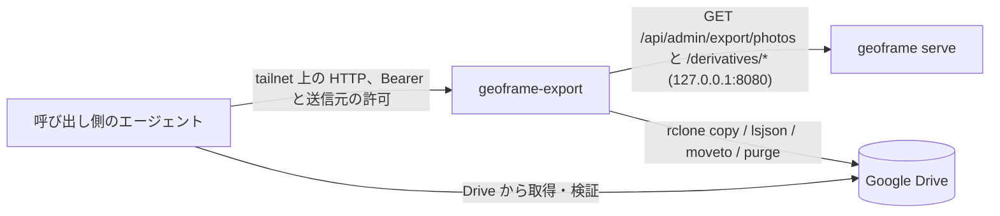

# note 記事用の写真書き出し 設計

- 状態: 実装済み（配置は未実施。配置の手順は [deploy/README.md §8](../../deploy/README.md)）。判断 U1〜U7 は 2026-11-22 に反映済み、U8 は判断待ち（5 章）
- 開始: 2026-11-20
- PRD: [prd.md](prd.md)

## 1. 概要

日付（または期間）と書き出し先の種類を受け取り、その期間に撮った全写真（非表示を除く）の表示用 JPEG と `manifest.json` を Google Drive へ書き出す。写真サービス（`geoframe serve`）とは**別のプロセス**（`geoframe-export`）にする。このプロセスは、写真サービスに足す読み取り専用の一覧 API（`GET /api/admin/export/photos`、6.4）と表示用 JPEG を HTTP で読み、rclone で Drive へ送る。呼び出し側のエージェント（別 VM）は tailnet 経由で、トークン付きで呼ぶ。

写真サービスに足すのは、その読み取り専用の API 1 つだけにする。unit と既存の API の動作は変えない。Drive は今の書き出し先（`yamareco/`・`travel-journal/`）へ、今と同じ権限（Drive 全体）で書く。

## 2. 今の作り（調査結果）

### 2.1 写真サービス

- 単一の crate `crates/geoframe`。入口は `src/main.rs:9-10` → `cli::run`。`serve` が `server::serve`（`src/server.rs:1056`）を起動し、ルーターは `src/server.rs:1007-1023`。
- 待ち受けのコード上の既定は `0.0.0.0:8080`（`src/config.rs:63-64`）。`--listen` か `GEOFRAME_HOST`/`GEOFRAME_PORT` で変えられる。unit（`deploy/geoframe-rs.service`）は `--listen` を付けず、環境ファイル（`deploy/geoframe-rs.service:34` 付近）の値に従う。
- **認証は無い**（`docs/architecture/photo-feed-contract.md:110`、`src/server.rs:671`）。守りは Host 検査（`src/server.rs:637-653`。IP リテラルは常に許可）と、POST の CSRF 検査（`src/post.rs:1-14`）だけ。外部への公開は Cloudflare Tunnel と Access を前提にしている（ADR 0008）。
- unit は `User=geoframe`、`ProtectHome=true`、`SystemCallFilter=@system-service`、`MemoryDenyWriteExecute=true` などで固めてある。バイナリは musl の静的ビルドで、本番の経路では**外部プロセスを起動しない**（`Command::new` は試験用の呼び出しだけ。例: `src/cache.rs:856`）。
- 設定はファイルを持たず、環境変数と起動引数だけ（`src/config.rs:1-30`、`docs/reference/configuration.md`）。

### 2.2 写真フィード `GET /api/v1/photos`

- ハンドラは `src/server.rs:269-289`。**クエリを読まない**。絞り込み・ページングは無く、全件（数千件）を返す。
- 対象の条件（`src/photos.rs:52-111`）は次のとおり。
  - `p.lat IS NOT NULL AND p.display IS NOT NULL AND COALESCE(p.hidden,0)=0`（`FEED_BASE_WHERE`）。さらに行の変換で `lon` が NULL の行も落とす（`src/photos.rs:166` 付近）。
  - 品質: 完全一致の重複グループで非推奨の写真を出さない（`QUALITY_VISIBLE`。人の代表の記録があればそれを優先）。
  - AI の類似グループ: 非推奨の写真を出さない。ただし、お気に入り・人の代表・表示できる推薦写真が無いグループなどの例外がある（`src/selection.rs:69` 付近）。
  - 並びは `taken_at` の昇順で、空は最後。
- 初稿では、書き出しはこのフィードの応答をそのまま採用する（品質・AI の選別を作り直さない）としていた。U1 で全写真に決めたので、選別はそもそも掛けない（下の最後の項目）。
- 1 件の形は `src/feed.rs:47-104`。使うのは `id`、`file`（= `photos.display`）、`title`、`lat`/`lon`、`time`（= `taken_at`）、`elev`、`inferred`（`loc_source=='inferred'`）。
- `time` は `YYYY-MM-DD HH:MM` のローカル時刻（オフセット無し）か、空文字（`src/feed.rs:64`）。サービスは `TZ=Asia/Tokyo` を前提にしている。取り込み時の正規化（`src/imaging/exif.rs:504` の `norm_time`）は暦や時刻の範囲までは検査しないので、書き出し側で検査する（4.4）。
- `elev` と `inferred` は応答に出ているが、JSON Schema（`docs/architecture/photo-feed.schema.json`）の必須項目ではない。
- U1 で対象を「その日の全写真」にしたので、書き出しはこのフィードを使わない（位置の無い写真と、重複・類似で非推奨の写真がフィードに載らないため）。写真の 1 件の形（`title` の作り方など）は、新しい一覧 API（6.4）でもフィードと同じ関数で作る。
- 寸法・明るさ・シャープネスはフィードに無い。品質解析の特徴量（`photo_quality_features.sharpness`/`luminance`、`src/schema.rs:85-100`）は DB にあるが、旧 manifest の値とは定義が違い、解析前の写真では空（4.3）。

### 2.3 表示用 JPEG

- `/derivatives/<name>` で静的に配信する（`src/webpath.rs:140,153`）。名前は Drive の ID から作る（`<drive_id>.jpg`、回転したものは `<drive_id>.r<角度>.jpg`。`src/imaging/derivative.rs:78-90`）ので、**カタログの `id` からは作れない**。一覧 API（6.4）の `file`（= `photos.display`）を使う。
- 長辺 2560px、JPEG 品質 85、EXIF（GPS を含む）は落としてある（`src/imaging/derivative.rs:1-17`）。原本を返す API は無い。Drive の写真の原本は派生を作った直後に消している（`src/drive/fetch.rs:1-14`）。
- ローカル由来の写真では `display` が原本（EXIF 付き）を指すことがある（`docs/architecture/photo-feed-contract.md:85`）。

### 2.4 期間で絞れる既存の API

- 管理用の `GET /api/admin/library/photos` は `from`/`to`（`YYYY-MM-DD HH:MM`、両端を含む）、`page`/`per`、`hidden=1` を持つ（`src/admin_library.rs:124-138`、`:231-241`）。応答に表示用 JPEG のパス（`display`）、`elev`、寸法は無い（`:816-832`）。そのため、全写真の書き出しにはそのまま使えない（3.1 の A′、6.4）。
- **フィードとの差**: 写真の多いある旅行の 1 日では、ライブラリの 322 枚に対し、フィードは 182 枚だった。差の 140 枚は、すべて位置があり非表示でもない写真で、重複・類似グループで非推奨になったものだった。

### 2.5 既存の書き出し機能（旅行ブログ）

- `POST /api/blog/export`（`src/blog_write.rs`）は `DATA_DIR/blog_exports/<trip_id>/` に画像と manifest を書く。作業領域に作ってから、旧フォルダを `.previous` へ退避して置き換え、失敗したら元に戻す（`src/blog_write.rs:801` 付近）。書き出せない写真は飛ばし、`skipped` で理由を返す。書き出しはプロセスで 1 本だけで、実行中は 409。
- 書く先はサービスの DATA_DIR の中だけで、Drive には送らない。今回の設計はこの 3 つの考え方を Drive の上で踏襲する（4.2）。
  - 作業領域に一式を作ってから公開する。
  - 置き換えるときは旧フォルダを退避し、失敗したら戻す。
  - 書き出しは 1 本だけにする。
- この旅行ブログの機能（`GEOFRAME_BLOG`、既定で無効）は、今回の書き出しで作りたかったものの前身である。書き出しが完成したら削除する（2026-11-22 のユーザーの指示。別の作業）。削除のあとは、この節の行番号の参照は切れる。考え方は上の 3 点で残る。

### 2.6 このホストの小サービスの形

同じホストの `miharashi-daidai-inbox`（miharashi リポジトリの Rust のバイナリ）と同じ形にする。

- system の unit で動く。
- `--listen` に tailnet の具体的な IP を取る（`0.0.0.0` は起動時に拒否する）。
- `--token-file`（実行ユーザーの 0600）の Bearer トークンと、`--allow`（送信元 IP の許可リスト）の両方で守る。
- `ProtectSystem=strict` などで固めてある。

### 2.7 Drive と rclone

- rclone の remote `gdrive:` はオーナーのホームの設定ファイル（0600）にある。`scope` を指定していないので、Drive 全体を読み書きできる権限になっている。`geoframe` ユーザーからは読めない。
- 既存の書き出し先の形（読み取りで確認）は次のとおり。
  - `gdrive:yamareco/` … 1 日は `YYYY-MM-DD`。2 日分は `YYYY-MM-DD-DD` のフォルダに、日付ごとのサブフォルダと、まとめた `manifest.json` を置いている。
  - `gdrive:travel-journal/` … 1 日 1 フォルダ（`YYYY-MM-DD`）。
- 既存のフォルダには手作業で作ったものがある（manifest に `generator` が無い）。また `yamareco/` の 2 日分のフォルダは、日付ごとのサブフォルダを持つ。
- rclone は「共用の client_id は 2026 年中に使えなくなる」と警告を出している（9 章）。U4 で権限を変えないと決めたが、この対応（専用の client_id の用意）は要る。

### 2.8 旧 manifest の形（互換の基準）

既存の manifest から読み取った形は次のとおり（値は架空のもの）。

```json
{
  "date": "2026-01-10",
  "source": "GEOFRAME /api/v1/photos",
  "count": 2,
  "catalog_count": 2,
  "notes": { "taken_at": "...", "mean_brightness": "...", "sharpness_laplacian_var": "...", "spot": "...", "gps_inferred": "..." },
  "photos": [
    {
      "id": 101, "filename": "091100_101.jpg", "title": "富士山",
      "taken_at": "2026-01-10 09:11", "lat": 35.3606, "lon": 138.7274,
      "width": 2560, "height": 1707, "file_size": 1345682,
      "mean_brightness": 61.21, "sharpness_laplacian_var": 2902.29,
      "spot": "", "nearest_spot_distance_m": null,
      "gps_inferred": true, "elev": 3776.0
    }
  ]
}
```

- 期間のときは `date` が `"2026-01-10/2026-01-11"`、`filename` が `"2026-01-10/091100_101.jpg"` になり、`days`（日ごとの `count`・`first`・`last`・`ids`）が付く。
- ファイル名の秒は、カタログの撮影時刻が分までしか持たないので常に `00`。
- 古い旅行記の manifest には `gps_inferred` と `elev` が無いものがある。新しいものには必ず入れる。
- `spot` と `nearest_spot_distance_m`: 山行の manifest では空欄（`""` と `null`）。旅行記の manifest には、名所の一覧から求めた名前と距離（300m 以内の最寄り）が入っていたものがある。その名所の一覧はこの環境では見つかっていない（U8）。
- `mean_brightness` はグレースケール（縮小前）の 0〜255 の平均。`sharpness_laplacian_var` は、長辺 1024px 以下に縮小したグレースケールに 3×3 の 4 近傍ラプラシアン（オフセット 128、0〜255 に丸め）を掛けた応答の分散。どちらも PIL で計算していた。計算に使ったスクリプトと Pillow の版は見つかっていない（4.3）。

### 2.9 全写真にしたときの負荷（2026-11-22 の見積もり）

U1 は「処理が重くならないのであれば全写真」という条件付きの判断だったので、本番のカタログ（その日のバックアップを手元に写したもの）を読み取りだけで数え、表示用 JPEG を同じホストで計算に掛けて測った。実際の撮影日はここに書かない。

| 項目 | 値 | 根拠 |
|---|---|---|
| カタログの件数 | 6,742 件（非表示 1、日時なし 33、位置なし 84） | `photos` の数え上げ |
| 表示用 JPEG の無い写真 | **0 件**（`display` が NULL の行も、`derivatives/` 以外を指す行も無い。ファイルも全件ある） | `display` の数え上げと、`derivatives/` のファイル一覧との突き合わせ |
| 1 日の最多 | **322 枚**（約 260MB、1 枚平均 0.81MB） | 日ごとの件数。非表示を除く |
| 1 日の件数の分布 | 写真のある 541 日のうち、50 枚以下が 498 日、51〜100 枚が 33 日、101〜200 枚が 9 日、201 枚以上が 1 日 | 同上 |
| 14 日（期間の上限）の最多 | **714 枚**（約 580MB と見込む） | 14 日の窓の合計の最大 |
| 明るさ・シャープネスの計算 | 最多の日の 322 枚で **6.6 秒**（1 枚約 20ms。うちデコード 2.6 秒） | Python と Pillow 11.1、1 スレッドで測った（Rust の実装の実測ではない）。CPU は 16 スレッドで、計測時の負荷は 1 未満 |
| 表示用 JPEG の作り直し | **不要**（作り直す写真が 0 件） | 上の数え上げ。もし要ると、原本は派生を作った直後に消している（2.3）ので書き出し側からは作れず、Drive から原本を取り直して HEIC を復号することになる。HEIC は 1 枚約 0.9 秒（検証環境 2 コアの実測、`docs/rust-migration/image-poc.md`）で、322 枚なら約 5 分。この経路は採らない（4.1） |
| 写真サービスの負荷 | 今の全件フィード（数千件）より軽い | 新しい一覧 API（6.4）は撮影時刻の索引（`idx_photos_time`）で期間だけを引く。表示用 JPEG は静的配信 |
| Drive への転送 | 最多の日で、上り 20Mbps なら約 2 分、5Mbps なら約 7 分。14 日の最多で、20Mbps なら約 4 分、5Mbps なら約 16 分 | **上り帯域は実測していない**（仮定）。配置の前に測る（10 章） |

**結論: 重くない。** CPU の計算は最多の日でも 10 秒以下で、表示用 JPEG の作り直しは起きない。所要時間はほぼ Drive への転送だけで決まり、ほとんどの日（50 枚以下、約 40MB 以下）は帯域が細くても 1 分ほどで終わる。数十分の処理が常態化する形ではない。14 日の最多を細い帯域で送るときだけ 15 分を超えうるので、rclone の転送の期限とジョブ全体の期限をこれに合わせて決める（4.1、4.2）。

## 3. 方針

### 3.1 置き場所の比較

| 案 | 利点 | 欠点 | 判定 |
|---|---|---|---|
| **A. 写真サービスに書き出しのエンドポイントを足す** | プロセスが増えない。DB を直接読めるので、寸法や品質の値も取れる | サービスは無認証。「Drive へ書く」操作を足すには、サービス全体に認証の仕組みを入れる必要がある。Drive に書ける資格情報を `geoframe` ユーザーに渡すことになる。`ProtectHome=true` を緩め、初めて外部プロセスを起動するので、今の unit のハードニングを見直すことになる。変更のたびに写真サービス（miharashi の表示元）を再起動する | **採らない**。既存サービスへの影響が大きい（止め条件に当たる） |
| **A′. 写真サービスには読み取り専用の GET だけを足し、転送は外のプロセス（B）で行う** | フィードに載らない写真（位置なし、重複・類似で非推奨）も、期間で絞って取れる。書き込みも資格情報も写真サービスに持ち込まない | 無認証のサービスに読み口を 1 つ増やす（既存の管理 API と同じ区域・同じ守り。8 章）。写真サービスと書き出しの 2 つの部品を、順に配る必要がある | **採る**（U1 で全写真に決めたため。2026-11-22） |
| **B. 独立した小さなサービス（Rust、`crates/geoframe-export`）** | 写真サービスに書き込みも資格情報も足さない。このホストの既存の形（2.6）に乗る。資格情報を写真サービスと分けられる。呼び出し側が直接呼べる。静的ビルド・配布の手順を写真サービスと共有できる | プロセス・unit・トークン・実行ユーザーが 1 つずつ増える。A′ の API の形に依存する（同じリポジトリで試験して固定する）。明るさ・シャープネスを Rust で作り直すので、旧 manifest の値と少しずれうる | **採る**（A′ と組み合わせる） |
| B′. 独立した小さなサービス（Python と Pillow） | 旧 manifest と同じ Pillow で計算でき、値を合わせやすい | Rust に移したリポジトリに Python の実行環境を戻す。Pillow の版に依存し、システムの Pillow の版では試験の一部が落ちる既知の問題がある | 採らない（U2 で Rust に決めたため） |
| C. コマンドだけにして、呼び出しは T3 のまま | 一番簡単。ネットワークに新しい入口ができない | 呼び出し側が直接呼べない（前提に合わない）。記事のたびに T3 を介す今の手間が残る | B の一部として持つ（R11。障害時の手動実行） |
| D. 呼び出し側が写真サービスから直接取る（Drive を使わない） | サーバー側の追加が要らない | 写真サービスは無認証で、tailnet からの読み取りを契約として想定していない（公開経路は Cloudflare Access）。受け取り側は Drive を前提にしている | 採らない |

**採る構成: A′ ＋ B（コマンドの入口 C を同梱）。** 写真サービスには読み取り専用の一覧 API（6.4）だけを足す。書き出しのプロセスとは HTTP（その一覧 API と `/derivatives/`）だけでつながり、写真サービスに書き込みも資格情報も持ち込まない。

### 3.2 コードの置き場所

- このリポジトリのワークスペースに 2 つ目の crate `crates/geoframe-export` を足す。バイナリは `geoframe-export`。
- `geoframe` crate（ライブラリ）には依存しない。つながりは HTTP だけにして、写真サービスの内部の型の変更に引きずられないようにする。依存はワークスペースで既に使っている crate（`axum`/`tokio`、`ureq`、`serde`/`serde_json`、`zune-jpeg`、縮小用の crate）の同じ版に限る。
- 既存の `geoframe` crate の 2 つ目のバイナリにする案もあるが、写真サービスの依存（SQLite など）を引き込み、ビルドと配布の単位が分けにくくなるので、crate を分ける。
- 他の小サービスはリポジトリの外にあるものもある。これは GEOFRAME のデータの形（一覧 API の形、派生画像）に依存するので、その試験と同じリポジトリに置く。
- 写真サービス側の一覧 API（A′）は `crates/geoframe` に新しいモジュール（例: `src/admin_export.rs`）として足す。書き出し側は、この API の応答の型を自分の crate に持ち、写真サービス側の試験で出した応答の例（fixture）を両方の試験で使って形を固定する。

### 3.3 同期か非同期か

- 量: 全写真にすると、1 日で最多 322 枚（約 260MB）、14 日で最多 714 枚（約 580MB）。ほとんどの日は 50 枚以下（2.9）。
- 転送時間は**実測していない**（このホストの上り帯域も未計測）。仮定として、1 日の最多で上り 20Mbps なら約 2 分、5Mbps なら約 7 分かかる。これに次の時間が加わる。
  - Drive の 1 ファイルごとの API の往復（並列 4 で数十秒〜1 分ほど）。
  - 明るさ・シャープネスの計算（322 枚で 10 秒以下の見込み。2.9）。
- 仮定が外れても、数分かかる処理を 1 本の HTTP 要求で待たせると、呼び出し側のタイムアウトと切断に弱い。**非同期にする**（受付で `202` とジョブ ID を返し、ID で状態を引く）。確認（`dry_run`）だけは数秒で終わるので同期で返す。
- ジョブの記録は小さな JSON にして、`StateDirectory` の `jobs/` に残す（終わったジョブは直近 50 件）。再起動しても、ジョブ ID で結果を引ける。実行中に止まったジョブは、次の起動で 4.2 の復旧の表に従って片付ける（Drive に触れる前の段階なら `interrupted`）。
- 呼び出し側は任意の `request_id` を付けられる。同じ `request_id` の再送には新しいジョブを作らずに同じジョブを返す（受付の応答を受け取れなかったときの再試行のため）。

### 3.4 認証と送信元の制限

- 2.6 と同じ形にする。
  - `--listen` は tailnet の具体的な IP とポート（`0.0.0.0`・`::` は起動時に拒否）。受け付けるアドレスは、Tailscale の tailnet の帯（IPv4 は 100.64.0.0/10、IPv6 は fd7a:115c:a1e0::/48）と、ループバック（`127.0.0.0/8`・`::1`）だけにする。LAN の私的アドレス（`192.168.x.x`・`10.x.x.x` など）やグローバルアドレスなど、それ以外の具体的な IP も起動時に拒否する。ループバックは同じホストの中にしか届かず、ネットワークには出ないので、本番でも害が無い（本番の unit は tailnet の IP を渡す。ループバックは試験が空きポートで起こすのに使う）。
  - `--token-file` のトークンを `Authorization: Bearer` で照合する（定数時間の比較）。無い・違うは 401。トークンのファイルが実行ユーザーの所有でない、グループやその他から読める、32 バイト未満のときは起動しない。
  - `--allow` で送信元 IP を並べる。判定はソケットの接続相手のアドレスで行い、`X-Forwarded-For` などのヘッダは見ない。許可外は 403。許可外の接続は accept の直後に分け、許可した送信元の枠（8 本）とは別の小さな枠（2 本、ヘッダの期限は短い）で 403 を返して閉じる。許可外の接続が、呼び出し側の枠を埋めない。
- トークンの値はログにも応答にも出さない。要求のヘッダはログに出さない。アクセスログは、メソッド（`GET`・`POST`・それ以外は `other`）と経路のテンプレート（`/v1/exports/{job_id}` など）だけを出し、要求のパス・クエリ・メソッド名の文字列はそのまま記録しない（トークンは、ジョブ ID と同じ形の小文字 16 進 32 文字にもでき、要求のどこにでも入れられるため）。ジョブ ID は、照会で見つかった記録と、受付で作ったものだけを出す。トークンの実パスと IP は公開リポジトリに書かず、配置時に `/etc/default/geoframe-export`（`0600 root:root`）の変数に置く（unit の雛形はその変数を `ExecStart` で展開する）。

### 3.5 書き出し先と再実行

- 書き出し先は種類で指定する。`destination` は `yamareco` か `travel-journal` のどちらか。
- Drive 上のパスは次の 2 つだけで決める。呼び出し側の文字列は rclone の引数に入れない。
  - サーバーの設定にある、種類ごとの固定の接頭辞（既定は `gdrive:yamareco` と `gdrive:travel-journal`。今の書き出し先のまま。U4）。
  - 検査済みの日付から作ったフォルダ名。
- フォルダ名は次のとおり。
  - 1 日: `YYYY-MM-DD`
  - 同じ月の期間: `YYYY-MM-DD-DD`（既存の形と同じ）
  - 月や年をまたぐ期間: `YYYY-MM-DD_YYYY-MM-DD`（既存に例が無い。U3 で決定。例: `2026-04-30_2026-05-02`）
  - 作った名前は `^\d{4}-\d{2}-\d{2}(-\d{2}|_\d{4}-\d{2}-\d{2})?$` に合うことを、使う直前に確かめる。
- 再実行（同じ宛先に既にフォルダがある）の扱いは次のとおり。
  - 既定（`on_exists: "error"`）: 書かずに、状態 `conflict` で終える。
  - `on_exists: "replace"`: 新しい一式を公開し、旧フォルダは退避してから Drive のゴミ箱へ移す（4.2）。ゴミ箱から戻せる。API からも許す（U6）。ただし置き換えるのは、このサービスが書き出したと確かめられるフォルダだけにする（4.2 の「管理しているフォルダの見分け方」）。手作業のフォルダには `conflict`（`not_managed`）を返し、何も変えない。手作業のフォルダを置き換えたいときは、オーナーが Drive の画面でゴミ箱へ移してから書き出し直す。
  - 追記（既存を残して足す）は持たない。ファイル名は `HHMMSS_<id>.jpg` で決まる。そのため同じ日をもう一度書けば同じ名前になり、追記と置き換えの違いは「消えた写真が残るかどうか」だけになる。残すと manifest と実ファイルが合わなくなり、受け取り側の検証が落ちる。

## 4. 構成



### 4.1 ジョブの流れ

1. 要求を検査する（6.1）。`request_id` が登録済みなら、実行枠を取らずにそのジョブを返す（6.1）。新しい要求なら実行枠（`StateDirectory` の `export.lock` の flock。サービスと CLI で共通）を取る。取れなければ 409。取れたら、ジョブの記録（要求・ジョブ ID）を `jobs/` に書いてから `202` を返す。
2. 写真サービスの一覧 API（6.4）で、期間の写真を取る。基底 URL は設定で、既定は `http://127.0.0.1:8080`。タイムアウトは 30 秒、応答の上限は 8MB、リダイレクトはたどらない。応答が上限の件数（2,000 件）を超えたと知らせてきたら `failed`（`too_many_photos`）。
3. 各写真の値を検査する（4.4）。一覧 API は期間内の写真だけを返すが、書き出し側でも `time` の日付が期間内であることを確かめる（外れていれば `feed_invalid`）。`time` が空の写真（`undated_in_catalog`）と形が崩れた写真（`invalid_time_in_catalog`）は、一覧 API がカタログ全体での数だけを返す（その写真の日付は分からないので、対象の日のものかどうかも分からない）。
   - 表示用 JPEG がまだ無い写真（一覧 API で `file` が `null`。取り込みの直後や回転の直後に起きうる）が 1 枚でもあれば、`failed`（`derivative_pending`）にして Drive に触れない。一部が欠けた書き出しを作らないため（R5b）。呼び出し側は少し待って出し直す。表示用 JPEG を書き出し側で作り直すことはしない（2.9）。
4. 選んだ写真（候補）が 0 枚なら、状態 `succeeded`、`count: 0`、`uploaded: false` で終える。Drive には触れず、フォルダも作らない（既存のフォルダがあっても変えない。U5）。
5. 作業領域（`StateDirectory/staging/<job_id>/`、0700）に、写真を 1 枚ずつ取る。
   - 次の写真は書き出しの対象から外す（仕様上の除外。件数と理由を返し、書き出しは続ける）。
     - `not_derivative` … `file` が 4.4 の形に合わない。EXIF 付きの原本を外へ出さないため。
     - `has_metadata` … JPEG に、許す区画（APP0 の JFIF、APP2 の ICC、DQT・DHT・SOF・DRI など）以外の区画（APP1 の Exif/XMP、APP13 の IPTC、APP2 の MPF、APP11、COM など）がある。または EOI の後ろにデータがある。派生画像はメタデータを落としてあるはずなので、作り方が変わったときに気づくため。
     - `time` が空・崩れた写真はそもそも期間に割り当てられないので候補に入らない（`excluded` ではなく、カタログ全体の件数として別に返す）。
   - 書き出しの対象にした写真の取得・デコードに失敗したら、**ジョブを `failed` にして公開しない**（一部の写真が欠けた書き出しを作らない）。
     - 取得の失敗の例: 接続できない、上限（1 枚 30MB、画素数 6,000 万）を超える、期限（1 枚 60 秒）を過ぎる。
   - 取ったバイト列はそのまま書く（再エンコードしない）。`file_size` は配信されたバイト数と一致する。ファイルは新規作成（`O_EXCL`・`O_NOFOLLOW`）で書く。
   - デコードして、寸法・明るさ・シャープネスを計算する（4.3）。寸法はデコードの前にヘッダで確かめる。
6. 仕様上の除外のあとで書き出す写真が 0 枚になったら（候補はあるのに、全部除外された）、`failed`（`nothing_to_export`）にして Drive に触れない。宛先の状態に関係なく、同じ入力なら同じ結果になるよう、Drive の照会はこの後で行う。
7. `manifest.json` を作業領域に書く。
8. 宛先の状態を調べる（4.2 の「宛先の状態」）。`exists` で `on_exists` が `error` なら `conflict` で終える。`exists` で `replace` でも、このサービスが書いたフォルダと確かめられなければ `conflict`（`not_managed`）で終える。照会に失敗したら `failed`。
9. Drive に公開する（4.2）。
10. 作業領域を消す。成功・失敗にかかわらず消す（起動時にも `staging/` の下の残骸を消す）。
11. ジョブ全体の期限は 60 分。過ぎたら `failed`（`timeout`）にする。期限は作業の開始（前のジョブの復旧が済んだあと）から数える。期限を過ぎたあとの、安全のための復旧（4.2 の復旧の表）は、rclone の 1 回ごとの期限（`--rclone-timeout`）と待ちの回数の上限の中で行い、全体の期限では打ち切らない（打ち切ると、公開の途中の状態が決まらないまま残る）。14 日の最多（約 580MB）を上り 5Mbps で送ると約 16 分かかる（2.9）ので、それに Drive の往復を足しても収まる長さにした。パニックでも実行枠は外れる（ロックのガードとタスクの終わりで外す）。パニックのとき、Drive の操作を含む段階（`uploading` 以降）が記録にあれば、`failed` を確定せず、実行枠を持ったまま復旧の表を当てる（退避の直後なら、宛先が空のまま復旧の対象から外れるため）。SIGINT・SIGTERM は、その場で終わらずキャンセルとして扱い、実行中の rclone をプロセスグループごと止めて `wait` し終えてから実行枠を手放す（子が残ったまま枠だけが外れて、次の復旧が進行中の `copy`・`moveto` と競合しないため）。キャンセルされたジョブは、Drive の段階が記録にあれば `running` のまま次の復旧（次のジョブの前・起動時・`recover`）に渡し、無ければ `interrupted` にする。

### 4.2 Drive への公開

既存の旅行ブログの書き出し（2.5）と同じく、一式を別の場所に作ってから置き換える。

**運用の前提**: U4 で、書き出し先は今の `yamareco/`・`travel-journal/` のまま、権限も Drive 全体のままにした。この 2 つの親フォルダには手作業で作ったフォルダがあり、これからもオーナーが画面から触ることがある。Drive 全体の権限なので、手作業のフォルダもこのサービスから見える。そのため「親フォルダの下にはこのサービスだけが書く」という前提は置かず、次のように扱う。

- 宛先と同じ名前のものが既にあれば、手作業のものでも `exists`・`ambiguous` として見つける（下の「宛先の状態」）。
- `replace` で置き換える・ゴミ箱へ移すのは、このサービスが書き出したと確かめられるフォルダだけにする（下の「管理しているフォルダの見分け方」）。手作業のフォルダの中身を、このサービスが動かすことはない。
- 残る前提は 1 つだけ。書き出しの実行中（数分）に、オーナーが同じ宛先のフォルダを画面から作ったり動かしたりしないこと。起きたときは、各段階の照合で見つけて `failed` か `blocked` にする。

**`moveto` の fallback の影響（見送り。残る前提の範囲）**: rclone の `moveto`（フォルダ）は、移し先にフォルダができていると、Drive の中でのフォルダの移動（親と名前の変更）をやめて、ファイル単位の移動に切り替わる（上流の `MoveDir` が `ErrorDirExists` を受けたときの fallback）。止める手段は rclone に無い。`ErrorCantDirMove`（remote 名が違うとき）は、起動時に remote 名をそろえて検査している設定では起きない。残る条件は、「直前に移し先が無いと確かめてから移すまでの数秒に、オーナーが同じ名前のフォルダを作る」競合だけで、上の前提の範囲として扱う。起きたときの影響は次のとおり。
  - 移し先のフォルダに、`incoming`（公開の移動）または旧フォルダ（退避の移動）の中身の**ファイルが足される**。移し先にあったものを消したり書き換えたりはしない（`--immutable`）。
  - 移したあとの ID の照合（移し先の ID が、記録した `incoming` の ID・旧フォルダの ID と違う）で見つけて、`blocked` で止まる（ゴミ箱へは進まない）。
  - `recover` の表示に、見えていた ID と手順を出す。オーナーが Drive の画面で、足された写真を手で片付ける。
  - `retiring`（旧フォルダの退避）の fallback は、**案内が別**。退避先 `replaced/<…>` にできていたフォルダへ、旧フォルダの中身のファイルが移る（足される）ので、写真を片付けるのではなく、**移った旧ファイル（旧 manifest の一式）を元の場所（宛先）へ戻す**必要がある。旧フォルダは、空になって宛先に残るか無くなっていることがある。`recover` の表示（`retire_mismatch`）に、この手順を、パスで解決する移動が別のフォルダを移してしまった場合（そのフォルダを元の場所へ戻す）とは別に出す。
  - 退避の fallback は、競合を待たなくても、**実行前から `replaced/<…>` に同名の項目があれば**起きる。そこで退避の直前に、退避先の親を一覧し、同名の項目があれば**何も動かさずに `blocked`**（`replaced_unexpected`）にする（下の公開の手順 4 の 1）。

**作業用のフォルダ**: 書き出し先の親フォルダとは別の最上位のフォルダ（設定 `--work-root`。既定は `gdrive:geoframe-export-work`）に置く。受け取り側が一覧する `yamareco/`・`travel-journal/` の直下に作業用のものを見せないためである。作業用のフォルダは誰とも共有しない（U7。配置のときに作り、共有が無いことを確かめる）。起動時に、`--work-root` が 2 つの接頭辞と別物で、互いに入れ子でないことを確かめる。

**管理しているフォルダの見分け方**: 公開に成功するたびに、宛先の種類・フォルダ名・Drive のフォルダの ID を、`StateDirectory` の公開の記録（`published.json`。書き方はジョブの記録と同じ。7 章）に足す。`replace` の対象にしてよいのは、次の両方に当てはまるフォルダだけにする。

- 宛先のフォルダの ID が、公開の記録の同じ種類・同じフォルダ名の行と一致する。
- フォルダの直下に `manifest.json`（4MB 以下）があり、その `generator` が `geoframe-export ` で始まり、`destination`・`folder` が宛先と一致する（`rclone cat` で読む）。

どちらかが合わなければ `not_managed` として `conflict` で終える。さらに、旧フォルダを `lsjson -R` で一覧し、ファイルの集合（相対パスとサイズ）が旧 manifest の `filename`・`file_size` と `manifest.json` そのものに完全に一致することを確かめる。オーナーや受け取り側が後からメモや写真を足していれば、足したものごとゴミ箱へ移さないよう、`conflict`（`modified`）で終える。この確認は手順 3 の確かめ直しでも行う。状態のディレクトリを失ったときは、前の書き出しも置き換えられなくなるが、そのときはオーナーが画面でゴミ箱へ移せばよい（安全な側に倒れる）。

**共有範囲（U7）**: このサービスは Drive の共有設定を一切変えない（rclone の共有・リンク作成の操作を呼ばない）。公開したフォルダは、宛先の親フォルダの今の共有設定をそのまま受け継ぐ（作業用のフォルダから宛先へ移した時点で受け継ぐ。逆に、退避で作業用のフォルダへ移した旧フォルダは、受け継いでいた共有を失う）。manifest には正確な緯度経度が入るので、親フォルダの共有を新たに広げない。配置のときに、2 つの親フォルダと作業用のフォルダの今の共有範囲を確かめて記録する（10 章の「配置後」）。

**宛先の状態**: 接頭辞の直下を `rclone lsjson --drive-skip-shortcuts` で一覧し（フォルダもファイルも）、名前が完全に一致するものを数える。各項目の Drive の ID（`lsjson` の `ID`）も控える。

| 一致したもの | 状態 | 扱い |
|---|---|---|
| 無い | `absent` | 新しく公開する |
| フォルダが 1 つ（空のフォルダも含む） | `exists` | `on_exists` に従う。`existing_files`（直下と下のフォルダを含むファイル数）を結果に入れる |
| 2 つ以上、またはファイル・ショートカット | `ambiguous` | `failed`（`ambiguous_destination`）。Drive では同じ名前を複数作れる |
| 照会の失敗 | — | `failed`（`drive_unavailable`）。「無い」と取り違えない |

**公開の手順**: 作業用のフォルダ（`<work-root>/`。以下では `incoming/`・`replaced/` と略す）を使う。各段階に進む前に、段階の名前と関係するフォルダの ID をジョブの記録（`jobs/<job_id>.json`）に書く。

1. `uploading`: 先に `<work-root>/incoming/<job_id>/` を作り、その ID をジョブの記録に書いてから、写真を `rclone copy` で送り、最後に manifest を送る（復旧で `incoming` をパスではなく ID で確かめて消せるようにする）。`rclone mkdir` は既にあるフォルダでも成功するので、作る**前**に `incoming/` を一覧し、`<job_id>` に一致する項目が既にあれば、作らず・触らずに止める（その ID をこのジョブのものとして記録し、送信や失敗時のゴミ箱への移動の対象にしてしまわないため）。ID は未記録なので、下の「ID を記録する前に止まって…」と同じく残りもの（`leftover_incoming`）として知らせて `failed`（`internal`）で終える。宛先も旧フォルダも動かしておらず、守るものが無いので `blocked` にはしない。作ったあとは、親の一覧で `<job_id>` に一致するものがちょうど 1 つのフォルダであることを確かめてから、その ID を記録する。
2. `verifying`: `rclone lsjson -R` で、`incoming` の相対パスとサイズを manifest と突き合わせる（受け取り側と同じ検証）。合わなければ `failed`（`verify_mismatch`）にし、`incoming` を消す。`incoming` のフォルダの ID を記録する。
3. 宛先の状態をもう一度調べる（実行中にオーナーが宛先を触らない前提なので、ここで変わっていることはないはずだが、変わっていたら `failed` にして公開しない）。`replace` なら、管理しているフォルダかどうかもここで確かめ直す。
4. 宛先の状態に応じて公開する。
   - `absent` のとき（`publishing`）: 直前に宛先が無いことをもう一度確かめてから、`rclone moveto incoming/<job_id> <宛先>` で移す。宛先が無い状態での移動なので、Drive の中でのフォルダの移動（親と名前の変更）になる。
   - `exists` で `replace`（管理しているフォルダ）のときは、次の順に行う。
     1. `retiring`: 旧フォルダ（ID を記録済み）を `replaced/<種類>-<フォルダ名>-<job_id>` へ移す（以下では `replaced/<フォルダ名>-<job_id>` と略す）。移す**前**に退避先の親（`replaced/`）を一覧し、同名の項目があれば、何も動かさずに `blocked`（`replaced_unexpected`。旧フォルダは宛先のまま、`incoming` も残る）にする。同名の項目があると `moveto` がファイル単位の移動に切り替わり、旧一式のファイルがそこへ移ってしまうため。移したあと、宛先が無いことと、`replaced/<フォルダ名>-<job_id>` が記録した旧フォルダの ID のもの 1 つだけであることを `lsjson` で確かめる。合わなければ（ファイル単位の移動に切り替わった、など）`blocked` にして先へ進まない。rclone の `moveto` はパスで解決するので、確かめてから移すまでの間に同じ名前の手作業のフォルダができると、そちらを移してしまうことがある。実装では、ID を指して移す方法（rclone の drive の `backend moveid` など）は、フォルダに使えるかをネットワークなしでは確かめられなかったので使わず、パスでの `moveto` と、移したあとの ID の照合にしている。この競合は残るので、移したあとの ID の照合で `blocked` にし（ゴミ箱へは移さない）、`recover` の表示に、移してしまったフォルダの ID と、元の場所へ戻す手順を出す。
     2. `publishing`: 直前に宛先が無いことをもう一度確かめてから、`incoming/<job_id>` を宛先へ移す。
     3. `trashing`: 直前に `replaced/` を一覧し、`<フォルダ名>-<job_id>` に完全に一致するものが、記録した旧フォルダの ID のフォルダ 1 つだけであることを確かめる。さらに、その中身（`lsjson -R` の相対パスとサイズ）が旧 manifest の一式と `manifest.json` そのものに完全に一致することを確かめ直す（停止している間に足されたファイルごとゴミ箱へ移さない。旧 manifest は、退避したフォルダの `manifest.json` を `rclone cat` で読み直す）。合わなければ `blocked`（旧フォルダはそのまま `replaced/` に残す）。合えば、`rclone purge --drive-use-trash=true` でゴミ箱へ移す。
5. 移動のあとはコマンドの終了コードを信じずに、毎回 `lsjson` で結果を確かめる（応答が失われても、移動は済んでいることがある）。
   - 宛先が記録した `incoming` の ID のフォルダ 1 つだけであること。
   - `incoming/<job_id>` が残っていないこと。
   - 中身が manifest と一致すること。
   - rclone はフォルダの移動ができないとファイル単位の移動に切り替えるので、宛先の ID が違う・中身が混ざっているなどの形でそれを見つける。見つけたら `blocked` にする（下の「復旧」）。
6. `succeeded`: 公開の記録（`published.json`）に、宛先と新しいフォルダの ID を書いてから（`replace` なら旧フォルダの行を置き換えて）、ジョブの記録を完了にする。

**ゴミ箱へ移すもの**: rclone の drive では、ID を固定したフォルダのゴミ箱への移動はできない（`root_folder_id=<ID>` の接続文字列で根を `purge` しても、上流の `purgeCheck` は根が空の分岐では何も消さない）。そこで `purge` を呼ぶのは、誰とも共有しない作業用のフォルダの中の、**`replaced/<種類>-<フォルダ名>-<job_id>` と `incoming/<job_id>` だけ**にする（`job_id` は 128 ビットの乱数で、このサービスしか使わない名前）。パスで指すので、競合の余地は、オーナーがその名前のフォルダを、照合から `purge` までの数秒のうちに作ることだけ（その名前を、画面から作る理由は無い）。`replaced/…` は上の 3 の確認（親・名前・旧 ID・中身）のあと、`purge` の直前にもう一度 ID を一覧する。`incoming/<job_id>` は、**記録した ID と一致するフォルダ 1 つだけ**のときに消す（ジョブの記録に ID を書けなかったときも、名前だけでは消さず、残りものとして知らせる）。ID を記録する前に止まって ID が未記録のときは、名前だけでは自動で消さず、残りもの（`leftover_incoming`）として結果と `recover` の表示に出す（宛先は変わっていないので `blocked` にはしない。オーナーが画面で消す）。旧フォルダのゴミ箱への移動に失敗したときは、新しい一式は公開済みとして、`replaced/` に旧 ID のフォルダが残っていると一覧で再確認できた場合に限り成功で返し、残っていることを知らせる（別の ID だった・一覧できないときは `blocked`）。

手順 4・5 のどこかで rclone が失敗・タイムアウトしたら、その場で（次のジョブや再起動を待たずに）下の「復旧」の表を実行し、宛先を旧か新のどちらかの一式に戻してからジョブを終える。rclone を止めたあとも Drive 側で移動が遅れて反映されることがあるので、少し（例: 30 秒）待ってから一覧を 2 回取り、同じ結果が得られたときだけ表を当てはめる。違えば待ってやり直し、決まらなければ `blocked` にする。

`replace` では、手順 4 の 1 と 2 の間（通常は数秒）、宛先が一時的に無くなる。受け取り側は、宛先が無ければ少し待って取り直す（PRD R6）。

**復旧**（起動時と各ジョブの前に、実行枠（flock）が取れたときだけ行う。CLI の `run` が動いている間に起動したサービスは、その作業領域と記録に触れない）: 未完了のジョブの記録があれば、記録した段階と ID を Drive の実際の状態（ID・親・名前）と照らし合わせて、次のように進める。

| 記録した段階 | Drive の状態 | 動き |
|---|---|---|
| `uploading`・`verifying` | 宛先は前のまま | 記録した ID の `incoming` を消して `interrupted` で終える。ID を記録する前に止まった `incoming`（名前だけで見つかったもの）は消さず、残りものとして知らせる |
| `retiring` | 旧フォルダ（記録した ID）が宛先にあり、`replaced/<フォルダ名>-<job_id>` が無い | 退避していないので、`incoming` を消して `interrupted` で終える。`replaced/` に何かあれば `blocked` |
| `retiring`・`publishing` | 旧フォルダが `replaced/` にあり、宛先が無く、検証済みの `incoming` がある | 前へ進める（`incoming` を宛先へ移し、旧フォルダをゴミ箱へ） |
| `publishing` | 宛先が `incoming` の ID のフォルダになっている | 公開済み。公開の記録に足し、`replace` なら旧フォルダのゴミ箱への移動を続ける |
| `publishing`（新規） | 宛先が無く、記録した ID の `incoming` が残っている | 移動が実行されなかった。`incoming` を消して `interrupted`。`incoming` も無く宛先も空なら `blocked` |
| `publishing`（置き換え） | 旧 ID のフォルダが宛先にある | `blocked`（`publishing` に進めるのは退避の照合に通ったあと。誰かが動かした状態） |
| `trashing` | 旧フォルダが `replaced/` にまだある | ゴミ箱への移動をやり直す（中身の照合のあと） |
| `trashing` | 宛先が新しい一式で、`replaced/` が空 | ゴミ箱への移動は済んでいる（応答が失われた）。公開済みとして終える |
| `aborting` | 宛先が前のまま（新規は無い、置き換えは記録した旧フォルダの ID だけ）で、`replaced/` に項目が無い | 記録した ID の `incoming` が残っていれば消し、もう無ければ片付け済みとして、`interrupted` で終える。`incoming` の ID が記録と違う・宛先が変わっている・`replaced/` に項目がある・宛先が新しい一式になっていれば `blocked` |
| どれにも当てはまらない（ID が見つからない、宛先に別のものがある、など） | — | `blocked` にする。記録を残して、次の書き出しをすべて断る（`503`、`blocked`）。オーナーが Drive を確かめ、`geoframe-export recover --resolve <job_id>` で解除する |

**中止の片付け（`aborting`）**: 公開の途中でこちらから中止する（宛先が変わっていた・検証が合わない、など）ときは、`incoming/<job_id>` をゴミ箱へ移す。最後に記録した段階が `publishing`（新規）のとき、ゴミ箱へ移した直後に止まると、再起動の復旧は「`publishing` のまま宛先も `incoming` も空」（あるはずのものが無い。`stage_inconsistent`）と見て `blocked` にしてしまう。そこで、ゴミ箱へ移す**前**に、段階 `aborting` と `incoming` の ID をジョブの記録に書く（公開の途中の中止でも、復旧の表の「前のまま」の動き〔記録した ID の `incoming` を消す〕でも同じ）。書けなければ、ゴミ箱へは移さず、残りものとして知らせる。`uploading`・`verifying`（と、`retiring` の記録前）で中止するときは、`incoming` が無くなっていても復旧の表が「前のまま」として `interrupted` で終えるので、記録は要らない（`aborting` は `publishing` のときだけ書く）。

復旧も、Drive を変える操作の前に段階を記録する（公開の途中の失敗でも、起動時でも同じ）。記録済みの `retiring` から復旧して `incoming` を宛先へ移す前に `publishing` を、旧フォルダをゴミ箱へ移す前に `trashing` を、ジョブの記録に書く。書けなければ、その操作はしない（移す前なら `blocked`〔`record_failed`〕、ゴミ箱へ移す前なら公開済みとして旧フォルダが残っていることを知らせる。この場合は、公開の記録を更新する**前**に、旧フォルダが退避先に記録した ID で残っていることを再確認し、別の ID・一覧できないときは、公開の記録を更新せずに `blocked` にする）。復旧の途中でまた止まっても、記録と Drive が食い違わず、次の起動の復旧が表のとおりに進む。移動の応答が失われたときの「待って一覧を 2 回取る」照合と、移した直後の照合（宛先の ID・`incoming` が残っていない・中身）も、復旧に同じく掛ける。

この手順は `rclone sync` を使わず、既存のファイルを 1 つずつ消す操作が無い。宛先に見えるのは、検証済みの一式か前の一式のどちらかになる（置き換えの数秒の空白を除く）。

**rclone の呼び方**:

- 実行ファイルと設定ファイルのパスは起動引数で固定する（`--rclone`、`--rclone-config`）。子プロセスには `--config` を明示し、環境変数は `env_clear()` で消して、要るもの（`PATH` など）だけを渡す。
- シェルを介さず、引数の配列で渡す。位置の引数の前に `--` を置く。Drive の操作には `--drive-skip-shortcuts` を付ける。`-vv` と `--dump*` は使わない。`lsjson` は毎回 `--drive-show-all-gdocs`（エクスポートできない Google のファイル、例えばフォームも出す。付けないと、宛先と同じ名前のフォームが「無い」ように見える）と `--drive-skip-gdocs=false` を付ける。ショートカットを見る照合用の一覧は `--drive-skip-shortcuts=false` を明示する（設定ファイルで省略が有効でも消えないように）。解決されたショートカットの ID は、rclone ではリンク先の ID とショートカットの ID をタブで結んだ複合 ID なので、複合 ID の項目はショートカットとして分類する（一覧全体を断らない）。リンク切れは MIME タイプ `…shortcut.dangling` で出る。ネイティブの Google 文書・エクスポートできないファイルは `Size: -1` で一覧に出るので、受け付けて「一式に無いファイル」として扱う（旧フォルダなら `modified`、公開後の照合なら `blocked`）。
- 接頭辞（`--remote-*`）と作業用のフォルダ（`--work-root`）は起動時に、3 つが別物で互いに入れ子になっていないこと、3 つの remote 名（`:` の前）が同じであること（別の remote や共有ドライブだと、移動がファイル単位のコピーと削除になるため）、remote の最上位でないこと、末尾が `/` でないこと、`^[A-Za-z0-9_-]+:[A-Za-z0-9_/-]+$` に合うこと、`-` で始まらないこと、`..` を含まないことを確かめる。
- 子プロセスにはタイムアウトを掛ける（`try_wait` の繰り返しで見て、過ぎたら kill する）。写真を送る `copy` は既定 45 分（14 日の最多を細い帯域で送る場合。2.9）、それ以外（`lsjson`・`moveto`・`purge`・`cat`）は既定 5 分。
- `copy`・`moveto` には `--immutable` を付け、既にあるファイルを書き換えないようにする。`<job_id>`・フォルダ名が空でないことを、パスを組み立てる前に確かめる（空だと `incoming/` や `replaced/` 全体が対象になる）。`incoming` を消すときも `--drive-use-trash=true` を付ける。
- 主なオプションは `--transfers 4`、`--checkers 8`、`--retries 3`、`--low-level-retries 10`。`purge` には `--drive-use-trash=true` を明示する。
- rclone の標準エラーは、読みながら行ごとに `token`・`Bearer`・`access_token` を含む行を伏せ字にしてから、最後の数行だけをログに残す（末尾だけを切り出してから検査しない。1 行が 64KiB を超えたら、その行はまるごと伏せ字にする）。API の応答には載せず、固定のエラーコードと短い説明だけを返す。

### 4.3 明るさとシャープネス

旧 manifest と同じ定義を Rust で実装する（U2 で決定）。値のわずかなずれは許し、実測して許容幅を記録する。

- `mean_brightness`: 縮小前の画像をグレースケールにした値の平均。小数 2 桁。グレースケールは ITU-R 601 の `L = (299R + 587G + 114B) / 1000` で、PIL の `convert("L")` と同じ丸めにする。
- `sharpness_laplacian_var`: 次の手順で求めた応答の分散（母分散）。小数 2 桁。
  1. グレースケールにする（縮小前の画像から。上の平均と同じ値）。
  2. 長辺 1024px 以下に縮小する。PIL の `thumbnail` に相当し、縦横比を保つ。フィルタ（BICUBIC）と `reducing_gap` は Pillow の既定に合わせ、Pillow 11.1 の畳み込み（固定小数点の係数、横→縦の 2 パス）と同じ手順で実装する。RGB のまま縮小してからグレーにする順序は、旧 manifest の値との差が大きかったので採らない（実測）。
  3. カーネル `[0,1,0; 1,-4,1; 0,1,0]`（`scale=1`、オフセット 128）を掛け、0〜255 に丸める。縁は PIL の `ImageFilter.Kernel` に合わせ、縁の 1 画素は元の値を写す。
- 旧スクリプトと Pillow の版は見つかっていない。縮小とグレー化の順序、JPEG のデコーダの違いで値がずれうる。
- 実装時に、縮小を要する実際の JPEG と、平坦・高周波・グレーの試験画像で、旧 manifest（または固定の版の Pillow）の値と比べる。ずれの大きさを測って記録し、その実測から許容幅を決めて試験の許容差にする（U2）。完全一致は求めない。
- `photo_quality_features` の値は使わない。品質解析が済んでいない写真では空で、定義も違う。

### 4.4 一覧 API の値の検査

一覧 API（6.4）の値は取り込んだ写真の EXIF やファイル名に由来するので、名前を組み立てる前に検査する。写真サービス側でも絞っているが、書き出し側は受け取った値を信じずに検査し直す。

- `time`: `^\d{4}-\d{2}-\d{2} \d{2}:\d{2}$` にそのまま合い、数値に直して実在する日付・時刻（時 0〜23、分 0〜59）であるものだけを使う。日付が要求の期間の外なら `failed`（`feed_invalid`）。
- `id`: 正の整数だけ。それ以外の行は応答が壊れているとして `failed`（`feed_invalid`）。同じ `id` が 2 度出ても `feed_invalid`。
- `file`: `null` なら表示用 JPEG の作成待ちとして `failed`（`derivative_pending`。4.1）。文字列なら `^derivatives/[A-Za-z0-9_-][A-Za-z0-9._-]*\.jpg$` に合い、`..` を含まないものだけ。それ以外は `not_derivative`。
- `inferred`: 真偽値であること。欠けていたら、`false` とみなさずに `failed`（`feed_invalid`）にする。`gps_inferred` を黙って `false` にしないため。
- `elev`: 数値か `null`。欠けていたら `null`。
- `lat`/`lon`: 両方とも有限の数値（緯度 ±90、経度 ±180 の範囲）か、両方とも `null`（位置の無い写真）。片方だけ `null`、範囲外は `feed_invalid`。位置が `null` で `inferred` が `true` なのも `feed_invalid`。
- `title`: 文字列であること（空でもよい）。

## 5. 判断事項と決定

U1〜U7 は 2026-11-22 にユーザーが決めた。U8 は判断待ち。

| 番号 | 何を決めるか | 決定（2026-11-22） | 決定で変わったこと | 変わらないこと |
|---|---|---|---|---|
| U1 | 対象の写真の範囲 | **その日の全写真（非表示を除く）**。ただし「処理が重くならないのであれば」という条件付き。負荷を見積もり、重くないと確かめた（2.9）。非表示の写真は、オーナーが意図して隠したものとして除く。位置の無い写真と、重複・類似で非推奨の写真は含める | 枚数が増える（写真の多い日は、フィードの 182 枚に対して 322 枚）。写真サービスに読み取り専用の一覧 API を足す（3.1 の A′、6.4）。manifest の `lat`/`lon` が `null` の写真がありうる（6.3）。表示用 JPEG の作成待ちの写真があれば失敗にする（`derivative_pending`） | 書き出しの手順・認証・Drive の置き場所 |
| U2 | 明るさ・シャープネスの値のずれ | **Rust で同じ定義を実装する**（推奨どおり）。値のわずかなずれは許し、実測して許容幅を記録する | 新しい書き出しの値は旧 manifest と厳密には一致しない。`notes` に計算方法と生成元を書く（4.3、6.3） | キーと単位、受け取り側のサイズの検証 |
| U3 | 月・年をまたぐ期間のフォルダ名 | **`YYYY-MM-DD_YYYY-MM-DD`**（任された。推奨を採る） | 例: `2026-04-30_2026-05-02`（3.5） | 1 日と同じ月の期間の名前（既存と同じ） |
| U4 | Drive の権限 | **今のまま変えない**。`drive.file`＋新しい親フォルダにはしない。今の `yamareco/`・`travel-journal/` へ書き、権限は Drive 全体のまま、受け取り側（だいだい）の経路も変えない。ただし rclone の共用 client_id が 2026 年中に止まるので、このサービス専用の client_id を用意して専用の rclone の設定を認可し直す（専用ユーザー `geoframe-export`、オーナーのホームの設定は使わない、は前のまま） | 「親フォルダの下にはこのサービスだけが書く」前提を外し、手作業のフォルダがある前提にした。`replace` は、このサービスが書いたと確かめられるフォルダだけにする（4.2）。作業用のフォルダを書き出し先の親の外に置く（4.2）。鍵が漏れたときの被害は Drive 全体になる（8 章・9 章） | 受け取り側のパス、既存のフォルダの中身 |
| U5 | 0 枚のときに Drive に空のフォルダや manifest を置くか | **何も置かない。フォルダも作らない**（推奨どおり） | 受け取り側は、Drive ではなく API の結果（`count: 0`）で 0 枚を知る | 0 枚がエラーにならないこと |
| U6 | `replace` を API から許すか | **許す**（推奨どおり。旧フォルダはゴミ箱に移るので戻せる） | 呼び出し側のエージェントが置き換えまでできる。対象はこのサービスが書いたフォルダだけ（U4 による） | `error` が既定であること |
| U7 | 書き出し先のフォルダの共有範囲 | **今の共有設定をそのまま使い、新たに共有を広げない**（任された）。manifest に正確な緯度経度が入るため | このサービスは共有設定を変えない。公開したフォルダは親フォルダの共有を受け継ぐ。作業用のフォルダは共有しない。配置のときに今の共有範囲を確かめて記録する（4.2、10 章） | — |
| U8 | 旅行記の名所（`spot`） | **判断待ち**。それまでは推奨どおり空欄とする | 旅行記の manifest で、前は入っていた名所の名前と距離が欠ける。記事を書く側で名所を補う | 山行の manifest（前から空欄）、その他のキー |
| U8′ | 〃（別案。判断待ち） | 名所の一覧（名前と座標）を用意し、300m 以内の最寄りを付ける | 一覧の置き場所と管理の方法を決める必要がある（後から足せる） | 同上 |

採らなかった案は次のとおり。U1′（フィードに載る写真だけ）、U2′（Python と Pillow で完全一致。3.1 の B′）、U4 の `drive.file`＋新しい親フォルダ、U6′（`replace` は CLI だけ）。

## 6. インターフェース

### 6.1 HTTP

すべての要求に `Authorization: Bearer <token>` が要る（`/healthz` を除く）。本文は JSON（`Content-Type: application/json`）で、上限は 4KiB、未知のキーと、同じキーの重複（`duplicate_field`。最後の値で上書きしない）は 400 で断る。接続数は、許可した送信元から 8 本まで（許可外は別の 2 本の枠で 403 を返す。3.4）。ヘッダと本文の読み取りに期限（10 秒）を掛ける。

**`POST /v1/exports`** … 書き出しを受け付ける。

```json
{ "from": "2026-01-10", "to": "2026-01-11", "destination": "yamareco", "on_exists": "error", "dry_run": false, "request_id": "任意の文字列" }
```

- `from`（必須）: `YYYY-MM-DD` の実在する日付。
- `to`（省略可）: 省略すると `from` と同じ。`from` 以上で、期間は 14 日以下（両端を含む）。
- `destination`（必須）: `yamareco` か `travel-journal`。
- `on_exists`（省略可）: `error`（既定）か `replace`。
- `dry_run`（省略可）: 真なら書かずに、`200` で次を返す。実行中のジョブがあれば 409。Drive の照会には 30 秒の期限を掛ける。画像は取らないので、返す枚数は一覧 API だけで数えた候補の数（`candidate_count`）で、APP1 の除外（`has_metadata`）や取得の失敗は反映しない。
  - 候補の数と、一覧 API だけで分かる除外（`not_derivative`）と、表示用 JPEG の作成待ちの数（`derivative_pending`。1 以上なら本番の書き出しは失敗する）
  - フォルダ名
  - 宛先の状態
- `request_id`（省略可）: `[A-Za-z0-9_-]{1,64}`。同じ値の再送には実行枠を取らずに同じジョブを返す（実行中でも 409 にしない）。対象は直近 50 件の記録。同じ値で中身（期間・宛先・`on_exists`）が違えば 409（`request_id_mismatch`）。重複の確認とジョブの登録は 1 つの排他の中で行い、記録を `jobs/` に書いてから `202` を返す。

応答は次のとおり。

- `202 {"job_id": "...", "status": "running"}`。同じ `request_id` の再送にはそのジョブの `job_id` と今の `status` を返す。
- `200`（`dry_run`）`{"folder": "2026-01-10-11", "destination": "yamareco", "candidate_count": 52, "days": {...}, "target": "absent", "managed": null, "existing_files": 0, "excluded": {"not_derivative": 0}, "derivative_pending": 0, "undated_in_catalog": 6, "invalid_time_in_catalog": 0}`
  - `managed`: `target` が `exists` のとき、このサービスが書いたフォルダか（`true`/`false`）。`false` なら `replace` でも `conflict`（`not_managed`）になる。それ以外は `null`。
- `400`（検査の失敗。`{"error": "invalid_date"}` など）、`401`、`403`、`409`（実行中・`request_id_mismatch`）、`503`（`dry_run` で写真サービスか Drive が使えない、または `blocked`。終了の印を受けたあとの受付は `{"error": "shutting_down"}`）

**`GET /v1/exports/{job_id}`** … 状態と結果。完了の速いジョブは、最初の GET で完了の状態が返ってよい。

```json
{
  "job_id": "...",
  "status": "succeeded",
  "request": { "from": "2026-01-10", "to": "2026-01-11", "destination": "yamareco", "on_exists": "error" },
  "started_at": "2026-01-12T19:30:00+09:00",
  "finished_at": "2026-01-12T19:32:10+09:00",
  "result": {
    "folder": "2026-01-10-11",
    "catalog_count": 52,
    "count": 51,
    "uploaded": true,
    "replaced": false,
    "bytes": 43210000,
    "excluded": [ { "id": 1234, "reason": "has_metadata" } ],
    "undated_in_catalog": 6,
    "invalid_time_in_catalog": 0,
    "existing_files": 0
  },
  "error": null
}
```

- 数の意味は次のとおり。
  - `catalog_count`: 候補の数。期間内の日付だとカタログ（一覧 API）から判定できた、非表示でない写真の数。
  - `excluded`: 候補のうち、仕様上の除外（`not_derivative`・`has_metadata`）で外した写真。
  - `count`: 公開した写真の数（= `catalog_count` − `excluded` の件数）。
  - `undated_in_catalog`・`invalid_time_in_catalog`: カタログ全体（非表示を除く）で `time` が空・形が崩れた写真の数。日付が分からないので候補にも `excluded` にも入れない。
- `status`: `running`、`succeeded`、`conflict`、`failed`、`interrupted`、`blocked`（4.2 の復旧で照合できなかった。オーナーが解除するまで次の書き出しを断る）のどれか。
- `conflict` のときは `result.conflict` に理由を入れる。`exists`（既定の `error` で宛先が既にある）、`not_managed`（`replace` だが、このサービスが書いたと確かめられないフォルダ）、`modified`（このサービスが書いたフォルダだが、中身が前の manifest と合わない）のどれか。
- `error`: 失敗したときに `{"code": ..., "message": "..."}` を返す。`message` は固定の短い説明で、rclone の出力は含めない。`code` は次のどれか。
  - `feed_unavailable`（一覧 API に接続できない・200 以外）、`feed_invalid`（一覧 API の値が 4.4 の検査に通らない）、`too_many_photos`、`derivative_pending`、`fetch_failed`、`decode_failed`、`nothing_to_export`
  - `drive_unavailable`、`ambiguous_destination`、`rclone_failed`、`rclone_timeout`、`verify_mismatch`
  - `timeout`、`blocked`、`internal`
- 0 枚の日は `status: "succeeded"`、`count: 0`、`uploaded: false`。
- 無い ID は 404。

**`GET /v1/exports`** … 直近のジョブの一覧（`job_id`・`status`・`request`・時刻だけ）。

**`GET /healthz`** … 認証なしで `200 ok` を返す（送信元の制限は掛ける）。

### 6.2 コマンド

```
geoframe-export run --from 2026-01-10 [--to ...] --destination yamareco [--on-exists replace] [--dry-run] [設定の引数]
geoframe-export serve --listen <ip:port> --token-file <path> --allow <ip> [--allow <ip> ...] [設定の引数]
geoframe-export recover [--resolve <job_id>] [設定の引数]
```

- `recover` は、未完了のジョブの記録と Drive の状態を照らし合わせて表示するだけで、Drive は変えない（4.2 の復旧）。完了済みでも、手作業の片付けが要る知らせ（残った `incoming`・旧フォルダなど。記録の `notes`）がある記録は、知らせだけを表示する（解除の対象ではない）。`--resolve` は、オーナーが Drive を確かめたあとで `blocked` を解除する。実行枠を取ってから動き、対象が `blocked` でなければ断る。Drive には触れず、`replaced/`・`incoming/` に残ったもののパスと ID を表示するだけにする。解除した日時を記録に残す。いったん `blocked` になったジョブは、あとで表の行に当てはまっても自動では動かさない。root で直接動かされたら断る。

- 設定の引数は次のとおり。
  - `--feed-base`（写真サービスの基底 URL。既定 `http://127.0.0.1:8080`）
  - `--rclone`、`--rclone-config`
  - `--remote-yamareco`、`--remote-travel-journal`（既定は 3.5。今の書き出し先のまま。U4）
  - `--work-root`（作業用のフォルダ。既定 `gdrive:geoframe-export-work`。4.2）
  - `--state-dir`、`--rclone-copy-timeout`（既定 45 分）、`--rclone-timeout`（既定 5 分）
- `run` は、サービスと同じ専用ユーザーで動かす。`deploy/geoframe-admin.sh` と同じ考え方の小さな包みを用意する。サービスと同じ実行枠（flock）を取るので、同時には動かない。
- `run` は、`GET /v1/exports/{job_id}` と同じ形の JSON（`status`・`result`・`error`）を標準出力に出す。終了コードは次のとおり。
  - 0: 成功・0 枚
  - 3: conflict
  - 4: 実行中（実行枠が取れない）
  - 1: 失敗（SIGINT・SIGTERM での中断を含む。実行中の rclone を止めて `wait` し終えてから終わる。Drive の段階を記録していれば、記録は `running` のまま次の復旧に渡す。4.1 の手順 11）
  - 2: 引数の誤り
- 引数の解釈は `geoframe` crate と同じく手書きにする（`crates/geoframe/src/cli.rs:1-2` の方針。依存を増やさない）。

### 6.3 manifest.json

2.8 の形に合わせる。キーは旧 manifest のものをすべて出し、次を足す。

- 最上位に足すキーは次のとおり。
  - `generator`（`"geoframe-export <版>"`）
  - `destination`、`folder`
  - `excluded`（理由付き）
  - `undated_in_catalog`、`invalid_time_in_catalog`
  - `scope`（`"all_visible"`。非表示を除く全写真であること。U1）
- `source` は `"GEOFRAME /api/admin/export/photos"` にする（旧 manifest の `"GEOFRAME /api/v1/photos"` から変わる。対象がフィードではなくなったため）。
- `catalog_count` は、期間内の非表示でない全写真の数（旧 manifest ではフィードに載る写真の数だった）。
- `notes` には次を書く。
  - 対象: 非表示を除く全写真で、重複・類似で非推奨の写真と、位置の無い写真も含むこと。
  - 時刻: 分までで、秒は 00。ローカル時刻のままで補正しない。
  - 明るさ・シャープネスの計算方法（4.3）と、旧 manifest とずれうること。
  - `gps_inferred` の意味。
  - `spot` が空である理由。
- `spot` は `""`、`nearest_spot_distance_m` は `null`（U8 は判断待ち。名所の一覧を用意すると決めたら、そのときに足す）。
- `lat`/`lon`/`elev` は一覧 API の値をそのまま出す（丸めない）。位置の無い写真は `lat`/`lon` が `null` で、`gps_inferred` は `false`。`elev` が無ければ `null`。位置の無い写真は旧 manifest には無かったので、受け取り側が `lat`/`lon` の `null` を扱えるかを、配置の前に確かめる（10 章の「配置後」）。
- 期間のときは日付ごとのサブフォルダに写真を置き、`filename` に日付を含め、`days` を付ける（2.8）。

### 6.4 写真サービスに足す一覧 API（A′）

**`GET /api/admin/export/photos?from=YYYY-MM-DD&to=YYYY-MM-DD`** … 期間に撮った、非表示でない全写真を返す。読み取り専用。

- 置き場所: `crates/geoframe` の新しいモジュール（例: `src/admin_export.rs`）。既存の管理 API（`/api/admin/*`）と同じ区域に置き、同じ守りを受ける。Cloudflare Tunnel を通る経路は Access の内側にある。ただし LAN と tailnet からは、Access を通らずに無認証で直接届く（IP リテラルの Host は常に許可。2.1）。Access から外す設定（bypass）を `/api/admin/` に広げない（`docs/admin-ops/design.md` と同じ方針）。GET だけで、DB を読むだけにする。書き込み・外部プロセス・外部への通信は無い。unit は変えない。
- 引数: `from`・`to` はどちらも必須で、実在する日付。`from <= to`、期間は 14 日以下。それ以外のクエリのキーは 400。
- 対象: `COALESCE(hidden,0)=0` で、`taken_at` が分までの形（既存の `TIMED` と同じ判定）で、`from 00:00`〜`to 23:59` に入る写真。重複・類似の選別と位置の有無では絞らない。並びは `taken_at`・`id` の昇順。撮影時刻の索引（`idx_photos_time`）で引く。
- 1 件の形: `{"id", "file", "title", "lat", "lon", "time", "elev", "inferred"}`。
  - `file` は `photos.display`。無ければ `null`（作成待ち）。`title` はフィードと同じ関数で作る。
  - `lat`/`lon` は無ければ `null`。`inferred` は `loc_source=='inferred'`。
- 応答: `{"from", "to", "photos": [...], "undated": <件数>, "invalid_time": <件数>, "truncated": <真偽>}`。
  - `undated`・`invalid_time` は、カタログ全体（非表示を除く）で `taken_at` が空・形が崩れた写真の数。
  - 上限は 2,000 件。超えたら先頭の 2,000 件と `truncated: true` を返し、書き出し側は `too_many_photos` にする。
- 外に出るものが増える範囲: このサービスは前から無認証で、既存の `GET /api/admin/library/photos` が非表示を含む全写真の座標と、表示用 JPEG のパス（`thumb`。`src/admin.rs:853` 付近）を返している。新たに出るのは、ほぼ `elev` だけである（8 章）。
- 試験: `crates/geoframe` の試験で、非表示・日時なし・形の崩れた日時・位置なし・`display` が NULL・重複の非推奨を含む DB から、期待どおりの行と件数が返ることを確かめる。出した応答の例を、書き出し側の試験の fixture にも使う（3.2）。

## 7. データ

- 書き出しの中身は持たない。`StateDirectory=geoframe-export` の下を次のように分け、掃除は `staging/` の下だけにする。
  - `staging/`（作業領域、0700）
  - `jobs/`（ジョブの記録。終わったジョブは直近 50 件）
  - `export.lock`（実行枠）
  - `published.json`（公開の記録。宛先の種類・フォルダ名・Drive のフォルダの ID・ジョブ ID。`replace` の対象を見分けるのに使う。4.2。間引かない）
  - `rclone/`（rclone の設定、0700）
- ジョブの記録と公開の記録は、一時ファイルに書いて `fsync` し、`rename` で置き換える。公開の記録が読めない・形が崩れていれば、`replace` はすべて `not_managed` として断る（安全な側に倒す）。記録を書き終えてから Drive を操作する。読めない・形の崩れた記録があれば `blocked` にする。間引くのは終わったジョブ（`succeeded`・`conflict`・`failed`・`interrupted`・解除済み）だけで、未完了と `blocked` の記録は消さない。
- `job_id` はサーバーが作る乱数（128 ビット）で、形を固定する。`GET /v1/exports/{job_id}` でも形を検査してからファイルを開く。復旧では、接頭辞は設定からだけ取り、記録から読んだ `destination`・`job_id`・フォルダ名・ID は形を検査し直す。
- unit に `StateDirectoryMode=0700` を書く。起動時に、`rclone/` と設定ファイルが自分の持ち物で、グループやその他から読めないことを確かめる。
- ジョブの記録とログには、ジョブ ID、期間、宛先、枚数、所要時間、結果を残す。トークンや Drive の資格情報は出さない。
- 写真サービスの DB・データ置き場には触れない（HTTP で読むだけ）。

## 8. 安全面

| 項目 | 対策 |
|---|---|
| 入口 | tailnet の具体的な IP にだけ bind する。送信元の許可リスト（呼び出し側の IP と、このホスト自身）を、ソケットの相手のアドレスで判定する。Bearer トークンは 0600 のファイルに置き、定数時間で比べ、32 バイト以上とする。接続数とヘッダの読み取りの期限に上限を掛ける |
| 入力 | 本文の上限は 4KiB で、未知のキーは拒否する。日付は `YYYY-MM-DD` の実在する日だけで、期間は 14 日以下。`destination`・`on_exists` は列挙値。`request_id` は文字の範囲と長さを決める |
| Drive のパス | 種類ごとの固定の接頭辞（起動時に検査）＋検査済みの日付から作った名前（使う直前に形を検査）だけで作る。呼び出し側の文字列は rclone に渡さない。rclone はシェルを介さず、引数の配列で起動し、`--` を置く |
| 削除の範囲 | `sync` を使わない。親フォルダの下には手作業のフォルダもある（U4）ので、置き換え・ゴミ箱へ移すのは、公開の記録の ID と manifest の `generator` の両方で、このサービスが書いたと確かめたフォルダだけにする（4.2）。手作業のフォルダは `not_managed` で断る。各段階を記録してから Drive を変え、照合できなければ `blocked` で止める。置き換えは、フォルダの移動と、退避した旧フォルダのゴミ箱への移動だけにする（`--drive-use-trash=true` を明示）。一部の写真が取れなければ公開しない。書き出す写真が 0 枚なら Drive に触れず、フォルダも作らない |
| 写真サービスから読むもの | 基底 URL は設定で固定し、リダイレクトはたどらない。`time`・`id`・`file`・`inferred` を検査する（4.4）。応答・画像の大きさ・画素数・時間に上限を掛ける。作業領域には `O_EXCL`・`O_NOFOLLOW` で書く |
| 外へ出すもの | 表示用 JPEG と manifest（正確な緯度経度を含む）。U1 で、重複・類似で非推奨の写真と位置の無い写真も出るようになった。EXIF 付きの原本は出さない（`file` の検査、APP1 の検査）。行き先はオーナーの Drive の書き出し先だけ。共有設定は変えず、親フォルダの今の共有をそのまま受け継ぐ。作業用のフォルダは共有しない（U7） |
| 資格情報 | 専用ユーザー `geoframe-export` と、`StateDirectory/rclone/` の専用の rclone の設定（このサービス専用の client_id で認可し直す。共用の client_id は 2026 年中に止まる）。オーナーのホームの設定は使わない。権限は Drive 全体のまま（U4）なので、この設定が漏れると Drive 全体を読まれ・消されうる。設定は 0600・`StateDirectory` は 0700 で、専用ユーザーだけが読める。写真サービスの Drive の鍵（読み取り用）とは分ける |
| 同時実行 | 書き出しと `dry_run` は、サービスと CLI で共通の実行枠（flock）を取る。1 ジョブの上限は 2,000 枚・2GB、全体の期限は 60 分（2.9）。パニックでも実行枠は外れる。SIGINT・SIGTERM では、子の rclone を止めて `wait` し終えてから枠を外す（4.1 の手順 11） |
| 子プロセス | rclone にタイムアウトを掛ける（写真の `copy` は既定 45 分、それ以外は 5 分）。環境変数は消してから渡す。標準エラーは伏せ字にしてログにだけ残す。共有・リンク作成の操作（`link` など）は呼ばない |
| 写真サービスに足す一覧 API | GET だけで DB を読むだけ。既存の管理 API と同じ区域・同じ守り（6.4）。このサービスは無認証で `0.0.0.0:8080` に出ている（2.1）。LAN・tailnet からは Access を通らずに届く。既存の管理 API が既に非表示を含む全写真の座標と表示用 JPEG のパスを返しているので、新たに出るのはほぼ `elev` だけ。Access の bypass を `/api/admin/` に広げない。引数は日付 2 つだけで、期間と件数に上限を掛ける |
| unit のハードニング | `NoNewPrivileges`、`ProtectSystem=strict`、`ProtectHome=yes`、`PrivateTmp`、`PrivateDevices`、`CapabilityBoundingSet=`、`RestrictAddressFamilies=AF_INET AF_INET6`（AF_UNIX が要るかは確かめる）、`SystemCallFilter=@system-service`、`UMask=0077` にする。書けるのは `StateDirectory` だけ。`MemoryMax`・`TasksMax` は rclone（Go）と JPEG のデコードを動かして実測してから決める。`MemoryDenyWriteExecute` は rclone と組み合わせて動くかを確かめてから付ける |
| ログ | トークン、要求のヘッダ、rclone の設定の中身は出さない |
| 写真サービスへの影響 | 読み取り専用の一覧 API を 1 つ足すだけで、既存の API の動作と unit は変えない。負荷は、1 回の書き出しで期間を索引で引く問い合わせ 1 回と、画像の順次取得だけ（今の全件フィードより軽い。2.9） |

## 9. リスクと対策

| リスク | 対策 |
|---|---|
| rclone の共用 client_id が 2026 年中に止まる（rclone 自身の警告） | U4 で権限は変えないが、この対応は要る。配置のときに、このサービス専用の client_id で専用の設定を認可する。オーナーのホームの設定（今の手作業の経路）も同じく止まるので、そちらも別に直す |
| 権限が Drive 全体のまま（U4）なので、rclone の設定が漏れると Drive 全体が被害の範囲になる | 専用ユーザー・0600・`StateDirectory` 0700・unit のハードニングで読める者を絞る。`drive.file` に絞る案は、受け取り側の経路が変わるので採らなかった（5 章） |
| 手作業のフォルダを `replace` で消してしまう | 公開の記録の ID と manifest の `generator` の両方で確かめたフォルダだけを置き換える（4.2）。手作業のフォルダは `not_managed` で断る |
| 一覧 API（6.4）の形が変わる | 写真サービス側の試験で応答の例を出し、書き出し側の試験の fixture にも使って固定する。両方とも同じリポジトリにある |
| 期間内に表示用 JPEG の作成待ちの写真がある | `derivative_pending` で失敗にし、何も公開しない。呼び出し側は少し待って出し直す |
| 受け取り側が、位置の無い写真（`lat`/`lon` が `null`）を扱えない | 配置の前に、受け取り側の検証と記事の作成が `null` で落ちないかを確かめる（10 章の「配置後」） |
| 明るさ・シャープネスが旧 manifest とずれる | 定義を合わせ、実装時に実データで差を測って記録する（U2） |
| 転送が遅い・途中で切れる | 非同期、タイムアウト、rclone の再試行で備える。公開は検証の後の移動だけなので、途中で止まっても宛先に半端な一式は見えない。退避の途中で止まったものは、次の起動で戻す（4.2） |
| 呼び出し側が受付の応答を受け取れない | `request_id` で同じジョブを引ける。ジョブの記録は再起動しても残る |
| 写真サービスが止まっている間に、ホストの別のユーザーが 8080 を取って偽の一覧を返す | このホストのアカウントが要る経路。JPEG として正しく読めることと、4.4 の検査で被害を抑える |
| 呼び出し側のエージェントが、誤った指示で `replace` を使う | U6 で API から許すと決めた。旧フォルダはゴミ箱（30 日で自動的に空になる）から戻せる。置き換えの対象は、このサービスが書いたフォルダだけ（4.2） |
| 写真サービスの待ち受けを、将来 tailnet の IP だけに絞る | `127.0.0.1:8080` で読めなくなる。そのときは `--feed-base` を変える |

## 10. テスト計画

偽の写真サービス（一覧 API の固定の JSON と JPEG を返す試験用の HTTP サーバー）と、偽の rclone（引数を記録し、`lsjson`・`cat` の応答や失敗を差し替えられる試験用のプログラム）を使う。外部のネットワークと本物の Drive は使わない。`cargo test -p geoframe-export` で回す。写真サービス側の一覧 API（6.4）は `cargo test -p geoframe` で試す。

| AC | 確かめ方 |
|---|---|
| AC1 | 日付の境界（00:00・23:59）、期間の両端、`to` の省略と `from == to` が同じ宛先になること、14 日（可）と 15 日（400）、逆順（400）、実在しない日付（400） |
| AC2 | 不正な `destination` は 400。rclone に渡る宛先が、固定の接頭辞＋フォルダ名だけであること。フォルダ名は 1 日、同じ月、月またぎ、年またぎの 4 通りを確かめる。不正な接頭辞の設定では起動しない |
| AC3 | 一覧 API の試験（6.4）で、非表示の写真が返らず、重複・類似で非推奨の写真と位置の無い写真が返ること。書き出し側で、`time` が空・形が崩れた写真が出ず、件数と理由が出ること。`file` が `null` の写真が 1 枚でもあれば `derivative_pending` で、rclone が呼ばれないこと。`truncated: true` なら `too_many_photos` |
| AC4 | 旧 manifest の形（2.8。単日と期間）を fixture にして、キー・型・`days`・`filename`（`HHMM00_<id>.jpg`、期間は日付のサブフォルダ付き）を比べる。`file_size` が配信のバイト数と一致すること。`elev: null`、`gps_inferred: false`/`true` が一覧 API どおりに出ること。位置の無い写真で `lat`/`lon` が `null`、`gps_inferred` が `false` になること。`inferred` が欠けた応答、片方だけの位置、位置なしで `inferred: true` の応答では `feed_invalid` |
| AC5 | 0 枚の日は `succeeded`・`count: 0` で、rclone が呼ばれない（フォルダも作られない）こと。宛先が既にある日でも同じ |
| AC6 | 宛先が `exists`（空のフォルダを含む）なら、既定は `conflict` で、`copy`・`moveto` が呼ばれないこと。`replace` は incoming → 検証 → 退避 → 移動 → ゴミ箱の順で呼ぶこと。各段階の記録が Drive の操作の前に書かれること。移動の応答が失われた（偽の rclone が移動を済ませて失敗を返す）とき、`lsjson` で済んでいると判定すること。復旧の表（4.2）の各行の状態（`aborting` を含む全セル）から起動して、表のとおりに進むこと。実行前から `incoming/<job_id>`・`replaced/<…>` に同名の項目があるとき、触らずに止まる（前者は残りものとして知らせる、後者は `blocked`）こと。中止の片付けの前に `aborting` が記録され、その直後に止まっても再起動で `interrupted` になること。照合できない状態では `blocked` になり、次の書き出しが 503 になること。同じ名前のフォルダが 2 つ・同じ名前のファイル・ショートカットがあると `ambiguous_destination`、照会の失敗で `drive_unavailable` になること。`replace` で、公開の記録に ID が無いフォルダ、manifest が無い・`generator` が違う・`destination`/`folder` が違うフォルダは `conflict`（`not_managed`）で、`moveto`・`purge` が呼ばれないこと。公開の記録が壊れていても `not_managed` になること。管理しているフォルダでも、manifest に無いファイルが足されている・サイズが違えば `conflict`（`modified`）で、`moveto`・`purge` が呼ばれないこと。作業用のフォルダと接頭辞の remote 名が違う設定では起動しないこと。作業用のフォルダが接頭辞と同じ・入れ子の設定では起動しないこと |
| AC7 | トークンが無い・違うと 401。許可外の送信元で 403。正しいトークンと許可された送信元では受け付けること。ログと応答にトークンが出ないこと。弱いトークンのファイルでは起動しないこと |
| AC8 | 実行中（偽の rclone を待たせる）の 2 件目は 409。CLI の `run` も 4 で終わること。`dry_run` も 409 |
| AC9 | `202` から、`running` を経て、`succeeded`・`failed`・`conflict` になる遷移。最初の GET で完了が返ってもよいこと。同じ `request_id` で、実行中でも同じジョブが返ること。中身が違えば `request_id_mismatch`。再起動後もジョブ ID で引けること。止まったジョブが 4.2 の復旧の表に従って片付くこと（Drive に触れる前なら `interrupted`）。パニックの後（退避の直後を含む）は `failed` を確定せず復旧の表で片付くこと。SIGINT・SIGTERM で、子の rclone が止まってから実行枠が外れ、記録が `blocked` にならず次の復旧に渡ること。別のインスタンスが同じ `request_id` を先に登録しても二重に登録しないこと。状態と食い違う記録が読めない記録として扱われること |
| AC10 | `dry_run` では `lsjson`（と管理の確認の `cat`）だけが呼ばれ、`copy`・`moveto`・`purge` は呼ばれないこと |
| AC11 | `run` で、同じ fixture から同じ manifest が出ること。成功・conflict・失敗の JSON と終了コード |
| 一部の失敗 | 1 枚の取得の失敗・デコードの失敗で `failed` になり、Drive に何も公開されないこと。全部が除外されたら、宛先の状態（無い・ある・照会できない）に関係なく `nothing_to_export` になり、Drive を照会しないこと。APP1 がある JPEG は `has_metadata` で除外されること |
| 上限 | 画像の大きさ・画素数・枚数・期限の上限を超えたら `failed` になること。リダイレクトをたどらないこと |
| 4.3 | 試験画像（縮小を要する大きさの実際の JPEG、平坦、高周波、グレー）で、固定の版の Pillow で計算した期待値と比べる。期待値は fixture として固定し、試験の実行時には Python を使わない。配置の前に、本番の数日分で旧 manifest と比べた差を記録する（記録は公開リポジトリの外に置く） |
| 配置後 | 配置の前に、このホストの上り帯域を測り、2.9 の転送時間の仮定と期限（4.1・4.2）を見直す。2 つの親フォルダと作業用のフォルダの今の共有範囲を確かめて記録する（U7。共有を広げない）。親フォルダが「リンクを知っている全員」や、オーナーと受け取り側以外に共有されていれば、配置を止めてオーナーに確かめる（manifest に正確な座標が入り、U1 で日常の写真も出るため）。受け取り側が `lat`/`lon` の `null` と、増えた枚数を扱えるかを確かめる。そのうえで本番で、旧 manifest がある日を `dry_run` してから、検証用の入口（本番と別の状態ディレクトリ・宛先の接頭辞・作業用のフォルダ。`deploy/README.md` §8.8）で書き出す。本番の入口に接頭辞だけを渡すと、本番の公開の記録を上書きするため使わない。旧 manifest と比べ、増えた枚数（フィード外の写真）以外の枚数・ファイル名・サイズが合うことを確かめ、呼び出し側の実際の検証（サイズの突き合わせ）まで通す |

## 11. 実装の順番

1 本の PR に、⓪（写真サービスの一覧 API）→①（書き出しの中身と CLI）→②（HTTP と配置）の順のコミットで積んだ。配る順は写真サービスが先（⓪を先に本番へ入れてから、①②の書き出しを入れる）。

0. **⓪: 写真サービスの一覧 API（A′。6.4）**
   1. `crates/geoframe` に `GET /api/admin/export/photos` を足す（読み取り専用。既存の API と unit は変えない）。
   2. 試験（6.4）と、書き出し側の fixture にする応答の例。
   3. `docs/reference/` の API の説明に足す。本番へは、いつもの写真サービスの更新の手順で入れる。
1. **①: 書き出しの中身とコマンド（R1〜R6、R8 の CLI 側、R10、R11）**
   1. crate の骨組み、引数の解釈、設定の検査。
   2. 一覧 API の取得と検査（4.4）、日付の選び方、フォルダ名の決め方。
   3. 画像の取得、寸法・明るさ・シャープネスの計算、manifest の生成。
   4. rclone の呼び出し（タイムアウト、宛先の状態、管理しているフォルダの見分け方、incoming → 検証 → 公開、退避と復旧）。
   5. 実行枠（flock）、ジョブの記録、`run` コマンド、試験。
2. **②: HTTP の入口と配置（R7〜R9）**
   1. `serve`: bind の検査、トークン、送信元の許可、本文の検査、接続の上限。
   2. ジョブの API（受付、状態、一覧、`request_id`）。
   3. unit の雛形（`deploy/geoframe-export.service`。IP とトークンのパスは書かない）、`deploy/README.md` の手順、musl の静的ビルドへの追加。
   4. 配置: 専用ユーザーと、このサービス専用の client_id で認可した rclone の設定（権限は Drive 全体のまま。U4）と、作業用のフォルダ（共有しない。U7）を用意する。そのあと本番で検証する（10 章の「配置後」）。rclone のトークン更新が unit の権限の下で動くことも確かめる。
3. 呼び出し側の変更は呼び出し側のリポジトリで別に行う。
