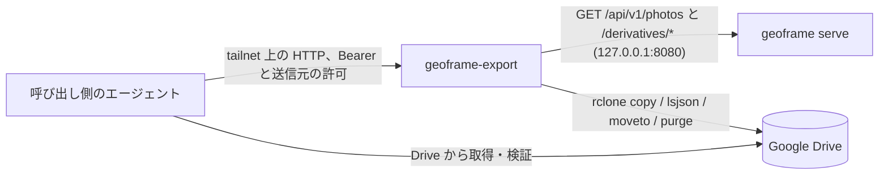

# note 記事用の写真書き出し 設計

- 状態: 計画（設計のみ。実装は未着手）
- 開始: 2026-11-20
- PRD: [prd.md](prd.md)

## 1. 概要

日付（または期間）と書き出し先の種類を受け取り、その期間の表示用 JPEG と `manifest.json` を Google Drive へ書き出す。写真サービス（`geoframe serve`）とは**別のプロセス**（`geoframe-export`）にする。このプロセスは写真フィードと表示用 JPEG を HTTP で読み、rclone で Drive へ送る。呼び出し側のエージェント（別 VM）は tailnet 経由で、トークン付きで呼ぶ。

写真サービスのコードと unit は変えない。

## 2. 今の作り（調査結果）

### 2.1 写真サービス

- 単一の crate `crates/geoframe`。入口は `src/main.rs:9-10` → `cli::run`。`serve` が `server::serve`（`src/server.rs:1056`）を起動し、ルーターは `src/server.rs:1007-1023`。
- 待ち受けのコード上の既定は `0.0.0.0:8080`（`src/config.rs:63-64`）。`--listen` か `GEOFRAME_HOST`/`GEOFRAME_PORT` で変えられる。unit（`deploy/geoframe-rs.service`）は `--listen` を付けず、環境ファイル（`deploy/geoframe-rs.service:34` 付近）の値に従う。
- **認証は無い**（`docs/architecture/photo-feed-contract.md:110`、`src/server.rs:671`）。守りは Host 検査（`src/server.rs:637-653`。IP リテラルは常に許可）と、POST の CSRF 検査（`src/post.rs:1-14`）だけ。外部への公開は Cloudflare Tunnel と Access を前提にしている（ADR 0008）。
- unit は `User=geoframe`、`ProtectHome=true`、`SystemCallFilter=@system-service`、`MemoryDenyWriteExecute=true` などで固めてある。バイナリは musl の静的ビルドで、本番の経路では**外部プロセスを起動しない**（`Command::new` は試験用の呼び出しだけ。例: `src/cache.rs:856`）。
- 設定はファイルを持たず、環境変数と起動引数だけ（`src/config.rs:1-30`、`docs/reference/configuration.md`）。

### 2.2 写真フィード `GET /api/v1/photos`

- ハンドラは `src/server.rs:269-289`。**クエリを読まない**。絞り込み・ページングは無く、全件（数千件）を返す。
- 対象の条件（`src/photos.rs:52-111`）は次のとおり。
  - `p.lat IS NOT NULL AND p.display IS NOT NULL AND COALESCE(p.hidden,0)=0`（`FEED_BASE_WHERE`）。さらに行の変換で `lon` が NULL の行も落とす（`src/photos.rs:166` 付近）。
  - 品質: 完全一致の重複グループで非推奨の写真を出さない（`QUALITY_VISIBLE`。人の代表の記録があればそれを優先）。
  - AI の類似グループ: 非推奨の写真を出さない。ただし、お気に入り・人の代表・表示できる推薦写真が無いグループなどの例外がある（`src/selection.rs:69` 付近）。
  - 並びは `taken_at` の昇順で、空は最後。
- 書き出しは**フィードの応答をそのまま採用し、品質・AI の選別を書き出し側で作り直さない**。
- 1 件の形は `src/feed.rs:47-104`。使うのは `id`、`file`（= `photos.display`）、`title`、`lat`/`lon`、`time`（= `taken_at`）、`elev`、`inferred`（`loc_source=='inferred'`）。
- `time` は `YYYY-MM-DD HH:MM` のローカル時刻（オフセット無し）か、空文字（`src/feed.rs:64`）。サービスは `TZ=Asia/Tokyo` を前提にしている。取り込み時の正規化（`src/imaging/exif.rs:504` の `norm_time`）は暦や時刻の範囲までは検査しないので、書き出し側で検査する（4.4）。
- `elev` と `inferred` は応答に出ているが、JSON Schema（`docs/architecture/photo-feed.schema.json`）の必須項目ではない。欠けたときの扱いを 6.3 で決める。
- 寸法・明るさ・シャープネスはフィードに無い。品質解析の特徴量（`photo_quality_features.sharpness`/`luminance`、`src/schema.rs:85-100`）は DB にあるが、旧 manifest の値とは定義が違い、解析前の写真では空（4.3）。

### 2.3 表示用 JPEG

- `/derivatives/<name>` で静的に配信する（`src/webpath.rs:140,153`）。名前は Drive の ID から作る（`<drive_id>.jpg`、回転したものは `<drive_id>.r<角度>.jpg`。`src/imaging/derivative.rs:78-90`）ので、**カタログの `id` からは作れない**。フィードの `file` を使う。
- 長辺 2560px、JPEG 品質 85、EXIF（GPS を含む）は落としてある（`src/imaging/derivative.rs:1-17`）。原本を返す API は無い。Drive の写真の原本は派生を作った直後に消している（`src/drive/fetch.rs:1-14`）。
- ローカル由来の写真では `display` が原本（EXIF 付き）を指すことがある（`docs/architecture/photo-feed-contract.md:85`）。

### 2.4 期間で絞れる既存の API

- 管理用の `GET /api/admin/library/photos` は `from`/`to`（`YYYY-MM-DD HH:MM`、両端を含む）、`page`/`per`、`hidden=1` を持つ（`src/admin_library.rs:124-138`、`:231-241`）。応答に `elev` と寸法は無い（`:816-832`）。
- **フィードとの差**: 写真の多いある旅行の 1 日では、ライブラリの 322 枚に対し、フィードは 182 枚だった。差の 140 枚は、すべて位置があり非表示でもない写真で、重複・類似グループで非推奨になったものだった。

### 2.5 既存の書き出し機能（旅行ブログ）

- `POST /api/blog/export`（`src/blog_write.rs`）は `DATA_DIR/blog_exports/<trip_id>/` に画像と manifest を書く。作業領域に作ってから、旧フォルダを `.previous` へ退避して置き換え、失敗したら元に戻す（`src/blog_write.rs:801` 付近）。書き出せない写真は飛ばし、`skipped` で理由を返す。書き出しはプロセスで 1 本だけで、実行中は 409。
- 書く先はサービスの DATA_DIR の中だけで、Drive には送らない。今回の設計はこの 3 つの考え方を Drive の上で踏襲する（4.2）。
  - 作業領域に一式を作ってから公開する。
  - 置き換えるときは旧フォルダを退避し、失敗したら戻す。
  - 書き出しは 1 本だけにする。

### 2.6 このホストの小サービスの形

同じホストの `miharashi-daidai-inbox`（miharashi リポジトリの Rust のバイナリ）と同じ形にする。

- system の unit で動く。
- `--listen` に tailnet の具体的な IP を取る（`0.0.0.0` は起動時に拒否する）。
- `--token-file`（実行ユーザーの 0600）の Bearer トークンと、`--allow`（送信元 IP の許可リスト）の両方で守る。
- `ProtectSystem=strict` などで固めてある。

### 2.7 Drive と rclone

- rclone の remote `gdrive:` はオーナーのホームの設定ファイル（0600）にある。`scope` を指定していないので、Drive 全体を読み書きできる権限になっている。`geoframe` ユーザーからは読めない。
- 既存の書き出し先の形（読み取りで確認）は次のとおり。
  - `gdrive:yamareco/` … 1 日は `YYYY-MM-DD`。2 日分は `YYYY-MM-DD-DD` のフォルダに、日付ごとのサブフォルダと、まとめた `manifest.json` を置いている。
  - `gdrive:travel-journal/` … 1 日 1 フォルダ（`YYYY-MM-DD`）。
- rclone は「共用の client_id は 2026 年中に使えなくなる」と警告を出している（9 章）。

### 2.8 旧 manifest の形（互換の基準）

既存の manifest から読み取った形は次のとおり（値は架空のもの）。

```json
{
  "date": "2026-01-10",
  "source": "GEOFRAME /api/v1/photos",
  "count": 2,
  "catalog_count": 2,
  "notes": { "taken_at": "...", "mean_brightness": "...", "sharpness_laplacian_var": "...", "spot": "...", "gps_inferred": "..." },
  "photos": [
    {
      "id": 101, "filename": "091100_101.jpg", "title": "富士山",
      "taken_at": "2026-01-10 09:11", "lat": 35.3606, "lon": 138.7274,
      "width": 2560, "height": 1707, "file_size": 1345682,
      "mean_brightness": 61.21, "sharpness_laplacian_var": 2902.29,
      "spot": "", "nearest_spot_distance_m": null,
      "gps_inferred": true, "elev": 3776.0
    }
  ]
}
```

- 期間のときは `date` が `"2026-01-10/2026-01-11"`、`filename` が `"2026-01-10/091100_101.jpg"` になり、`days`（日ごとの `count`・`first`・`last`・`ids`）が付く。
- ファイル名の秒は、フィードが分までしか持たないので常に `00`。
- 古い旅行記の manifest には `gps_inferred` と `elev` が無いものがある。新しいものには必ず入れる。
- `spot` と `nearest_spot_distance_m`: 山行の manifest では空欄（`""` と `null`）。旅行記の manifest には、名所の一覧から求めた名前と距離（300m 以内の最寄り）が入っていたものがある。その名所の一覧はこの環境では見つかっていない（U8）。
- `mean_brightness` はグレースケール（縮小前）の 0〜255 の平均。`sharpness_laplacian_var` は、長辺 1024px 以下に縮小したグレースケールに 3×3 の 4 近傍ラプラシアン（オフセット 128、0〜255 に丸め）を掛けた応答の分散。どちらも PIL で計算していた。計算に使ったスクリプトと Pillow の版は見つかっていない（4.3）。

## 3. 方針

### 3.1 置き場所の比較

| 案 | 利点 | 欠点 | 判定 |
|---|---|---|---|
| **A. 写真サービスに書き出しのエンドポイントを足す** | プロセスが増えない。DB を直接読めるので、寸法や品質の値も取れる | サービスは無認証。「Drive へ書く」操作を足すには、サービス全体に認証の仕組みを入れる必要がある。Drive に書ける資格情報を `geoframe` ユーザーに渡すことになる。`ProtectHome=true` を緩め、初めて外部プロセスを起動するので、今の unit のハードニングを見直すことになる。変更のたびに写真サービス（miharashi の表示元）を再起動する | **採らない**。既存サービスへの影響が大きい（止め条件に当たる） |
| A′. 写真サービスには読み取り専用の GET だけを足し、転送は外のプロセスで行う | DB の値（品質の特徴量、フィード外の写真）を使える | 無認証の API に新しい読み口を増やす。2 つの部品を同時に配る必要がある。今回の項目は、フィードと JPEG からすべて作れるので不要 | 今は採らない。対象を「その日の全写真」に広げると決めたときに見直す（5 章 U1） |
| **B. 独立した小さなサービス（Rust、`crates/geoframe-export`）** | 写真サービスを変えない。このホストの既存の形（2.6）に乗る。資格情報を写真サービスと分けられる。呼び出し側が直接呼べる。静的ビルド・配布の手順を写真サービスと共有できる | プロセス・unit・トークン・実行ユーザーが 1 つずつ増える。フィードの契約に依存する（ただし文書と試験で固定された契約）。明るさ・シャープネスを Rust で作り直すので、旧 manifest の値と少しずれうる | **推奨** |
| B′. 独立した小さなサービス（Python と Pillow） | 旧 manifest と同じ Pillow で計算でき、値を合わせやすい | Rust に移したリポジトリに Python の実行環境を戻す。Pillow の版に依存し、システムの Pillow の版では試験の一部が落ちる既知の問題がある | 値の完全一致が必須なら選ぶ（5 章 U2） |
| C. コマンドだけにして、呼び出しは T3 のまま | 一番簡単。ネットワークに新しい入口ができない | 呼び出し側が直接呼べない（前提に合わない）。記事のたびに T3 を介す今の手間が残る | B の一部として持つ（R11。障害時の手動実行） |
| D. 呼び出し側が写真サービスから直接取る（Drive を使わない） | サーバー側の追加が要らない | 写真サービスは無認証で、tailnet からの読み取りを契約として想定していない（公開経路は Cloudflare Access）。受け取り側は Drive を前提にしている | 採らない |

**推奨: B（コマンドの入口 C を同梱）。** 写真サービスとは HTTP（フィードと `/derivatives/`）だけでつながり、書き込みも資格情報も持ち込まない。

### 3.2 コードの置き場所

- このリポジトリのワークスペースに 2 つ目の crate `crates/geoframe-export` を足す。バイナリは `geoframe-export`。
- `geoframe` crate（ライブラリ）には依存しない。つながりは HTTP だけにして、写真サービスの内部の型の変更に引きずられないようにする。依存はワークスペースで既に使っている crate（`axum`/`tokio`、`ureq`、`serde`/`serde_json`、`zune-jpeg`、縮小用の crate）の同じ版に限る。
- 既存の `geoframe` crate の 2 つ目のバイナリにする案もあるが、写真サービスの依存（SQLite など）を引き込み、ビルドと配布の単位が分けにくくなるので、crate を分ける。
- 他の小サービスはリポジトリの外にあるものもある。これは GEOFRAME のデータの形（フィードの契約、派生画像）に依存するので、契約の試験と同じリポジトリに置く。

### 3.3 同期か非同期か

- 量: 1 回あたり 19〜182 枚（実績）。表示用 JPEG は 1 枚平均約 0.85MB（40 枚の実測。合計 34MB）で、182 枚なら約 155MB。
- 転送時間は**実測していない**（このホストの上り帯域も未計測）。仮定として、上り 20Mbps なら約 1 分、5Mbps なら約 4 分かかる。これに次の時間が加わる。
  - Drive の 1 ファイルごとの API の往復（並列 4 で数十秒）。
  - 明るさ・シャープネスの計算（182 枚で数十秒の見込み）。
- 仮定が外れても、数分かかる処理を 1 本の HTTP 要求で待たせると、呼び出し側のタイムアウトと切断に弱い。**非同期にする**（受付で `202` とジョブ ID を返し、ID で状態を引く）。確認（`dry_run`）だけは数秒で終わるので同期で返す。
- ジョブの記録は小さな JSON にして、`StateDirectory` の `jobs/` に残す（終わったジョブは直近 50 件）。再起動しても、ジョブ ID で結果を引ける。実行中に止まったジョブは、次の起動で 4.2 の復旧の表に従って片付ける（Drive に触れる前の段階なら `interrupted`）。
- 呼び出し側は任意の `request_id` を付けられる。同じ `request_id` の再送には新しいジョブを作らずに同じジョブを返す（受付の応答を受け取れなかったときの再試行のため）。

### 3.4 認証と送信元の制限

- 2.6 と同じ形にする。
  - `--listen` は tailnet の具体的な IP とポート（`0.0.0.0`・`::` は起動時に拒否）。
  - `--token-file` のトークンを `Authorization: Bearer` で照合する（定数時間の比較）。無い・違うは 401。トークンのファイルが実行ユーザーの所有でない、グループやその他から読める、32 バイト未満のときは起動しない。
  - `--allow` で送信元 IP を並べる。判定はソケットの接続相手のアドレスで行い、`X-Forwarded-For` などのヘッダは見ない。許可外は 403。
- トークンの値はログにも応答にも出さない。要求のヘッダはログに出さない。トークンの実パスと IP は公開リポジトリに書かず、配置時の unit（`/etc/systemd/system/` の側）に置く。

### 3.5 書き出し先と再実行

- 書き出し先は種類で指定する。`destination` は `yamareco` か `travel-journal` のどちらか。
- Drive 上のパスは次の 2 つだけで決める。呼び出し側の文字列は rclone の引数に入れない。
  - サーバーの設定にある、種類ごとの固定の接頭辞（既定は `gdrive:yamareco` と `gdrive:travel-journal`。U4 で変わりうる）。
  - 検査済みの日付から作ったフォルダ名。
- フォルダ名は次のとおり。
  - 1 日: `YYYY-MM-DD`
  - 同じ月の期間: `YYYY-MM-DD-DD`（既存の形と同じ）
  - 月や年をまたぐ期間: `YYYY-MM-DD_YYYY-MM-DD`（既存に例が無い。5 章 U3）
  - 作った名前は `^\d{4}-\d{2}-\d{2}(-\d{2}|_\d{4}-\d{2}-\d{2})?$` に合うことを、使う直前に確かめる。
- 再実行（同じ宛先に既にフォルダがある）の扱いは次のとおり。
  - 既定（`on_exists: "error"`）: 書かずに、状態 `conflict` で終える。
  - `on_exists: "replace"`: 新しい一式を公開し、旧フォルダは退避してから Drive のゴミ箱へ移す（4.2）。ゴミ箱から戻せる。
  - 追記（既存を残して足す）は持たない。ファイル名は `HHMMSS_<id>.jpg` で決まる。そのため同じ日をもう一度書けば同じ名前になり、追記と置き換えの違いは「消えた写真が残るかどうか」だけになる。残すと manifest と実ファイルが合わなくなり、受け取り側の検証が落ちる。

## 4. 構成



### 4.1 ジョブの流れ

1. 要求を検査する（6.1）。`request_id` が登録済みなら、実行枠を取らずにそのジョブを返す（6.1）。新しい要求なら実行枠（`StateDirectory` の `export.lock` の flock。サービスと CLI で共通）を取る。取れなければ 409。取れたら、ジョブの記録（要求・ジョブ ID）を `jobs/` に書いてから `202` を返す。
2. フィードを取る。基底 URL は設定で、既定は `http://127.0.0.1:8080`。タイムアウトは 30 秒、応答の上限は 32MB、リダイレクトはたどらない。
3. 各写真の `time` を検査する（4.4）。期間内の日付の写真を選ぶ。`time` が空の写真（`undated_in_feed`）と形が崩れた写真（`invalid_time_in_feed`）は、フィード全体での数だけ数える（その写真の日付は分からないので、対象の日のものかどうかも分からない）。
4. 選んだ写真（候補）が 0 枚なら、状態 `succeeded`、`count: 0`、`uploaded: false` で終える。Drive には触れない（既存のフォルダがあっても変えない）。
5. 作業領域（`StateDirectory/staging/<job_id>/`、0700）に、写真を 1 枚ずつ取る。
   - 次の写真は書き出しの対象から外す（仕様上の除外。件数と理由を返し、書き出しは続ける）。
     - `not_derivative` … `file` が 4.4 の形に合わない。EXIF 付きの原本を外へ出さないため。
     - `has_metadata` … JPEG に、許す区画（APP0 の JFIF、APP2 の ICC、DQT・DHT・SOF・DRI など）以外の区画（APP1 の Exif/XMP、APP13 の IPTC、APP2 の MPF、APP11、COM など）がある。または EOI の後ろにデータがある。派生画像はメタデータを落としてあるはずなので、作り方が変わったときに気づくため。
     - `time` が空・崩れた写真はそもそも期間に割り当てられないので候補に入らない（`excluded` ではなく、フィード全体の件数として別に返す）。
   - 書き出しの対象にした写真の取得・デコードに失敗したら、**ジョブを `failed` にして公開しない**（一部の写真が欠けた書き出しを作らない）。
     - 取得の失敗の例: 接続できない、上限（1 枚 30MB、画素数 6,000 万）を超える、期限（1 枚 60 秒）を過ぎる。
   - 取ったバイト列はそのまま書く（再エンコードしない）。`file_size` は配信されたバイト数と一致する。ファイルは新規作成（`O_EXCL`・`O_NOFOLLOW`）で書く。
   - デコードして、寸法・明るさ・シャープネスを計算する（4.3）。寸法はデコードの前にヘッダで確かめる。
6. 仕様上の除外のあとで書き出す写真が 0 枚になったら（候補はあるのに、全部除外された）、`failed`（`nothing_to_export`）にして Drive に触れない。宛先の状態に関係なく、同じ入力なら同じ結果になるよう、Drive の照会はこの後で行う。
7. `manifest.json` を作業領域に書く。
8. 宛先の状態を調べる（4.2 の「宛先の状態」）。`exists` で `on_exists` が `error` なら `conflict` で終える。照会に失敗したら `failed`。
9. Drive に公開する（4.2）。
10. 作業領域を消す。成功・失敗にかかわらず消す（起動時にも `staging/` の下の残骸を消す）。
11. ジョブ全体の期限は 30 分。過ぎたら `failed`（`timeout`）にする。パニックでも実行枠は外れる（ロックのガードとタスクの終わりで外す）。

### 4.2 Drive への公開

既存の旅行ブログの書き出し（2.5）と同じく、一式を別の場所に作ってから置き換える。

**運用の前提**: 書き出し先の接頭辞（親フォルダ）は配置のときに作り、その下に書くのはこのサービスだけにする（人が画面から同じ名前のフォルダを作らない）。U4 の `drive.file` では、他のアプリや画面で作られたフォルダがこのサービスから見えないことがあるので、この前提が要る。受け取り側からも、宛先が 1 つだけ見えることを配置の試験で確かめる。

**宛先の状態**: 接頭辞の直下を `rclone lsjson --drive-skip-shortcuts` で一覧し（フォルダもファイルも）、名前が完全に一致するものを数える。各項目の Drive の ID（`lsjson` の `ID`）も控える。

| 一致したもの | 状態 | 扱い |
|---|---|---|
| 無い | `absent` | 新しく公開する |
| フォルダが 1 つ（空のフォルダも含む） | `exists` | `on_exists` に従う。`existing_files`（直下と下のフォルダを含むファイル数）を結果に入れる |
| 2 つ以上、またはファイル・ショートカット | `ambiguous` | `failed`（`ambiguous_destination`）。Drive では同じ名前を複数作れる |
| 照会の失敗 | — | `failed`（`drive_unavailable`）。「無い」と取り違えない |

**公開の手順**: 作業用のフォルダは接頭辞の下の `_geoframe-export/` に置く。各段階に進む前に、段階の名前と関係するフォルダの ID をジョブの記録（`jobs/<job_id>.json`）に書く。

1. `uploading`: 写真を `_geoframe-export/incoming/<job_id>/` へ `rclone copy` で送り、最後に manifest を送る。
2. `verifying`: `rclone lsjson -R` で、`incoming` の相対パスとサイズを manifest と突き合わせる（受け取り側と同じ検証）。合わなければ `failed`（`verify_mismatch`）にし、`incoming` を消す。`incoming` のフォルダの ID を記録する。
3. 宛先の状態をもう一度調べる（運用の前提により、ここで変わっていることはないはずだが、変わっていたら `failed` にして公開しない）。
4. 宛先の状態に応じて公開する。
   - `absent` のとき（`publishing`）: 直前に宛先が無いことをもう一度確かめてから、`rclone moveto incoming/<job_id> <宛先>` で移す。宛先が無い状態での移動なので、Drive の中でのフォルダの移動（親と名前の変更）になる。
   - `exists` で `replace` のときは、次の順に行う。
     1. `retiring`: 旧フォルダ（ID を記録済み）を `_geoframe-export/replaced/<フォルダ名>-<job_id>` へ移す。移したあと、宛先が無いことと、`replaced/<フォルダ名>-<job_id>` が記録した旧フォルダの ID のもの 1 つだけであることを `lsjson` で確かめる。合わなければ（ファイル単位の移動に切り替わった、など）`blocked` にして先へ進まない。
     2. `publishing`: 直前に宛先が無いことをもう一度確かめてから、`incoming/<job_id>` を宛先へ移す。
     3. `trashing`: 直前に `replaced/` を一覧し、`<フォルダ名>-<job_id>` に完全に一致するものが、記録した旧フォルダの ID のフォルダ 1 つだけであることを確かめてから、`rclone purge --drive-use-trash=true` でゴミ箱へ移す。合わなければ `blocked`。
5. 移動のあとはコマンドの終了コードを信じずに、毎回 `lsjson` で結果を確かめる（応答が失われても、移動は済んでいることがある）。
   - 宛先が記録した `incoming` の ID のフォルダ 1 つだけであること。
   - `incoming/<job_id>` が残っていないこと。
   - 中身が manifest と一致すること。
   - rclone はフォルダの移動ができないとファイル単位の移動に切り替えるので、宛先の ID が違う・中身が混ざっているなどの形でそれを見つける。見つけたら `blocked` にする（下の「復旧」）。
6. `succeeded`: ジョブの記録を完了にする。

手順 4・5 のどこかで rclone が失敗・タイムアウトしたら、その場で（次のジョブや再起動を待たずに）下の「復旧」の表を実行し、宛先を旧か新のどちらかの一式に戻してからジョブを終える。rclone を止めたあとも Drive 側で移動が遅れて反映されることがあるので、少し（例: 30 秒）待ってから一覧を 2 回取り、同じ結果が得られたときだけ表を当てはめる。違えば待ってやり直し、決まらなければ `blocked` にする。

`replace` では、手順 4 の 1 と 2 の間（通常は数秒）、宛先が一時的に無くなる。受け取り側は、宛先が無ければ少し待って取り直す（PRD R6）。

**復旧**（起動時と各ジョブの前に、実行枠（flock）が取れたときだけ行う。CLI の `run` が動いている間に起動したサービスは、その作業領域と記録に触れない）: 未完了のジョブの記録があれば、記録した段階と ID を Drive の実際の状態（ID・親・名前）と照らし合わせて、次のように進める。

| 記録した段階 | Drive の状態 | 動き |
|---|---|---|
| `uploading`・`verifying` | 宛先は前のまま | `incoming` を消して `interrupted` で終える |
| `retiring` | 旧フォルダ（記録した ID）が宛先にあり、`replaced/<フォルダ名>-<job_id>` が無い | 退避していないので、`incoming` を消して `interrupted` で終える。`replaced/` に何かあれば `blocked` |
| `retiring`・`publishing` | 旧フォルダが `replaced/` にあり、宛先が無く、検証済みの `incoming` がある | 前へ進める（`incoming` を宛先へ移し、旧フォルダをゴミ箱へ） |
| `publishing` | 宛先が `incoming` の ID のフォルダになっている | 公開済み。`replace` なら旧フォルダのゴミ箱への移動を続ける |
| `trashing` | 旧フォルダが `replaced/` にまだある | ゴミ箱への移動をやり直す |
| どれにも当てはまらない（ID が見つからない、宛先に別のものがある、など） | — | `blocked` にする。記録を残して、次の書き出しをすべて断る（`503`、`blocked`）。オーナーが Drive を確かめ、`geoframe-export recover --resolve <job_id>` で解除する |

この手順は `rclone sync` を使わず、既存のファイルを 1 つずつ消す操作が無い。宛先に見えるのは、検証済みの一式か前の一式のどちらかになる（置き換えの数秒の空白を除く）。

**rclone の呼び方**:

- 実行ファイルと設定ファイルのパスは起動引数で固定する（`--rclone`、`--rclone-config`）。子プロセスには `--config` を明示し、環境変数は `env_clear()` で消して、要るもの（`PATH` など）だけを渡す。
- シェルを介さず、引数の配列で渡す。位置の引数の前に `--` を置く。Drive の操作には `--drive-skip-shortcuts` を付ける。`-vv` と `--dump*` は使わない。
- 接頭辞（`--remote-*`）は起動時に、2 つが別物で入れ子になっていないこと、remote の最上位でないこと、末尾が `/` でないこと、`^[A-Za-z0-9_-]+:[A-Za-z0-9_/-]+$` に合うこと、`-` で始まらないこと、`..` を含まないことを確かめる。
- 子プロセスにはタイムアウトを掛ける（既定 15 分。`try_wait` の繰り返しで見て、過ぎたら kill する）。
- `copy`・`moveto` には `--immutable` を付け、既にあるファイルを書き換えないようにする。`<job_id>`・フォルダ名が空でないことを、パスを組み立てる前に確かめる（空だと `incoming/` や `replaced/` 全体が対象になる）。`incoming` を消すときも `--drive-use-trash=true` を付ける。
- 主なオプションは `--transfers 4`、`--checkers 8`、`--retries 3`、`--low-level-retries 10`。`purge` には `--drive-use-trash=true` を明示する。
- rclone の標準エラーは `token`・`Bearer`・`access_token` を含む行を伏せ字にしてから、最後の数行だけをログに残す。API の応答には載せず、固定のエラーコードと短い説明だけを返す。

### 4.3 明るさとシャープネス

旧 manifest と同じ定義を Rust で実装する。

- `mean_brightness`: 縮小前の画像をグレースケールにした値の平均。小数 2 桁。グレースケールは ITU-R 601 の `L = (299R + 587G + 114B) / 1000` で、PIL の `convert("L")` と同じ丸めにする。
- `sharpness_laplacian_var`: 次の手順で求めた応答の分散（母分散）。小数 2 桁。
  1. 長辺 1024px 以下に縮小する。PIL の `thumbnail` に相当し、縦横比を保つ。フィルタと `reducing_gap` は Pillow の既定に合わせる。
  2. グレースケールにする。
  3. カーネル `[0,1,0; 1,-4,1; 0,1,0]`（`scale=1`、オフセット 128）を掛け、0〜255 に丸める。縁は PIL の `ImageFilter.Kernel` に合わせ、縁の 1 画素は元の値を写す。
- 旧スクリプトと Pillow の版は見つかっていない。縮小とグレー化の順序、JPEG のデコーダの違いで値がずれうる。
- 実装時に、縮小を要する実際の JPEG と、平坦・高周波・グレーの試験画像で、旧 manifest（または固定の版の Pillow）の値と比べる。ずれの大きさを測って記録し、許容差を U2 で決める。
- `photo_quality_features` の値は使わない。品質解析が済んでいない写真では空で、定義も違う。

### 4.4 フィードの値の検査

フィードの値は取り込んだ写真の EXIF やファイル名に由来するので、名前を組み立てる前に検査する。

- `time`: `^\d{4}-\d{2}-\d{2} \d{2}:\d{2}$` にそのまま合い、数値に直して実在する日付・時刻（時 0〜23、分 0〜59）であるものだけを使う。空は `undated`、それ以外は `invalid_time`。
- `id`: 正の整数だけ。それ以外の行はフィードが壊れているとして `failed`（`feed_invalid`）。
- `file`: `^derivatives/[A-Za-z0-9_-][A-Za-z0-9._-]*\.jpg$` に合い、`..` を含まないものだけ。それ以外は `not_derivative`。
- `inferred`: 真偽値であること。欠けていたら、`false` とみなさずに `failed`（`feed_invalid`）にする。`gps_inferred` を黙って `false` にしないため。
- `elev`: 数値か `null`。欠けていたら `null`。
- `lat`/`lon`: 数値であること（フィードの対象条件で必ずある）。

## 5. ユーザーに決めてもらうこと

| 番号 | 何を決めるか | 推奨 | 推奨どおりなら変わること | 変わらないこと |
|---|---|---|---|---|
| U1 | 対象の写真の範囲 | **フィードに載る写真**（今の手作業と同じ） | 何も変わらない（今の手作業と同じ枚数） | 重複・類似で非推奨の写真は出ない（多い日には 100 枚以上が出ない） |
| U1′ | 〃（別案） | その日の全写真（非表示を除く） | 枚数が増える（上の例の日は 182 → 322 枚）。写真サービスに読み取り専用の API を足す必要がある（3.1 の A′） | 書き出しの手順・認証・Drive の置き場所 |
| U2 | 明るさ・シャープネスの値のずれ | **許す**（定義は同じ。実測したずれを記録し、許容差を決める） | 新しい書き出しの値は旧 manifest と厳密には一致しない。`notes` に計算方法と生成元を書く | キーと単位、受け取り側のサイズの検証 |
| U2′ | 〃（別案） | 完全一致が必須 | 3.1 の B′（Python と Pillow）にする | 同上 |
| U3 | 月・年をまたぐ期間のフォルダ名 | `YYYY-MM-DD_YYYY-MM-DD` | 例: `2026-04-30_2026-05-02` | 1 日と同じ月の期間の名前（既存と同じ） |
| U4 | Drive の権限（専用ユーザー `geoframe-export` と専用の rclone の設定は必須。どちらにしても、このサービス専用の client_id で認可し直す。`drive.file` で見える範囲は client_id ごとなので使い回さない） | **`drive.file`**（このアプリが作ったファイルだけを読み書きできる）にし、新しい親フォルダ（例: `note-photos/yamareco/`、`note-photos/travel-journal/`）をこのサービスに作らせる | 鍵が漏れても、Drive 全体ではなく書き出し先だけが被害の範囲になる。受け取り側が読むパスが新しい親フォルダに変わる。既存のフォルダは見えなくなる。新しい親フォルダの下には、このサービスだけが書く（人が画面から作ったフォルダは見えないことがあるため。4.2 の運用の前提） | 既存の `yamareco/`・`travel-journal/` の中身（残る。移さない） |
| U4′ | 〃（別案） | `drive`（Drive 全体）のまま、既存の `yamareco/`・`travel-journal/` に書く | 受け取り側のパスは今のまま。鍵が漏れると Drive 全体を読まれ・消されうる 既存のフォルダには手作業のものがあり、「このサービスだけが書く」前提（4.2）が成り立たない。`replace` はフォルダの中の写真以外のファイルもまとめてゴミ箱へ移す | 同上 |
| U5 | 0 枚のときに Drive に空のフォルダや manifest を置くか | **置かない**（結果の `count: 0` だけ） | 受け取り側は、Drive ではなく API の結果で 0 枚を知る | 0 枚がエラーにならないこと |
| U6 | `replace` を API から許すか | **許す**（旧フォルダはゴミ箱に移るので戻せる） | 呼び出し側のエージェントが置き換えまでできる | `error` が既定であること |
| U6′ | 〃（別案） | CLI だけに許す（API の `replace` は 403） | 置き換えはオーナーがホストで行う | 同上 |
| U7 | 書き出し先のフォルダの共有範囲 | オーナーが確認する（manifest に正確な緯度経度が入るため） | — | — |
| U8 | 旅行記の名所（`spot`） | **空欄のまま**（名所の一覧が見つかっていない） | 旅行記の manifest で、前は入っていた名所の名前と距離が欠ける。記事を書く側で名所を補う | 山行の manifest（前から空欄）、その他のキー |
| U8′ | 〃（別案） | 名所の一覧（名前と座標）を用意し、300m 以内の最寄りを付ける | 一覧の置き場所と管理の方法を決める必要がある（後から足せる） | 同上 |

## 6. インターフェース

### 6.1 HTTP

すべての要求に `Authorization: Bearer <token>` が要る（`/healthz` を除く）。本文は JSON（`Content-Type: application/json`）で、上限は 4KiB、未知のキーは 400 で断る。接続数は 8 本まで。ヘッダと本文の読み取りに期限（10 秒）を掛ける。

**`POST /v1/exports`** … 書き出しを受け付ける。

```json
{ "from": "2026-01-10", "to": "2026-01-11", "destination": "yamareco", "on_exists": "error", "dry_run": false, "request_id": "任意の文字列" }
```

- `from`（必須）: `YYYY-MM-DD` の実在する日付。
- `to`（省略可）: 省略すると `from` と同じ。`from` 以上で、期間は 14 日以下（両端を含む）。
- `destination`（必須）: `yamareco` か `travel-journal`。
- `on_exists`（省略可）: `error`（既定）か `replace`。
- `dry_run`（省略可）: 真なら書かずに、`200` で次を返す。実行中のジョブがあれば 409。Drive の照会には 30 秒の期限を掛ける。画像は取らないので、返す枚数はフィードだけで数えた候補の数（`candidate_count`）で、APP1 の除外（`has_metadata`）や取得の失敗は反映しない。
  - 候補の数と、フィードだけで分かる除外（`not_derivative`）
  - フォルダ名
  - 宛先の状態
- `request_id`（省略可）: `[A-Za-z0-9_-]{1,64}`。同じ値の再送には実行枠を取らずに同じジョブを返す（実行中でも 409 にしない）。対象は直近 50 件の記録。同じ値で中身（期間・宛先・`on_exists`）が違えば 409（`request_id_mismatch`）。重複の確認とジョブの登録は 1 つの排他の中で行い、記録を `jobs/` に書いてから `202` を返す。

応答は次のとおり。

- `202 {"job_id": "...", "status": "running"}`。同じ `request_id` の再送にはそのジョブの `job_id` と今の `status` を返す。
- `200`（`dry_run`）`{"folder": "2026-01-10-11", "destination": "yamareco", "candidate_count": 52, "days": {...}, "target": "absent", "existing_files": 0, "excluded": {"not_derivative": 0}, "undated_in_feed": 6, "invalid_time_in_feed": 0}`
- `400`（検査の失敗。`{"error": "invalid_date"}` など）、`401`、`403`、`409`（実行中・`request_id_mismatch`）、`503`（`dry_run` でフィードか Drive が使えない、または `blocked`）

**`GET /v1/exports/{job_id}`** … 状態と結果。完了の速いジョブは、最初の GET で完了の状態が返ってよい。

```json
{
  "job_id": "...",
  "status": "succeeded",
  "request": { "from": "2026-01-10", "to": "2026-01-11", "destination": "yamareco", "on_exists": "error" },
  "started_at": "2026-01-12T19:30:00+09:00",
  "finished_at": "2026-01-12T19:32:10+09:00",
  "result": {
    "folder": "2026-01-10-11",
    "catalog_count": 52,
    "count": 51,
    "uploaded": true,
    "replaced": false,
    "bytes": 43210000,
    "excluded": [ { "id": 1234, "reason": "has_metadata" } ],
    "undated_in_feed": 6,
    "invalid_time_in_feed": 0,
    "existing_files": 0
  },
  "error": null
}
```

- 数の意味は次のとおり。
  - `catalog_count`: 候補の数。期間内の日付だとフィードから判定できた写真の数。
  - `excluded`: 候補のうち、仕様上の除外（`not_derivative`・`has_metadata`）で外した写真。
  - `count`: 公開した写真の数（= `catalog_count` − `excluded` の件数）。
  - `undated_in_feed`・`invalid_time_in_feed`: フィード全体で `time` が空・形が崩れた写真の数。日付が分からないので候補にも `excluded` にも入れない。
- `status`: `running`、`succeeded`、`conflict`、`failed`、`interrupted`、`blocked`（4.2 の復旧で照合できなかった。オーナーが解除するまで次の書き出しを断る）のどれか。
- `error`: 失敗したときに `{"code": ..., "message": "..."}` を返す。`message` は固定の短い説明で、rclone の出力は含めない。`code` は次のどれか。
  - `feed_unavailable`、`feed_invalid`、`fetch_failed`、`decode_failed`、`nothing_to_export`
  - `drive_unavailable`、`ambiguous_destination`、`rclone_failed`、`rclone_timeout`、`verify_mismatch`
  - `timeout`、`blocked`、`internal`
- 0 枚の日は `status: "succeeded"`、`count: 0`、`uploaded: false`。
- 無い ID は 404。

**`GET /v1/exports`** … 直近のジョブの一覧（`job_id`・`status`・`request`・時刻だけ）。

**`GET /healthz`** … 認証なしで `200 ok` を返す（送信元の制限は掛ける）。

### 6.2 コマンド

```
geoframe-export run --from 2026-01-10 [--to ...] --destination yamareco [--on-exists replace] [--dry-run] [設定の引数]
geoframe-export serve --listen <ip:port> --token-file <path> --allow <ip> [--allow <ip> ...] [設定の引数]
geoframe-export recover [--resolve <job_id>] [設定の引数]
```

- `recover` は、未完了のジョブの記録と Drive の状態を照らし合わせて表示するだけで、Drive は変えない（4.2 の復旧）。`--resolve` は、オーナーが Drive を確かめたあとで `blocked` を解除する。実行枠を取ってから動き、対象が `blocked` でなければ断る。Drive には触れず、`replaced/`・`incoming/` に残ったもののパスと ID を表示するだけにする。解除した日時を記録に残す。いったん `blocked` になったジョブは、あとで表の行に当てはまっても自動では動かさない。root で直接動かされたら断る。

- 設定の引数は次のとおり。
  - `--feed-base`（既定 `http://127.0.0.1:8080`）
  - `--rclone`、`--rclone-config`
  - `--remote-yamareco`、`--remote-travel-journal`（既定は 3.5。U4 で変わる）
  - `--state-dir`、`--rclone-timeout`
- `run` は、サービスと同じ専用ユーザーで動かす。`deploy/geoframe-admin.sh` と同じ考え方の小さな包みを用意する。サービスと同じ実行枠（flock）を取るので、同時には動かない。
- `run` は、`GET /v1/exports/{job_id}` と同じ形の JSON（`status`・`result`・`error`）を標準出力に出す。終了コードは次のとおり。
  - 0: 成功・0 枚
  - 3: conflict
  - 4: 実行中（実行枠が取れない）
  - 1: 失敗
  - 2: 引数の誤り
- 引数の解釈は `geoframe` crate と同じく手書きにする（`crates/geoframe/src/cli.rs:1-2` の方針。依存を増やさない）。

### 6.3 manifest.json

2.8 の形に合わせる。キーは旧 manifest のものをすべて出し、次を足す。

- 最上位に足すキーは次のとおり。
  - `generator`（`"geoframe-export <版>"`）
  - `destination`、`folder`
  - `excluded`（理由付き）
  - `undated_in_feed`、`invalid_time_in_feed`
- `source` は `"GEOFRAME /api/v1/photos"` のまま。
- `notes` には次を書く。
  - 時刻: 分までで、秒は 00。ローカル時刻のままで補正しない。
  - 明るさ・シャープネスの計算方法（4.3）と、旧 manifest とずれうること。
  - `gps_inferred` の意味。
  - `spot` が空である理由。
- `spot` は `""`、`nearest_spot_distance_m` は `null`（U8 で名所の一覧を用意すると決めたら、そのときに足す）。
- `lat`/`lon`/`elev` はフィードの値をそのまま出す（丸めない）。`elev` が無ければ `null`。
- 期間のときは日付ごとのサブフォルダに写真を置き、`filename` に日付を含め、`days` を付ける（2.8）。

## 7. データ

- 書き出しの中身は持たない。`StateDirectory=geoframe-export` の下を次のように分け、掃除は `staging/` の下だけにする。
  - `staging/`（作業領域、0700）
  - `jobs/`（ジョブの記録。終わったジョブは直近 50 件）
  - `export.lock`（実行枠）
  - `rclone/`（rclone の設定、0700）
- ジョブの記録は、一時ファイルに書いて `fsync` し、`rename` で置き換える。記録を書き終えてから Drive を操作する。読めない・形の崩れた記録があれば `blocked` にする。間引くのは終わったジョブ（`succeeded`・`conflict`・`failed`・`interrupted`・解除済み）だけで、未完了と `blocked` の記録は消さない。
- `job_id` はサーバーが作る乱数（128 ビット）で、形を固定する。`GET /v1/exports/{job_id}` でも形を検査してからファイルを開く。復旧では、接頭辞は設定からだけ取り、記録から読んだ `destination`・`job_id`・フォルダ名・ID は形を検査し直す。
- unit に `StateDirectoryMode=0700` を書く。起動時に、`rclone/` と設定ファイルが自分の持ち物で、グループやその他から読めないことを確かめる。
- ジョブの記録とログには、ジョブ ID、期間、宛先、枚数、所要時間、結果を残す。トークンや Drive の資格情報は出さない。
- 写真サービスの DB・データ置き場には触れない（HTTP で読むだけ）。

## 8. 安全面

| 項目 | 対策 |
|---|---|
| 入口 | tailnet の具体的な IP にだけ bind する。送信元の許可リスト（呼び出し側の IP と、このホスト自身）を、ソケットの相手のアドレスで判定する。Bearer トークンは 0600 のファイルに置き、定数時間で比べ、32 バイト以上とする。接続数とヘッダの読み取りの期限に上限を掛ける |
| 入力 | 本文の上限は 4KiB で、未知のキーは拒否する。日付は `YYYY-MM-DD` の実在する日だけで、期間は 14 日以下。`destination`・`on_exists` は列挙値。`request_id` は文字の範囲と長さを決める |
| Drive のパス | 種類ごとの固定の接頭辞（起動時に検査）＋検査済みの日付から作った名前（使う直前に形を検査）だけで作る。呼び出し側の文字列は rclone に渡さない。rclone はシェルを介さず、引数の配列で起動し、`--` を置く |
| 削除の範囲 | `sync` を使わない。宛先の下に書くのはこのサービスだけ（4.2 の運用の前提）。各段階を記録してから Drive を変え、照合できなければ `blocked` で止める。置き換えは、フォルダの移動と、退避した旧フォルダのゴミ箱への移動だけにする（`--drive-use-trash=true` を明示）。一部の写真が取れなければ公開しない。書き出す写真が 0 枚なら Drive に触れない |
| 写真サービスから読むもの | 基底 URL は設定で固定し、リダイレクトはたどらない。`time`・`id`・`file`・`inferred` を検査する（4.4）。応答・画像の大きさ・画素数・時間に上限を掛ける。作業領域には `O_EXCL`・`O_NOFOLLOW` で書く |
| 外へ出すもの | 表示用 JPEG と manifest（正確な緯度経度を含む）。EXIF 付きの原本は出さない（`file` の検査、APP1 の検査）。行き先はオーナーの Drive の書き出し先だけで、共有範囲はオーナーが確かめる（U7） |
| 資格情報 | 専用ユーザー `geoframe-export` と、`StateDirectory/rclone/` の専用の rclone の設定（自分の client_id）。オーナーのホームの設定は使わない。権限の範囲は U4 で決める（推奨は `drive.file`）。写真サービスの Drive の鍵（読み取り用）とは分ける |
| 同時実行 | 書き出しと `dry_run` は、サービスと CLI で共通の実行枠（flock）を取る。1 ジョブの上限は 2,000 枚・2GB、全体の期限は 30 分。パニックでも実行枠は外れる |
| 子プロセス | rclone にタイムアウトを掛ける（既定 15 分）。環境変数は消してから渡す。標準エラーは伏せ字にしてログにだけ残す |
| unit のハードニング | `NoNewPrivileges`、`ProtectSystem=strict`、`ProtectHome=yes`、`PrivateTmp`、`PrivateDevices`、`CapabilityBoundingSet=`、`RestrictAddressFamilies=AF_INET AF_INET6`（AF_UNIX が要るかは確かめる）、`SystemCallFilter=@system-service`、`UMask=0077` にする。書けるのは `StateDirectory` だけ。`MemoryMax`・`TasksMax` は rclone（Go）と JPEG のデコードを動かして実測してから決める。`MemoryDenyWriteExecute` は rclone と組み合わせて動くかを確かめてから付ける |
| ログ | トークン、要求のヘッダ、rclone の設定の中身は出さない |
| 写真サービスへの影響 | コードも unit も変えない。負荷は、1 回の書き出しでフィード全件の取得 1 回と、画像の順次取得だけ |

## 9. リスクと対策

| リスク | 対策 |
|---|---|
| rclone の共用 client_id が 2026 年中に止まる（rclone 自身の警告） | 配置のときに、自分の client_id で専用の設定を認可する（U4）。止まると、今の手作業の経路も同じく止まる |
| U4 で `drive.file` にすると、受け取り側のパスが変わる | 呼び出し側（別リポジトリ）の変更と同時に切り替える。既存のフォルダはそのまま残す |
| フィードの契約が変わる | 契約は `docs/architecture/photo-feed-contract.md` と試験で固定されている。`geoframe-export` の試験に、契約の例（JSON Schema の例）を使う |
| 明るさ・シャープネスが旧 manifest とずれる | 定義を合わせ、実装時に実データで差を測って記録する（U2） |
| 転送が遅い・途中で切れる | 非同期、タイムアウト、rclone の再試行で備える。公開は検証の後の移動だけなので、途中で止まっても宛先に半端な一式は見えない。退避の途中で止まったものは、次の起動で戻す（4.2） |
| 呼び出し側が受付の応答を受け取れない | `request_id` で同じジョブを引ける。ジョブの記録は再起動しても残る |
| 写真サービスが止まっている間に、ホストの別のユーザーが 8080 を取って偽のフィードを返す | このホストのアカウントが要る経路。JPEG として正しく読めることと、4.4 の検査で被害を抑える |
| 呼び出し側のエージェントが、誤った指示で `replace` を使う | 旧フォルダはゴミ箱（30 日で自動的に空になる）から戻せる。心配なら U6′ にする |
| 写真サービスの待ち受けを、将来 tailnet の IP だけに絞る | `127.0.0.1:8080` で読めなくなる。そのときは `--feed-base` を変える |

## 10. テスト計画

偽のフィード（固定の JSON と JPEG を返す試験用の HTTP サーバー）と、偽の rclone（引数を記録し、`lsjson` の応答や失敗を差し替えられる試験用のプログラム）を使う。外部のネットワークと本物の Drive は使わない。`cargo test -p geoframe-export` で回す。

| AC | 確かめ方 |
|---|---|
| AC1 | 日付の境界（00:00・23:59）、期間の両端、`to` の省略と `from == to` が同じ宛先になること、14 日（可）と 15 日（400）、逆順（400）、実在しない日付（400） |
| AC2 | 不正な `destination` は 400。rclone に渡る宛先が、固定の接頭辞＋フォルダ名だけであること。フォルダ名は 1 日、同じ月、月またぎ、年またぎの 4 通りを確かめる。不正な接頭辞の設定では起動しない |
| AC3 | フィードに無い写真が出ないこと。`time` が空・形が崩れた写真が出ず、件数と理由が出ること |
| AC4 | 旧 manifest の形（2.8。単日と期間）を fixture にして、キー・型・`days`・`filename`（`HHMM00_<id>.jpg`、期間は日付のサブフォルダ付き）を比べる。`file_size` が配信のバイト数と一致すること。`elev: null`、`gps_inferred: false`/`true` がフィードどおりに出ること。`inferred` が欠けたフィードでは `feed_invalid` |
| AC5 | 0 枚の日は `succeeded`・`count: 0` で、rclone が呼ばれないこと。宛先が既にある日でも同じ |
| AC6 | 宛先が `exists`（空のフォルダを含む）なら、既定は `conflict` で、`copy`・`moveto` が呼ばれないこと。`replace` は incoming → 検証 → 退避 → 移動 → ゴミ箱の順で呼ぶこと。各段階の記録が Drive の操作の前に書かれること。移動の応答が失われた（偽の rclone が移動を済ませて失敗を返す）とき、`lsjson` で済んでいると判定すること。復旧の表（4.2）の各行の状態から起動して、表のとおりに進むこと。照合できない状態では `blocked` になり、次の書き出しが 503 になること。同じ名前のフォルダが 2 つ・同じ名前のファイル・ショートカットがあると `ambiguous_destination`、照会の失敗で `drive_unavailable` になること |
| AC7 | トークンが無い・違うと 401。許可外の送信元で 403。正しいトークンと許可された送信元では受け付けること。ログと応答にトークンが出ないこと。弱いトークンのファイルでは起動しないこと |
| AC8 | 実行中（偽の rclone を待たせる）の 2 件目は 409。CLI の `run` も 4 で終わること。`dry_run` も 409 |
| AC9 | `202` から、`running` を経て、`succeeded`・`failed`・`conflict` になる遷移。最初の GET で完了が返ってもよいこと。同じ `request_id` で、実行中でも同じジョブが返ること。中身が違えば `request_id_mismatch`。再起動後もジョブ ID で引けること。止まったジョブが 4.2 の復旧の表に従って片付くこと（Drive に触れる前なら `interrupted`） |
| AC10 | `dry_run` では `lsjson` だけが呼ばれ、`copy`・`moveto`・`purge` は呼ばれないこと |
| AC11 | `run` で、同じ fixture から同じ manifest が出ること。成功・conflict・失敗の JSON と終了コード |
| 一部の失敗 | 1 枚の取得の失敗・デコードの失敗で `failed` になり、Drive に何も公開されないこと。全部が除外されたら、宛先の状態（無い・ある・照会できない）に関係なく `nothing_to_export` になり、Drive を照会しないこと。APP1 がある JPEG は `has_metadata` で除外されること |
| 上限 | 画像の大きさ・画素数・枚数・期限の上限を超えたら `failed` になること。リダイレクトをたどらないこと |
| 4.3 | 試験画像（縮小を要する大きさの実際の JPEG、平坦、高周波、グレー）で、固定の版の Pillow で計算した期待値と比べる。期待値は fixture として固定し、試験の実行時には Python を使わない。配置の前に、本番の数日分で旧 manifest と比べた差を記録する（記録は公開リポジトリの外に置く） |
| 配置後 | 本番で、旧 manifest がある日を `dry_run` してから、検証用の接頭辞に書き出す。旧 manifest と枚数・ファイル名・サイズを比べ、呼び出し側の実際の検証（サイズの突き合わせ）まで通す |

## 11. 実装の順番

PR は 2 本に分ける。どちらも単独でマージ・差し戻しできる。

1. **PR ①: 書き出しの中身とコマンド（R1〜R6、R8 の CLI 側、R10、R11）**
   1. crate の骨組み、引数の解釈、設定の検査。
   2. フィードの取得と検査（4.4）、日付の選び方、フォルダ名の決め方。
   3. 画像の取得、寸法・明るさ・シャープネスの計算、manifest の生成。
   4. rclone の呼び出し（タイムアウト、宛先の状態、incoming → 検証 → 公開、退避と復旧）。
   5. 実行枠（flock）、ジョブの記録、`run` コマンド、試験。
2. **PR ②: HTTP の入口と配置（R7〜R9）**
   1. `serve`: bind の検査、トークン、送信元の許可、本文の検査、接続の上限。
   2. ジョブの API（受付、状態、一覧、`request_id`）。
   3. unit の雛形（`deploy/geoframe-export.service`。IP とトークンのパスは書かない）、`deploy/README.md` の手順、musl の静的ビルドへの追加。
   4. 配置: U4 に従って、専用ユーザーと rclone の設定を用意する。そのあと本番で検証する（10 章の「配置後」）。rclone のトークン更新が unit の権限の下で動くことも確かめる。
3. 呼び出し側の変更は呼び出し側のリポジトリで別に行う。
